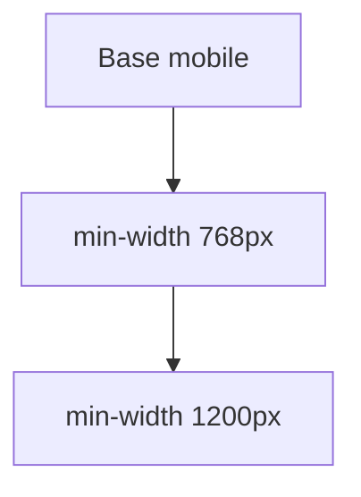

# Responsive design

> [!info] En une phrase
> Une page qui s'adapte à toutes les tailles d'écran, du téléphone au grand écran, grâce aux mises en page fluides et aux media queries.

```dataviewjs
await dv.view("10 — Templates/Scripts/learning", { view: "concept" })
```

## 1 · Comprendre
### Définition
Trois ingrédients :
1. la balise `<meta name="viewport" content="width=device-width, initial-scale=1">` ;
2. des tailles **fluides** (`%`, `fr`, `rem`, `max-width`) plutôt que fixes ;
3. des **media queries** : des règles qui ne s'appliquent qu'à partir d'une certaine largeur.

On écrit souvent **mobile d'abord** : le style de base pour petit écran, puis des ajustements pour les écrans plus larges.

### Pourquoi ça existe
Plus de la moitié des visites se font sur téléphone.

### Le problème résolu
Faire une version séparée du site pour chaque appareil.

## 2 · Explorer
### Comment ça fonctionne


### Exemple concret
```css
.page { display: grid; grid-template-columns: 1fr; gap: 1rem; padding: 1rem; }
img { max-width: 100%; height: auto; }

@media (min-width: 768px) {          /* tablette et plus */
  .page { grid-template-columns: 220px 1fr; }
}
@media (min-width: 1200px) {         /* grand écran */
  .page { max-width: 1100px; margin: 0 auto; }
}
```
Dans F12, le mode « appareil » (Ctrl+Maj+M) simule différentes tailles.

### Cas d'utilisation
- Toute page publique ; les tableaux de bord consultés sur tablette
- Les frameworks CSS (Bootstrap, Tailwind) proposent des points de rupture prêts

> [!warning] À ne pas confondre
> Réduire la fenêtre du navigateur (approximation) et tester sur un vrai téléphone : les tailles de police, le tactile et le zoom diffèrent. Et une largeur fixe en `px` sur un grand bloc provoque un défilement horizontal sur mobile.

## 3 · Pratiquer
- Rends ta page lisible sur 375 px de large sans défilement horizontal, puis passe en deux colonnes au-delà de 768 px.

## 4 · Expliquer
> [!quote] Mon résumé, avec mes mots
> _À écrire sans regarder la fiche. Si je bloque, je ne l'ai pas encore compris._

## 5 · Relier
- **Prérequis** : [[Flexbox]] · [[Grid CSS]]
- **Complémentaires** : [[Accessibilité web]]

## 6 · Réviser
> [!question] Me faire interroger
> Je demande à Claude de m'interroger sur cette notion pour vérifier que je l'ai comprise.

### Validation de la maîtrise
La notion est maîtrisée quand j'ai réussi **tous les exercices** qui l'utilisent (statut `reussi` dans l'exercice).

```dataviewjs
await dv.view("10 — Templates/Scripts/learning", { view: "maitrise" })
```
