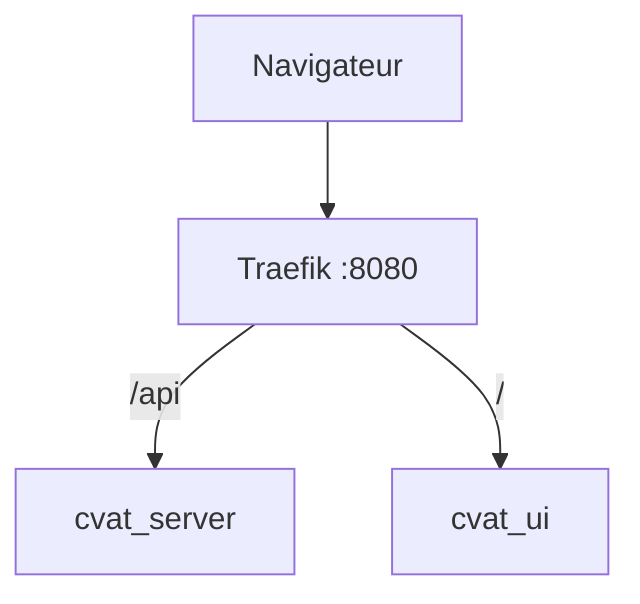

# Reverse proxy

> [!info] En une phrase
> Un serveur placé devant les services, qui reçoit toutes les requêtes et les envoie au bon service selon l'adresse demandée.

```dataviewjs
await dv.view("10 — Templates/Scripts/learning", { view: "concept" })
```

## 1 · Comprendre
### Définition
Un **reverse proxy** est la **porte d'entrée** d'une application : il écoute sur 80/443 et transmet chaque requête au bon conteneur, selon le nom de domaine (`Host`) ou le chemin (`/api`). Il peut aussi gérer le HTTPS.

**Traefik** est le reverse proxy utilisé par CVAT : il lit des **labels** posés sur les conteneurs dans le `docker-compose.yml` pour savoir où envoyer quoi.

### Pourquoi ça existe
Plusieurs services (interface, API, outils) doivent être joignables par une seule adresse et un seul port.

### Le problème résolu
Sans lui, il faudrait publier un port par service (`:8080`, `:8081`…) et gérer le HTTPS dans chacun.

## 2 · Explorer
### Comment ça fonctionne


### Exemple concret
Dans CVAT, Traefik route selon le nom d'hôte, défini par `CVAT_HOST` :
```yaml
# extrait simplifié du docker-compose.yml de CVAT
cvat_server:
  labels:
    - traefik.http.routers.cvat.rule=Host(`${CVAT_HOST:-localhost}`) && PathPrefix(`/api/`)
```
- `CVAT_HOST` vaut `localhost` par défaut : CVAT ne répond que si on l'appelle **avec ce nom**.
- Sur un serveur : `export CVAT_HOST=cvat.mon-entreprise.local` avant `docker compose up -d`, sinon la page renvoie **404**.
- `${CVAT_HOST:-localhost}` = « la variable `CVAT_HOST`, ou `localhost` si elle est vide ».

### Cas d'utilisation
- Déployer CVAT sur un serveur accessible par un nom
- Mettre plusieurs applications derrière un seul port 443

> [!warning] À ne pas confondre
> [[Proxy]] (sortant, côté clients) et **reverse proxy** (entrant, côté serveurs). Et un **404 de Traefik** (aucune règle ne correspond : souvent le nom d'hôte) n'est pas un 404 de l'application.

## 3 · Pratiquer
- Lance CVAT en local, puis ouvre-le avec `127.0.0.1:8080` au lieu de `localhost:8080` : que se passe-t-il, et pourquoi ?
- Dans le `docker-compose.yml` de CVAT, retrouve les labels Traefik de deux services et explique leur règle.

## 4 · Expliquer
> [!quote] Mon résumé, avec mes mots
> _À écrire sans regarder la fiche. Si je bloque, je ne l'ai pas encore compris._

## 5 · Relier
- **Prérequis** : [[Port]] · [[HTTP]] · [[Docker Compose]]
- **Complémentaires** : [[Proxy]] · [[Variable d'environnement]]

## 6 · Réviser
> [!question] Me faire interroger
> Je demande à Claude de m'interroger sur cette notion pour vérifier que je l'ai comprise.

### Validation de la maîtrise
- [ ] Je l'explique sans notes, en 3 phrases, à quelqu'un qui ne connaît pas
- [ ] J'ai réussi un exercice qui l'utilise
- [ ] Je l'ai utilisé dans un projet
- [ ] Je sais dire quand ne pas l'utiliser (ou ce qu'il ne faut pas confondre)
