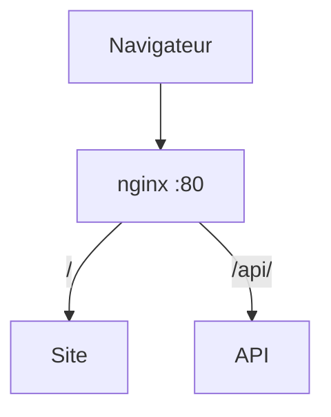

# Reverse proxy

> [!info] En une phrase
> Un serveur placé **devant les services**, qui reçoit toutes les requêtes des visiteurs et envoie chacune au bon service.

```dataviewjs
await dv.view("10 — Templates/Scripts/learning", { view: "concept" })
```

## 1 · Comprendre
### Définition
Un **reverse proxy** est la **porte d'entrée** d'une application. C'est un programme (nginx, Traefik, HAProxy) qui écoute sur 80 et 443, reçoit les requêtes des visiteurs et les **transmet** au bon service caché derrière lui. Le visiteur ne voit que le reverse proxy : il ne sait pas combien de services il y a derrière.

C'est l'inverse du [[Proxy]] : le proxy agit **pour les clients** (il sort vers Internet à leur place), le reverse proxy agit **pour les serveurs** (il reçoit à leur place).

Ses trois rôles principaux :
| Rôle | Ce que ça veut dire |
| --- | --- |
| **Router** | envoyer `/` à l'interface et `/api/` à l'API, ou `app.local` à l'appli et `docs.local` à la doc, selon le chemin ou le nom d'hôte (`Host`) |
| **Gérer le HTTPS** | il garde le [[Certificat]] et chiffre avec le visiteur ; derrière, les services parlent en HTTP simple (voir [[HTTPS et TLS]]) |
| **Répartir la charge** | s'il y a deux copies d'un service, il envoie les requêtes à l'une puis à l'autre (*load balancing*) |

Il peut aussi mettre en cache, compresser, ou refuser les requêtes trop nombreuses.

### Pourquoi ça existe
Une application est souvent faite de plusieurs services, mais les visiteurs doivent l'atteindre par **une seule adresse** et un seul port.

### Le problème résolu
Sans lui, il faudrait publier un port par service (`:8080`, `:8081`…), gérer le HTTPS dans chacun, et le visiteur devrait connaître toute l'organisation interne.

## 2 · Explorer
### Comment ça fonctionne


### Exemple concret : nginx
```nginx
server {
    listen 80;

    location / {
        proxy_pass http://site:80;        # nom du service compose, pas localhost
    }

    location /api/ {
        proxy_pass http://api:8000/;      # le / final retire /api/ du chemin
    }
}
```
- Seul nginx publie un port (`8080:80`). `site` et `api` n'en publient pas : on ne peut les joindre **qu'en passant par lui**.
- Dans un conteneur, `localhost` désigne **le conteneur lui-même** : `proxy_pass http://localhost:8000` donne `502 Bad Gateway`.
- `502 Bad Gateway` = le reverse proxy fonctionne, mais le service derrière ne répond pas.

### Cas d'utilisation
- Mettre une interface et une API derrière une seule adresse
- Lancer deux copies d'un service et répartir les visiteurs

> [!warning] À ne pas confondre
> - [[Proxy]] (côté clients, vers Internet) et **reverse proxy** (côté serveurs, devant les services).
> - Un reverse proxy **n'est pas une API** : il ne produit aucune donnée et ne décide pas de la réponse, il **transmet** la requête au service qui, lui, répond. Une [[Passerelle d'API (API gateway)]] est un reverse proxy spécialisé pour les API, mais ce n'est pas non plus elle qui contient la logique.
> - Un **404 de Traefik ou de nginx** (aucune règle ne correspond) n'est pas un 404 de l'application. Un **502** veut dire que le service derrière ne répond pas.

## 3 · Pratiquer

### Exercice visuel

Sur Excalidraw, **sans regarder la fiche**. Puis je compare avec la fiche, je corrige en rouge ce qui était faux, et j'explique mon dessin à voix haute ou à Claude dans le chat.

> [!example] 🛣️ Suis le trajet
> Dessine nginx devant ton application : les requêtes `/` vont au front, `/api` va à l'API. Suis une requête de chaque sorte.

> [!example] 🔍 Trouve l'erreur
> Ce schéma est faux. Corrige-le en rouge et explique l'erreur.
>
> ```mermaid
> flowchart TD
>   U[Navigateur] --> A[API]
>   A --> N[nginx]
>   N --> F[Front Vue]
> ```

### Mon schéma

> [!tip] Mon dessin Excalidraw
> _Je crée le dessin « Schéma - Reverse proxy » et je l'intègre ici avec `![[Schéma - Reverse proxy.excalidraw]]`, puis je coche `schema`._

### Appliquer dans le fil rouge
- Pas encore d'étape du fil rouge pour cette notion : elle sera pratiquée dans le fil rouge de son niveau (voir [[Niveaux]]).

## 4 · Relier
- **Au travail** : [[Reverse proxy au travail]]
- **Prérequis** : [[Port]] · [[HTTP]] · [[Docker Compose]]
- **Complémentaires** : [[Proxy]] · [[HTTPS et TLS]] · [[Variable d'environnement]]
- **Va plus loin** : [[Passerelle d'API (API gateway)]]
- **Même idée en code** : [[Patron Proxy]]

## 5 · Réviser
> [!question] Me faire interroger
> Je demande à Claude de m'interroger sur cette notion pour vérifier que je l'ai comprise.

### Validation (compris, puis maîtrisé)
Trois cases à cocher dans les propriétés de la fiche :
- `schema` : mon dessin du concept est dans « Mon schéma » ;
- `exercice_visuel` : j'ai fait et corrigé les exercices visuels de la section 3 ;
- `fil_rouge` : je l'ai appliqué dans le fil rouge (coché tout seul quand une étape qui l'utilise est réussie).

Les trois cochées : la notion compte comme **comprise**. **Maîtrisé** : c'est moi qui le mets dans `status`, quand je le sens.

```dataviewjs
await dv.view("10 — Templates/Scripts/learning", { view: "maitrise" })
```
