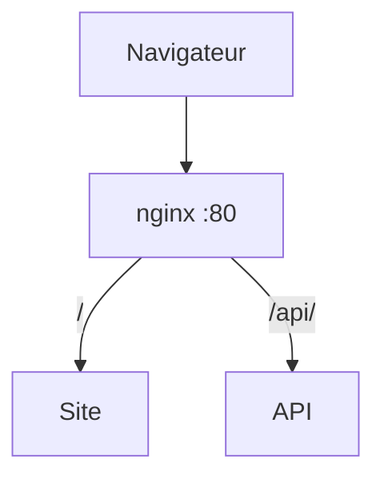

# Reverse proxy

> [!info] En une phrase
> Un serveur placé **devant les services**, qui reçoit toutes les requêtes des visiteurs et envoie chacune au bon service.

```dataviewjs
await dv.view("10 — Templates/Scripts/learning", { view: "concept" })
```

## 1 · Comprendre
### Définition
Un **reverse proxy** est la **porte d'entrée** d'une application. C'est un programme (nginx, Traefik, HAProxy) qui écoute sur 80 et 443, reçoit les requêtes des visiteurs et les **transmet** au bon service caché derrière lui. Le visiteur ne voit que le reverse proxy : il ne sait pas combien de services il y a derrière.

C'est l'inverse du [[Proxy]] : le proxy agit **pour les clients** (il sort vers Internet à leur place), le reverse proxy agit **pour les serveurs** (il reçoit à leur place).

Ses trois rôles principaux :
| Rôle | Ce que ça veut dire |
| --- | --- |
| **Router** | envoyer `/` à l'interface et `/api/` à l'API, ou `cvat.local` à CVAT et `nexus.local` au Nexus, selon le chemin ou le nom d'hôte (`Host`) |
| **Gérer le HTTPS** | il garde le [[Certificat]] et chiffre avec le visiteur ; derrière, les services parlent en HTTP simple (voir [[HTTPS et TLS]]) |
| **Répartir la charge** | s'il y a deux copies d'un service, il envoie les requêtes à l'une puis à l'autre (*load balancing*) |

Il peut aussi mettre en cache, compresser, ou refuser les requêtes trop nombreuses.

### Pourquoi ça existe
Une application est souvent faite de plusieurs services, mais les visiteurs doivent l'atteindre par **une seule adresse** et un seul port.

### Le problème résolu
Sans lui, il faudrait publier un port par service (`:8080`, `:8081`…), gérer le HTTPS dans chacun, et le visiteur devrait connaître toute l'organisation interne.

## 2 · Explorer
### Comment ça fonctionne


### Exemple concret : nginx
```nginx
server {
    listen 80;

    location / {
        proxy_pass http://site:80;        # nom du service compose, pas localhost
    }

    location /api/ {
        proxy_pass http://api:8000/;      # le / final retire /api/ du chemin
    }
}
```
- Seul nginx publie un port (`8080:80`). `site` et `api` n'en publient pas : on ne peut les joindre **qu'en passant par lui**.
- Dans un conteneur, `localhost` désigne **le conteneur lui-même** : `proxy_pass http://localhost:8000` donne `502 Bad Gateway`.
- `502 Bad Gateway` = le reverse proxy fonctionne, mais le service derrière ne répond pas.

### Exemple concret : Traefik dans CVAT
Traefik fait la même chose, mais lit ses règles dans des **labels** posés sur les conteneurs du `docker-compose.yml` :
```yaml
cvat_server:
  labels:
    - traefik.http.routers.cvat.rule=Host(`${CVAT_HOST:-localhost}`) && PathPrefix(`/api/`)
```
- `CVAT_HOST` vaut `localhost` par défaut : CVAT ne répond que si on l'appelle **avec ce nom**.
- Sur un serveur : `export CVAT_HOST=cvat.mon-entreprise.local` avant `docker compose up -d`, sinon la page renvoie **404**.
- `${CVAT_HOST:-localhost}` = « la variable `CVAT_HOST`, ou `localhost` si elle est vide ».

### Cas d'utilisation
- Mettre une interface et une API derrière une seule adresse
- Déployer CVAT sur un serveur accessible par un nom, en HTTPS
- Lancer deux copies d'un service et répartir les visiteurs

> [!warning] À ne pas confondre
> - [[Proxy]] (côté clients, vers Internet) et **reverse proxy** (côté serveurs, devant les services).
> - Un reverse proxy **n'est pas une API** : il ne produit aucune donnée et ne décide pas de la réponse, il **transmet** la requête au service qui, lui, répond. Une [[Passerelle d'API (API gateway)]] est un reverse proxy spécialisé pour les API, mais ce n'est pas non plus elle qui contient la logique.
> - Un **404 de Traefik ou de nginx** (aucune règle ne correspond) n'est pas un 404 de l'application. Un **502** veut dire que le service derrière ne répond pas.

## 3 · Pratiquer
- [[Exercice - Un reverse proxy nginx]] : mettre nginx devant un site et une petite API, puis répartir la charge sur deux copies de l'API.
- [[Exercice - CVAT derrière Traefik]] : la même idée avec Traefik, dans CVAT.

## 4 · Expliquer
> [!quote] Mon résumé, avec mes mots
> _À écrire sans regarder la fiche. Si je bloque, je ne l'ai pas encore compris._

## 5 · Relier
- **Prérequis** : [[Port]] · [[HTTP]] · [[Docker Compose]]
- **Complémentaires** : [[Proxy]] · [[HTTPS et TLS]] · [[Variable d'environnement]]
- **Va plus loin** : [[Passerelle d'API (API gateway)]]
- **Même idée en code** : [[Patron Proxy]]

## 6 · Réviser
> [!question] Me faire interroger
> Je demande à Claude de m'interroger sur cette notion pour vérifier que je l'ai comprise.

### Validation de la maîtrise
La notion est maîtrisée quand j'ai réussi **tous les exercices** qui l'utilisent (statut `reussi` dans l'exercice).

```dataviewjs
await dv.view("10 — Templates/Scripts/learning", { view: "maitrise" })
```
