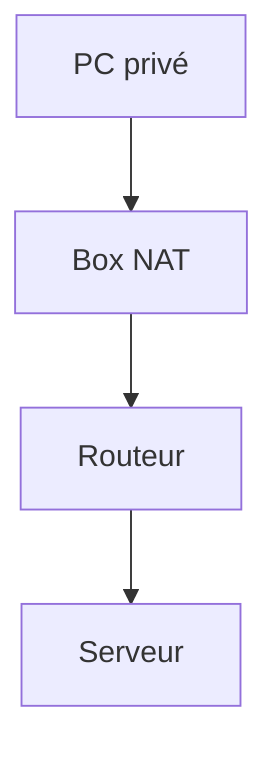

# Routage et NAT

> [!info] En une phrase
> Le routage fait passer les paquets de réseau en réseau jusqu'à leur destination ; le NAT permet à plusieurs machines privées de partager une adresse publique.

```dataviewjs
await dv.view("10 — Templates/Scripts/learning", { view: "concept" })
```

## 1 · Comprendre
### Définition
- Une **passerelle** (*gateway*, souvent la box) est la sortie par défaut de ton réseau. Chaque **routeur** sur le chemin transmet le paquet un cran plus loin.
- Le **NAT** remplace l'adresse privée de ta machine par l'adresse publique de la box à la sortie, et fait l'inverse au retour. Docker et WSL font aussi du NAT pour leurs réseaux privés.
- Le **VPN** crée un tunnel chiffré vers le réseau de l'entreprise : tu reçois une adresse de ce réseau et ses routes.

### Pourquoi ça existe
Internet est un réseau de réseaux ; et il n'y a pas assez d'IPv4 publiques pour chaque appareil.

### Le problème résolu
Relier des millions de réseaux différents, et faire sortir tout un réseau local avec une seule IP publique.

## 2 · Explorer
### Comment ça fonctionne


### Exemple concret
```bash
ip route               # Linux : « default via 192.168.1.1 » = la passerelle
traceroute gitlab.com  # chaque routeur traversé
curl ifconfig.me       # ton IP publique vue d'Internet
```
```powershell
route print
tracert gitlab.com
```

### Cas d'utilisation
- Comprendre pourquoi un service sur ton PC n'est pas joignable depuis Internet (NAT)
- Publier un port de conteneur (`-p`) = une règle de NAT faite par Docker
- Un outil interne joignable seulement quand le VPN est actif

> [!warning] À ne pas confondre
> Ton **IP privée** (`192.168.x`, vue par ton réseau local) et ton **IP publique** (celle de la box, vue par Internet).

## 3 · Pratiquer

### Exercice visuel

Sur Excalidraw, **sans regarder la fiche**. Puis je compare avec la fiche, je corrige en rouge ce qui était faux, et j'explique mon dessin à voix haute ou à Claude dans le chat.

> [!example] 🛣️ Suis le trajet
> Dessine un paquet qui part de ton PC (adresse privée) vers Internet : le routeur, le NAT qui change l'adresse, la réponse qui revient.

> [!example] 🔄 Change de contexte
> Redessine la même idée pour `-p 8080:80` dans Docker. Qu'est-ce qui joue le rôle du NAT ?

### Mon schéma

> [!tip] Mon dessin Excalidraw
> _Je crée le dessin « Schéma - Routage et NAT » et je l'intègre ici avec `![[Schéma - Routage et NAT.excalidraw]]`, puis je coche `schema`._

### Appliquer dans le fil rouge
- Pas encore d'étape du fil rouge pour cette notion : elle sera pratiquée dans le fil rouge de son niveau (voir [[Niveaux]]).

## 4 · Relier
- **Prérequis** : [[Adresse IP]]
- **Complémentaires** : [[Pare-feu]] · [[Proxy]]
- **Commandes** : [[traceroute]] · [[ip]]

## 5 · Réviser
> [!question] Me faire interroger
> Je demande à Claude de m'interroger sur cette notion pour vérifier que je l'ai comprise.

### Validation (compris, puis maîtrisé)
Trois cases à cocher dans les propriétés de la fiche :
- `schema` : mon dessin du concept est dans « Mon schéma » ;
- `exercice_visuel` : j'ai fait et corrigé les exercices visuels de la section 3 ;
- `fil_rouge` : je l'ai appliqué dans le fil rouge (coché tout seul quand une étape qui l'utilise est réussie).

Les trois cochées : la notion compte comme **comprise**. **Maîtrisé** : c'est moi qui le mets dans `status`, quand je le sens.

```dataviewjs
await dv.view("10 — Templates/Scripts/learning", { view: "maitrise" })
```
