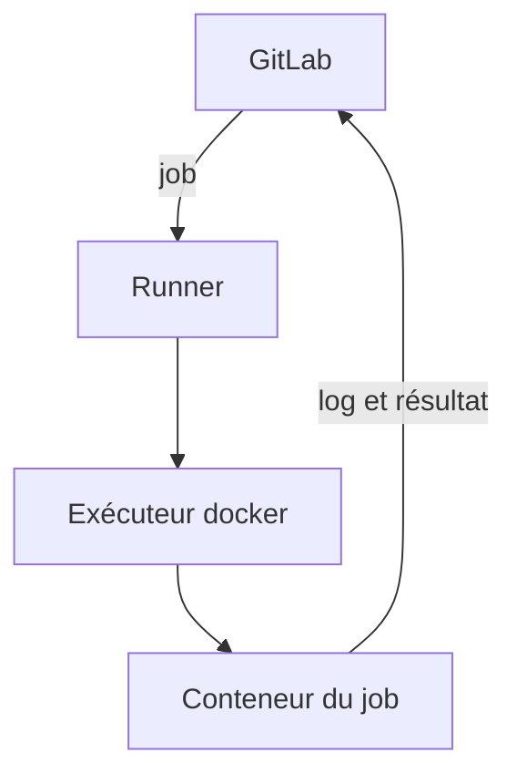
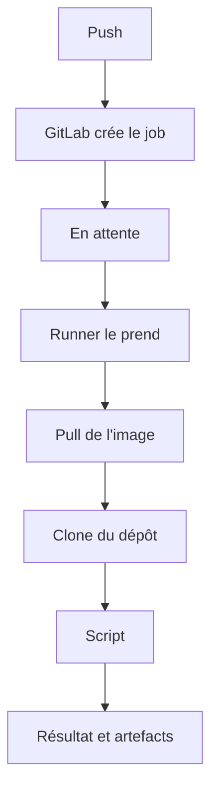

# Runner GitLab

> [!info] En une phrase
> Un runner est le programme, installé sur une machine, qui exécute réellement les jobs d'une pipeline : GitLab décide quoi faire, le runner le fait.

```dataviewjs
await dv.view("10 — Templates/Scripts/learning", { view: "concept" })
```

## 1 · Comprendre
### D'abord, qui fait quoi
Quand tu pousses un commit, **GitLab** (le site, le serveur) lit ton `.gitlab-ci.yml` et crée une liste de jobs à faire. Mais GitLab **n'exécute rien lui-même** : il n'a ni ton Python, ni ton Docker, ni ta machine.
Les jobs sont exécutés par un **runner** : un programme (`gitlab-runner`) installé sur une machine (un serveur de l'entreprise, une machine virtuelle dans le cloud, ou même ton PC).

### Une image pour comprendre
| Dans un restaurant | Dans GitLab CI |
| --- | --- |
| la salle qui prend les commandes | le serveur GitLab |
| le ticket de commande | un job (son script, son image) |
| le cuisinier qui prépare | **le runner** |
| la cuisine et ses ustensiles | la machine du runner et l'**exécuteur** |
| « ce plat, seulement par le pâtissier » | les **tags** du job |
Le cuisinier vient régulièrement voir s'il y a des tickets, prend celui qui lui correspond, cuisine, et rapporte l'assiette.

### Définition
Le **runner** est un agent qui :
1. **demande** régulièrement à GitLab « as-tu un job pour moi ? » (c'est lui qui contacte GitLab, pas l'inverse) ;
2. **récupère** le job : le script, l'image, les variables ;
3. **prépare** l'environnement : télécharge l'image Docker, clone le dépôt ;
4. **exécute** les commandes de `script:` ;
5. **renvoie** à GitLab le journal en direct, le résultat (réussi ou échoué selon le [[Code de sortie|code de sortie]]) et les [[Artefacts GitLab CI|artefacts]].

### Pourquoi ça existe
Les jobs ont besoin d'une vraie machine : processeur, mémoire, disque, réseau, outils. Séparer le serveur GitLab (qui organise) des runners (qui travaillent) permet :
- d'avoir **beaucoup** de runners pour exécuter de nombreux jobs en parallèle ;
- d'avoir des runners **spécialisés** (avec GPU, sous Windows, dans le réseau interne pour atteindre Nexus) ;
- de garder le serveur GitLab léger et sûr.

### Les exécuteurs : où tourne le job
Le runner lance chaque job grâce à un **exécuteur** (*executor*) :
| Exécuteur | Le job tourne… | Remarque |
| --- | --- | --- |
| **docker** | dans un conteneur créé à partir de `image:`, détruit à la fin | le plus courant : chaque job part propre |
| **kubernetes** | dans un pod Kubernetes | grandes installations |
| **shell** | directement sur la machine du runner, avec son utilisateur | simple mais tout reste installé d'un job à l'autre |
| **docker-autoscaler** / **instance** | sur des machines virtuelles créées à la demande | runners de GitLab.com |
C'est l'exécuteur **docker** qui explique pourquoi `image: python:3.12-slim` marche : le runner télécharge cette image et lance le script dedans.

### Quels runners prennent mes jobs
- **Runners d'instance** (*shared*) : disponibles pour tous les projets (sur GitLab.com, fournis par GitLab avec un quota de minutes).
- **Runners de groupe** : pour tous les projets d'un groupe.
- **Runners de projet** : pour un seul projet.
- **Tags** : un runner a des étiquettes (`docker`, `gpu`, `interne`). Un job avec `tags: [interne]` ne sera pris **que** par un runner qui a ce tag.
Tu les vois dans GitLab : *Settings → CI/CD → Runners* du projet.

## 2 · Explorer
### Comment ça fonctionne


### Exemple concret : le trajet d'un job

Dans le journal d'un job, tu vois exactement ces étapes :
```
Running with gitlab-runner 17.5.0 (…)
  on runner-interne-01 abc123, system ID: s_…        ← quel runner
Preparing the "docker" executor                         ← quel exécuteur
Using docker image python:3.12-slim …                   ← l'image du job
Getting source from Git repository
Fetching changes with git depth set to 20…              ← le clone
Executing "step_script" stage of the job script
$ pip install -r requirements.txt                       ← ton script
$ pytest
Job succeeded
```

### Installer et enregistrer un runner (pour comprendre)
```bash
# sur une machine Linux avec Docker (WSL convient pour s'entraîner)
docker run -d --name gitlab-runner --restart always \
  -v /srv/gitlab-runner/config:/etc/gitlab-runner \
  -v /var/run/docker.sock:/var/run/docker.sock \
  gitlab/gitlab-runner:latest
# créer le runner dans GitLab (Settings → CI/CD → Runners → New project runner), copier le jeton glrt-…
docker exec -it gitlab-runner gitlab-runner register \
  --url https://gitlab.com --token glrt-XXXX --executor docker --docker-image alpine:3.20
```
La configuration est écrite dans **`config.toml`** :
```toml
concurrent = 4                      # jobs en parallèle au maximum sur cette machine
[[runners]]
  name = "runner-interne-01"
  url = "https://gitlab.exemple.com"
  executor = "docker"
  [runners.docker]
    image = "alpine:3.20"           # image par défaut si le job n'en donne pas
    privileged = false              # true seulement pour docker-in-docker
    volumes = ["/cache"]
```

### Dans ton projet CVAT
- Les runners de l'entreprise sont probablement dans le **réseau interne** : c'est ce qui leur permet de joindre **Nexus**, que GitLab.com ne peut pas atteindre.
- Construire une image dans un job demande soit un runner `privileged` (docker-in-docker), soit **[[Kaniko]]**, qui n'a pas besoin de privilège : c'est pour ça qu'on l'utilise sur des runners partagés.
- Si un job reste **en attente** (*pending*) : aucun runner disponible n'accepte ses tags, ou tous sont occupés.

### Cas d'utilisation
- Comprendre où et comment s'exécute ta pipeline
- Diagnostiquer un job bloqué « pending » ou qui échoue avant même ton script
- Choisir des `tags` pour envoyer un job vers le bon runner (réseau interne, GPU)
- Comprendre pourquoi on utilise Kaniko et pas `docker build` dans la CI

> [!warning] À ne pas confondre
> **Runner** (le programme qui exécute, sur une machine) et **job** (le travail à faire, décrit dans `.gitlab-ci.yml`). Et **runner** et **exécuteur** : le runner reçoit le job, l'exécuteur est la façon de le lancer (conteneur Docker, shell, Kubernetes).
Ne confonds pas non plus le **jeton du runner** (`glrt-…`, qui l'enregistre auprès de GitLab : un secret à protéger) et le **jeton du job** (`CI_JOB_TOKEN`, temporaire, donné à chaque job).
Avec l'exécuteur **shell**, les jobs tournent directement sur la machine, avec ses fichiers : un job peut laisser des restes qui faussent le suivant, et un script malveillant agit sur la machine. Préfère l'exécuteur docker.

## 3 · Pratiquer
- Ouvre le journal d'un job de ta pipeline et repère : le nom du runner, l'exécuteur, l'image, le clone et le début de ton script
- Dans *Settings → CI/CD → Runners* de ton projet, note les runners disponibles et leurs tags
- Fais l'[[Exercice - Faire tourner son propre runner]]

## 4 · Expliquer
> [!quote] Mon résumé, avec mes mots
> _À écrire sans regarder la fiche. Si je bloque, je ne l'ai pas encore compris._

## 5 · Relier
- **Prérequis** : [[Pipeline GitLab CI]] · [[Docker]] · [[Conteneur]]
- **Complémentaires** : [[Kaniko]] · [[Construire une image dans la CI]] · [[Variables CI-CD GitLab]]
- **Utilisé par** : [[Intégration et déploiement continus (CI-CD)]]

## 6 · Réviser
> [!question] Me faire interroger
> Je demande à Claude de m'interroger sur cette notion pour vérifier que je l'ai comprise.

### Validation de la maîtrise
La notion est maîtrisée quand j'ai réussi **tous les exercices** qui l'utilisent (statut `reussi` dans l'exercice).

```dataviewjs
await dv.view("10 — Templates/Scripts/learning", { view: "maitrise" })
```
