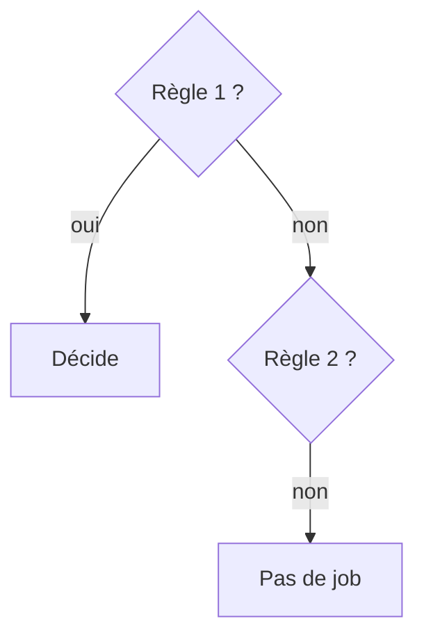

# Règles d'un job GitLab (rules)

> [!info] En une phrase
> La section rules: d'un job décide s'il est lancé, quand (automatique ou manuel) et si son échec bloque la pipeline.

```dataviewjs
await dv.view("10 — Templates/Scripts/learning", { view: "concept" })
```

## 1 · Comprendre
### Définition
`rules:` est une liste de conditions lues **dans l'ordre** ; la **première** qui correspond décide. Chaque règle peut dire :
- `if:` une condition sur des variables (`$CI_COMMIT_BRANCH == "main"`) ;
- `changes:` seulement si certains fichiers ont changé ;
- `when:` `on_success` (par défaut), `manual` (bouton ▶), `never` (jamais), `always` ;
- `allow_failure: true` : un échec n'arrête pas la pipeline.

Si **aucune** règle ne correspond, le job n'est **pas ajouté** à la pipeline.

### Pourquoi ça existe
Tous les jobs ne doivent pas tourner tout le temps : publier seulement sur `main`, déployer seulement sur demande, ignorer un job instable.

### Le problème résolu
Des pipelines qui font tout à chaque push (lentes, coûteuses) ou qui publient des images depuis n'importe quelle branche.

## 2 · Explorer
### Comment ça fonctionne


### Exemple concret
```yaml
publier:
  stage: publish
  script: ./publier.sh
  rules:
    - if: $CI_COMMIT_BRANCH == $CI_DEFAULT_BRANCH   # sur main : automatique
    - if: $CI_COMMIT_TAG                            # sur un tag : automatique
    - when: manual                                  # ailleurs : bouton ▶
      allow_failure: true                           # sans bloquer la pipeline

tests-lents:
  script: pytest tests/lents
  rules:
    - changes: [cvat/**/*]                          # seulement si le code a changé
```
Un job **manuel** sans `allow_failure: true` **bloque** les stages suivants jusqu'au clic.

### Cas d'utilisation
- Construire à chaque push, publier seulement sur `main` ou un tag
- Un job manuel de déploiement

> [!warning] À ne pas confondre
> `when: never` / aucune règle (le job **n'existe pas** dans la pipeline) et `skipped` (le job existe mais n'a pas été lancé). Et l'ancien `only:` / `except:` : même rôle, à ne pas mélanger avec `rules:` dans un même job.

## 3 · Pratiquer

### Exercice visuel

Sur Excalidraw, **sans regarder la fiche**. Puis je compare avec la fiche, je corrige en rouge ce qui était faux, et j'explique mon dessin à voix haute ou à Claude dans le chat.

> [!example] 🧠 Dessine de mémoire
> Dessine trois situations (push sur une branche, merge request, tag) et, pour chacune, les jobs de ton application qui se lancent.

> [!example] 🔄 Change de contexte
> Redessine-les pour un dépôt avec trois dossiers (api, front-vue, front-angular) : comment ne lancer que les jobs de la partie modifiée ?

### Mon schéma

> [!tip] Mon dessin Excalidraw
> _Je crée le dessin « Schéma - Règles d'un job GitLab (rules) » et je l'intègre ici avec `![[Schéma - Règles d'un job GitLab (rules).excalidraw]]`, puis je coche `schema`._

### Appliquer dans le fil rouge
- [[MesDépenses Front 11 - La CI du front Angular]]
- [[MesDépenses 09 - La CI de l'API]]
- [[MesDépenses 10 - Sortir une version]]
- [[MesDépenses 14 - Déployer depuis la CI]]
- [[Fil rouge 07 - Tester l'image et ranger la pipeline]]

## 4 · Relier
- **Au travail** : [[Règles d'un job GitLab (rules) au travail]]
- **Prérequis** : [[Pipeline GitLab CI]] · [[Variables CI-CD GitLab]] · [[YAML]]
- **Complémentaires** : [[extends GitLab CI]]

## 5 · Réviser
> [!question] Me faire interroger
> Je demande à Claude de m'interroger sur cette notion pour vérifier que je l'ai comprise.

### Validation (compris, puis maîtrisé)
Trois cases à cocher dans les propriétés de la fiche :
- `schema` : mon dessin du concept est dans « Mon schéma » ;
- `exercice_visuel` : j'ai fait et corrigé les exercices visuels de la section 3 ;
- `fil_rouge` : je l'ai appliqué dans le fil rouge (coché tout seul quand une étape qui l'utilise est réussie).

Les trois cochées : la notion compte comme **comprise**. **Maîtrisé** : c'est moi qui le mets dans `status`, quand je le sens.

```dataviewjs
await dv.view("10 — Templates/Scripts/learning", { view: "maitrise" })
```
