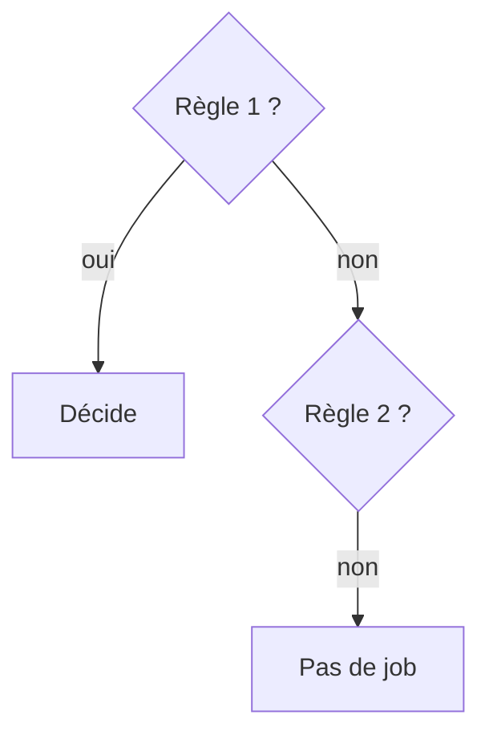

# Règles d'un job GitLab (rules)

> [!info] En une phrase
> La section rules: d'un job décide s'il est lancé, quand (automatique ou manuel) et si son échec bloque la pipeline.

```dataviewjs
await dv.view("10 — Templates/Scripts/learning", { view: "concept" })
```

## 1 · Comprendre
### Définition
`rules:` est une liste de conditions lues **dans l'ordre** ; la **première** qui correspond décide. Chaque règle peut dire :
- `if:` une condition sur des variables (`$CI_COMMIT_BRANCH == "main"`) ;
- `changes:` seulement si certains fichiers ont changé ;
- `when:` `on_success` (par défaut), `manual` (bouton ▶), `never` (jamais), `always` ;
- `allow_failure: true` : un échec n'arrête pas la pipeline.

Si **aucune** règle ne correspond, le job n'est **pas ajouté** à la pipeline.

### Pourquoi ça existe
Tous les jobs ne doivent pas tourner tout le temps : publier seulement sur `main`, déployer seulement sur demande, ignorer un job instable.

### Le problème résolu
Des pipelines qui font tout à chaque push (lentes, coûteuses) ou qui publient des images depuis n'importe quelle branche.

## 2 · Explorer
### Comment ça fonctionne


### Exemple concret
```yaml
publier:
  stage: publish
  script: ./publier.sh
  rules:
    - if: $CI_COMMIT_BRANCH == $CI_DEFAULT_BRANCH   # sur main : automatique
    - if: $CI_COMMIT_TAG                            # sur un tag : automatique
    - when: manual                                  # ailleurs : bouton ▶
      allow_failure: true                           # sans bloquer la pipeline

tests-lents:
  script: pytest tests/lents
  rules:
    - changes: [cvat/**/*]                          # seulement si le code a changé
```
Un job **manuel** sans `allow_failure: true` **bloque** les stages suivants jusqu'au clic.

### Cas d'utilisation
- Construire à chaque push, publier seulement sur `main` ou un tag
- Un job manuel de déploiement
- Projet CVAT : ne lancer que les jobs utiles sur ta branche

> [!warning] À ne pas confondre
> `when: never` / aucune règle (le job **n'existe pas** dans la pipeline) et `skipped` (le job existe mais n'a pas été lancé). Et l'ancien `only:` / `except:` : même rôle, à ne pas mélanger avec `rules:` dans un même job.

## 3 · Pratiquer

### Exercice visuel

Sur Excalidraw, **sans regarder la fiche**. Puis je compare avec la fiche, je corrige en rouge ce qui était faux, et j'explique mon dessin avec mes mots (section 4).

> [!example] 🧠 Dessine de mémoire
> Dessine trois situations (push sur une branche, merge request, tag) et, pour chacune, les jobs de MesDépenses qui se lancent.

> [!example] 🔄 Change de contexte
> Redessine-les pour un dépôt avec trois dossiers (api, front-vue, front-angular) : comment ne lancer que les jobs de la partie modifiée ?

### Mon schéma

> [!tip] Mon dessin Excalidraw
> _Je crée le dessin « Schéma - Règles d'un job GitLab (rules) » et je l'intègre ici avec `![[Schéma - Règles d'un job GitLab (rules).excalidraw]]`._

### Appliquer dans le fil rouge
- [[MesDépenses 08 - La CI de l'API]]
- [[MesDépenses 14 - La CI du front Angular]]
- [[Fil rouge 07 - Tester l'image et ranger la pipeline]]

## 4 · Expliquer
> [!quote] Mon résumé, avec mes mots
> _J'explique mon schéma avec mes mots, sans regarder la fiche. Si je bloque, je ne l'ai pas encore compris._

## 5 · Relier
- **Prérequis** : [[Pipeline GitLab CI]] · [[Variables CI-CD GitLab]] · [[YAML]]
- **Complémentaires** : [[extends GitLab CI]]

## 6 · Réviser
> [!question] Me faire interroger
> Je demande à Claude de m'interroger sur cette notion pour vérifier que je l'ai comprise.

### Validation de la maîtrise
La notion est maîtrisée quand je sais :
1. **l'expliquer** de façon fluide, à partir de mon schéma (section 4) ;
2. **l'adapter** à un autre contexte (consigne « Change de contexte », ou Claude m'interroge sur un autre cas) ;
3. **l'appliquer** pour de vrai dans le fil rouge (section 3).

Réussir un exercice ne suffit pas. C'est moi qui passe le statut en `maitrise`.

```dataviewjs
await dv.view("10 — Templates/Scripts/learning", { view: "maitrise" })
```
