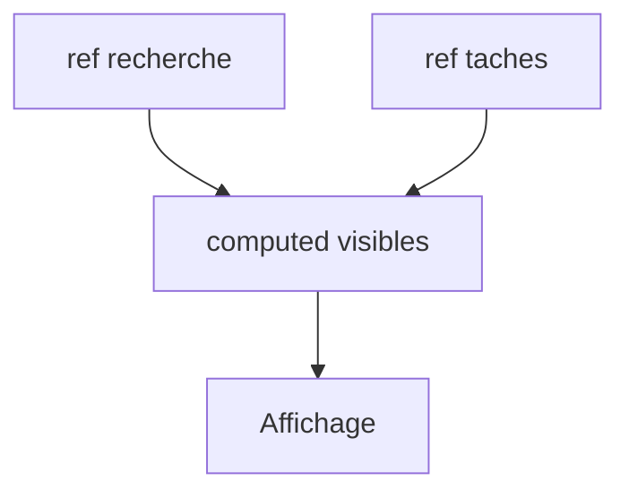

# Réactivité Vue (ref et computed)

> [!info] En une phrase
> En Vue, ref et reactive créent des données réactives : quand on les modifie, tout ce qui en dépend (affichage, computed, watch) se met à jour tout seul.

```dataviewjs
await dv.view("10 — Templates/Scripts/learning", { view: "concept" })
```

## 1 · Comprendre
### Définition
```ts
import { ref, reactive, computed, watch, onMounted } from "vue";
const recherche = ref("");                 // une valeur : recherche.value (dans le script)
const taches = ref<Tache[]>([]);
const filtre = reactive({ statut: "toutes" });   // un objet réactif, sans .value
const visibles = computed(() =>              // valeur dérivée, recalculée seulement si besoin
  taches.value.filter((t) => t.nom.includes(recherche.value)));
watch(recherche, (nouv, anc) => console.log(anc, "→", nouv));   // réagir à un changement
onMounted(async () => { taches.value = await charger(); });     // à l'apparition
```
- Dans le **template**, pas de `.value` : `{{ recherche }}`.
- On peut **modifier directement** : `taches.value.push(t)` fonctionne (contrairement à React).
- `computed` pour ce qui se calcule ; `watch` pour une action à faire quand une valeur change (appel d'API, stockage).

### Pourquoi ça existe
L'affichage doit suivre les données sans que le développeur ait à dire quand réafficher.

### Le problème résolu
Moins de code de mise à jour, et des valeurs dérivées toujours justes.

## 2 · Explorer
### Comment ça fonctionne


### Exemple concret
```vue
<script setup lang="ts">
import { ref, computed } from "vue";
const prix = ref(10), quantite = ref(3);
const total = computed(() => prix.value * quantite.value);
</script>
<template>
  <input v-model.number="quantite" type="number" /> Total : {{ total }} €
</template>
```

### Cas d'utilisation
- Formulaires et filtres
- Valeurs calculées (totaux, listes filtrées)
- Charger des données au montage

> [!warning] À ne pas confondre
> Oublier `.value` dans le script (`recherche === ""` compare l'objet ref, toujours faux). Et déstructurer un `reactive` (`const { statut } = filtre`) perd la réactivité.

## 3 · Pratiquer
- Réécris en Vue le composant panier (ajouter, retirer, total calculé avec computed)

## 4 · Expliquer
> [!quote] Mon résumé, avec mes mots
> _À écrire sans regarder la fiche. Si je bloque, je ne l'ai pas encore compris._

## 5 · Relier
- **Prérequis** : [[Composant monofichier Vue (SFC)]] · [[Tableau et objet JavaScript]]
- **Complémentaires** : [[État React (useState)]] · [[Directives Vue]]

## 6 · Réviser
> [!question] Me faire interroger
> Je demande à Claude de m'interroger sur cette notion pour vérifier que je l'ai comprise.

### Validation de la maîtrise
La notion est maîtrisée quand j'ai réussi **tous les exercices** qui l'utilisent (statut `reussi` dans l'exercice).

```dataviewjs
await dv.view("10 — Templates/Scripts/learning", { view: "maitrise" })
```
