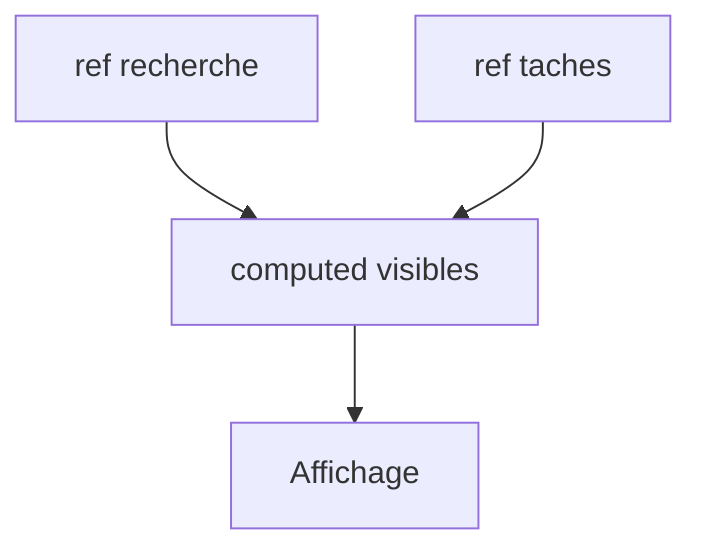

# Réactivité Vue (ref et computed)

> [!info] En une phrase
> En Vue, ref et reactive créent des données réactives : quand on les modifie, tout ce qui en dépend (affichage, computed, watch) se met à jour tout seul.

```dataviewjs
await dv.view("10 — Templates/Scripts/learning", { view: "concept" })
```

## 1 · Comprendre
### Définition
```ts
import { ref, reactive, computed, watch, onMounted } from "vue";
const recherche = ref("");                 // une valeur : recherche.value (dans le script)
const taches = ref<Tache[]>([]);
const filtre = reactive({ statut: "toutes" });   // un objet réactif, sans .value
const visibles = computed(() =>              // valeur dérivée, recalculée seulement si besoin
  taches.value.filter((t) => t.nom.includes(recherche.value)));
watch(recherche, (nouv, anc) => console.log(anc, "→", nouv));   // réagir à un changement
onMounted(async () => { taches.value = await charger(); });     // à l'apparition
```
- Dans le **template**, pas de `.value` : `{{ recherche }}`.
- On peut **modifier directement** : `taches.value.push(t)` fonctionne (contrairement à React).
- `computed` pour ce qui se calcule ; `watch` pour une action à faire quand une valeur change (appel d'API, stockage).

### Pourquoi ça existe
L'affichage doit suivre les données sans que le développeur ait à dire quand réafficher.

### Le problème résolu
Moins de code de mise à jour, et des valeurs dérivées toujours justes.

## 2 · Explorer
### Comment ça fonctionne


### Exemple concret
```vue
<script setup lang="ts">
import { ref, computed } from "vue";
const prix = ref(10), quantite = ref(3);
const total = computed(() => prix.value * quantite.value);
</script>
<template>
  <input v-model.number="quantite" type="number" /> Total : {{ total }} €
</template>
```

### Cas d'utilisation
- Formulaires et filtres
- Valeurs calculées (totaux, listes filtrées)
- Charger des données au montage

> [!warning] À ne pas confondre
> Oublier `.value` dans le script (`recherche === ""` compare l'objet ref, toujours faux). Et déstructurer un `reactive` (`const { statut } = filtre`) perd la réactivité.

## 3 · Pratiquer

### Exercice visuel

Sur Excalidraw, **sans regarder la fiche**. Puis je compare avec la fiche, je corrige en rouge ce qui était faux, et j'explique mon dessin à voix haute ou à Claude dans le chat.

> [!example] 🛣️ Suis le trajet
> Dessine ce qui arrive quand tu ajoutes une dépense à `depenses` (une `ref`) : le `computed` du total se recalcule, le template se redessine.

> [!example] 🔍 Trouve l'erreur
> Ce schéma est faux. Corrige-le en rouge et explique l'erreur.
>
> ```mermaid
> flowchart TD
>   L[let total] --> M[Modifié]
>   M --> A[Affichage changé]
> ```

### Mon schéma

> [!tip] Mon dessin Excalidraw
> _Je crée le dessin « Schéma - Réactivité Vue (ref et computed) » et je l'intègre ici avec `![[Schéma - Réactivité Vue (ref et computed).excalidraw]]`, puis je coche `schema`._

### Appliquer dans le fil rouge
- [[MesDépenses 03 - Vue, afficher la liste]]

## 4 · Relier
- **Prérequis** : [[Composant monofichier Vue (SFC)]] · [[Liste et dictionnaire]]
- **Complémentaires** : [[État React (useState)]] · [[Directives Vue]]

## 5 · Réviser
> [!question] Me faire interroger
> Je demande à Claude de m'interroger sur cette notion pour vérifier que je l'ai comprise.

### Validation de la maîtrise
Trois cases à cocher dans les propriétés de la fiche :
- `schema` : mon dessin du concept est dans « Mon schéma » ;
- `exercice_visuel` : j'ai fait et corrigé les exercices visuels de la section 3 ;
- `fil_rouge` : je l'ai appliqué dans le fil rouge (coché tout seul quand une étape qui l'utilise est réussie).

Les trois cochées : la notion compte comme **comprise**. **Maîtrisé** : c'est moi qui le mets dans `status`, quand je le sens.

```dataviewjs
await dv.view("10 — Templates/Scripts/learning", { view: "maitrise" })
```
