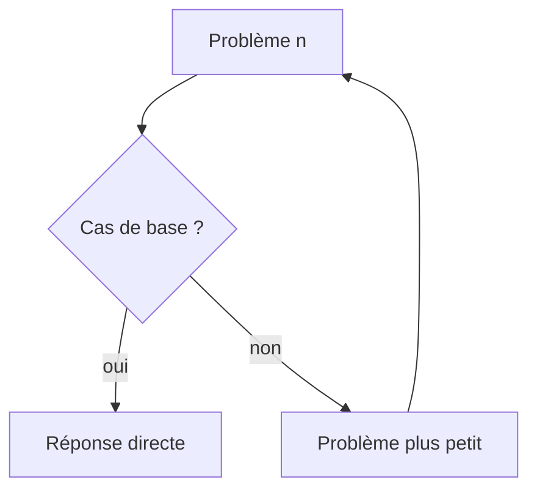

# Récursivité

> [!info] En une phrase
> Une fonction récursive s'appelle elle-même sur une version plus petite du problème, jusqu'à un cas de base qu'on sait résoudre directement.

```dataviewjs
await dv.view("10 — Templates/Scripts/learning", { view: "concept" })
```

## 1 · Comprendre
### Définition
Deux ingrédients **obligatoires** :
1. le **cas de base** : le plus petit cas, résolu sans appel récursif (sinon, appels infinis) ;
2. le **cas récursif** : on se ramène à un problème **plus petit** du même type, et on combine.
```python
def factorielle(n):
    if n <= 1:             # cas de base
        return 1
    return n * factorielle(n - 1)   # cas récursif, plus petit
```
Chaque appel attend le résultat du suivant : ils s'empilent sur la **pile d'appels**, puis se dépilent. Trop d'appels : `RecursionError` en Python (vers 1 000), `Maximum call stack size exceeded` en JavaScript.
La récursivité est naturelle pour les structures **imbriquées** : dossiers dans des dossiers, JSON dans du JSON, arbres, menus.

### Pourquoi ça existe
Certains problèmes se définissent naturellement en fonction d'eux-mêmes : la taille d'un dossier, c'est la taille de ses fichiers plus la taille de ses sous-dossiers.

### Le problème résolu
Écrire simplement des solutions pour des données imbriquées de profondeur inconnue.

## 2 · Explorer
### Comment ça fonctionne


### Exemple concret
```python
from pathlib import Path
def taille_dossier(d: Path) -> int:
    total = 0
    for p in d.iterdir():
        if p.is_file():
            total += p.stat().st_size          # cas simple
        elif p.is_dir():
            total += taille_dossier(p)         # même problème, plus petit
    return total                               # un dossier vide renvoie 0 : cas de base
```
Trace de `factorielle(3)` :
```
factorielle(3) = 3 * factorielle(2)
                     factorielle(2) = 2 * factorielle(1)
                                          factorielle(1) = 1
                     = 2 * 1 = 2
= 3 * 2 = 6
```
Tout algorithme récursif peut s'écrire avec une boucle et une [[Pile et file|pile]] ; c'est parfois préférable pour de très grandes profondeurs.

### Cas d'utilisation
- Parcourir un dossier et ses sous-dossiers
- Lire un JSON imbriqué (annotations, configuration)
- Tri fusion, parcours d'arbre

> [!warning] À ne pas confondre
> Oublier le cas de base, ou un cas récursif qui ne rapproche pas du cas de base : récursion infinie. Et la récursivité naïve qui recalcule les mêmes choses (Fibonacci) explose en temps : garder les résultats déjà calculés (*mémoïsation*, `functools.cache`).

## 3 · Pratiquer
- Écris récursivement : la somme d'une liste, l'inversion d'une chaîne, le nombre de fichiers `.png` dans un dossier et ses sous-dossiers

## 4 · Expliquer
> [!quote] Mon résumé, avec mes mots
> _À écrire sans regarder la fiche. Si je bloque, je ne l'ai pas encore compris._

## 5 · Relier
- **Prérequis** : [[Fonction]] · [[Pseudo-code et trace d'exécution]]
- **Complémentaires** : [[Pile et file]] · [[Arbre et graphe]]

## 6 · Réviser
> [!question] Me faire interroger
> Je demande à Claude de m'interroger sur cette notion pour vérifier que je l'ai comprise.

### Validation de la maîtrise
La notion est maîtrisée quand j'ai réussi **tous les exercices** qui l'utilisent (statut `reussi` dans l'exercice).

```dataviewjs
await dv.view("10 — Templates/Scripts/learning", { view: "maitrise" })
```
