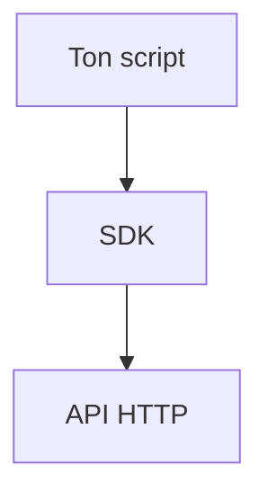

# SDK

> [!info] En une phrase
> Une bibliothèque fournie pour utiliser une API depuis un langage, sans écrire soi-même les requêtes HTTP.

```dataviewjs
await dv.view("10 — Templates/Scripts/learning", { view: "concept" })
```

## 1 · Comprendre
### Définition
Un **SDK** (*Software Development Kit*) emballe les appels à une API dans des fonctions et des objets du langage. Au lieu de construire l'URL, les en-têtes et de décoder le JSON, on appelle `client.tasks.retrieve(12)`. Beaucoup de SDK sont **générés** à partir du fichier [[OpenAPI]].

### Pourquoi ça existe
Gagner du temps et éviter les erreurs (URL, authentification, format) en utilisant une API.

### Le problème résolu
Réécrire dans chaque script la même plomberie HTTP, et la casser quand l'API évolue.

## 2 · Explorer
### Comment ça fonctionne


### Exemple concret
Sans SDK (avec `requests`) :
```python
import requests
r = requests.get("http://localhost:8080/api/tasks/12/annotations", auth=("user", "motdepasse"))
r.raise_for_status()
annotations = r.json()
```
Avec le SDK de CVAT (`pip install cvat-sdk`, même version que le serveur) :
```python
from cvat_sdk import make_client
with make_client("http://localhost:8080", credentials=("user", "motdepasse")) as client:
    tache = client.tasks.retrieve(12)
    annotations = tache.get_annotations()
```

### Cas d'utilisation
- Récupérer les annotations CVAT dans la fonction Nuclio
- Automatiser la création de tâches

> [!warning] À ne pas confondre
> **SDK** (bibliothèque côté client) et **API** (le service côté serveur). La version du SDK doit correspondre à celle du serveur CVAT, sinon des champs manquent ou changent.

## 3 · Pratiquer
- Fais le même appel (liste des tâches) avec `requests` puis avec le SDK, et compare.

## 4 · Expliquer
> [!quote] Mon résumé, avec mes mots
> _À écrire sans regarder la fiche. Si je bloque, je ne l'ai pas encore compris._

## 5 · Relier
- **Prérequis** : [[API REST]] · [[pip]] · [[Liste et dictionnaire]]
- **Complémentaires** : [[OpenAPI]] · [[JSON]]
- **Utilisé par** : [[Pillow]] (tracer les annotations récupérées)

## 6 · Réviser
> [!question] Me faire interroger
> Je demande à Claude de m'interroger sur cette notion pour vérifier que je l'ai comprise.

### Validation de la maîtrise
- [ ] Je l'explique sans notes, en 3 phrases, à quelqu'un qui ne connaît pas
- [ ] J'ai réussi un exercice qui l'utilise
- [ ] Je l'ai utilisé dans un projet
- [ ] Je sais dire quand ne pas l'utiliser (ou ce qu'il ne faut pas confondre)
