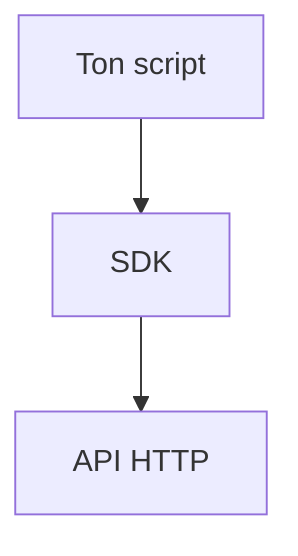

# SDK

> [!info] En une phrase
> Une bibliothèque fournie pour utiliser une API depuis un langage, sans écrire soi-même les requêtes HTTP.

## 1 · Comprendre
### Définition
Un **SDK** (*Software Development Kit*) emballe les appels à une API dans des fonctions et des objets du langage. Au lieu de construire l'URL, les en-têtes et de décoder le JSON, on appelle `client.tasks.retrieve(12)`. Beaucoup de SDK sont **générés** à partir du fichier [[OpenAPI]].

### Pourquoi ça existe
Gagner du temps et éviter les erreurs (URL, authentification, format) en utilisant une API.

### Le problème résolu
Réécrire dans chaque script la même plomberie HTTP, et la casser quand l'API évolue.

## 2 · Explorer
### Comment ça fonctionne


### Exemple concret
Sans SDK (avec `requests`) :
```python
import requests
r = requests.get("http://localhost:8080/api/tasks/12/annotations", auth=("user", "motdepasse"))
r.raise_for_status()
annotations = r.json()
```
Avec le SDK du service (même version que le serveur) :
```python
from cvat_sdk import make_client
with make_client("http://localhost:8080", credentials=("user", "motdepasse")) as client:
    tache = client.tasks.retrieve(12)
    annotations = tache.get_annotations()
```

### Cas d'utilisation
- Automatiser la création de tâches

> [!warning] À ne pas confondre
> **SDK** (bibliothèque côté client) et **API** (le service côté serveur). La version du SDK doit correspondre à celle du serveur, sinon des champs manquent ou changent.

## 3 · Relier
- **Au travail** : [SDK au travail](obsidian://open?vault=Travail&file=SDK%20au%20travail)
- **Prérequis** : [[API REST]] · [[Gestionnaire de paquets]] · [[Liste et dictionnaire]]
- **Complémentaires** : [[OpenAPI]] · [[JSON]]
- **Complémentaires** : [[Appeler une API HTTP]] (le même appel, sans SDK)
