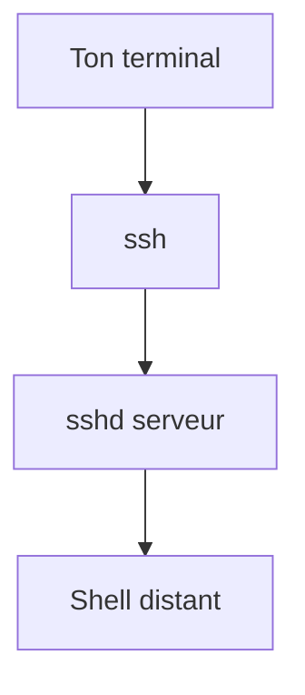

# SSH

> [!info] En une phrase
> Le protocole pour ouvrir un terminal sur une machine distante, de façon chiffrée ; il sert aussi à Git et à copier des fichiers.

```dataviewjs
await dv.view("10 — Templates/Scripts/learning", { view: "concept" })
```

## 1 · Comprendre
### Définition
**SSH** (*Secure Shell*, port 22) te donne un shell sur un serveur comme si tu étais devant. La connexion est chiffrée ; tu t'identifies par mot de passe ou, mieux, par [[Clé SSH]]. Au premier contact, SSH mémorise l'**empreinte** du serveur dans `~/.ssh/known_hosts` pour détecter un imposteur ensuite.

### Pourquoi ça existe
Administrer des serveurs (souvent sans écran) depuis n'importe où, en sécurité.

### Le problème résolu
Les anciens outils (telnet) envoyaient tout, mot de passe compris, en clair.

## 2 · Explorer
### Comment ça fonctionne


### Exemple concret
```bash
ssh oumar@serveur.entreprise.local          # se connecter
ssh -p 2222 oumar@10.0.0.5                  # autre port
scp archive.zip oumar@serveur:/tmp/         # copier un fichier
ssh oumar@serveur "docker ps"               # lancer une commande et revenir
```
Configuration pour ne plus retaper : `~/.ssh/config`
```text
Host cvat
    HostName serveur.entreprise.local
    User oumar
    IdentityFile ~/.ssh/id_ed25519
```
→ `ssh cvat`.

### Cas d'utilisation
- Déployer CVAT sur un serveur
- `git clone git@gitlab.com:equipe/projet.git` passe par SSH

> [!warning] À ne pas confondre
> `REMOTE HOST IDENTIFICATION HAS CHANGED` : l'empreinte du serveur a changé (réinstallation… ou attaque). Ne supprime l'ancienne ligne de `known_hosts` qu'après avoir vérifié avec l'équipe.

## 3 · Pratiquer
- Fais l'[[Exercice - Se connecter en SSH avec une clé]].

## 4 · Expliquer
> [!quote] Mon résumé, avec mes mots
> _À écrire sans regarder la fiche. Si je bloque, je ne l'ai pas encore compris._

## 5 · Relier
- **Prérequis** : [[Terminal]] · [[TCP et UDP]]
- **Complémentaires** : [[Clé SSH]] · [[Pare-feu]]
- **Commandes** : [[ssh user@hôte]] · [[scp]]

## 6 · Réviser
> [!question] Me faire interroger
> Je demande à Claude de m'interroger sur cette notion pour vérifier que je l'ai comprise.

### Validation de la maîtrise
La notion est maîtrisée quand j'ai réussi **tous les exercices** qui l'utilisent (statut `reussi` dans l'exercice).

```dataviewjs
await dv.view("10 — Templates/Scripts/learning", { view: "maitrise" })
```
