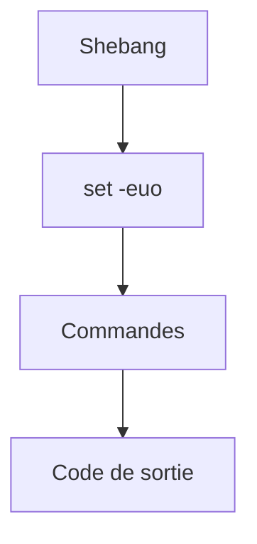

# Script shell

> [!info] En une phrase
> Un fichier texte qui contient une suite de commandes Bash, qu'on lance d'un coup comme un programme.

```dataviewjs
await dv.view("10 — Templates/Scripts/learning", { view: "concept" })
```

## 1 · Comprendre
### Définition
Un **script shell** (`.sh`) regroupe des commandes. Sa première ligne, le **shebang** (`#!/usr/bin/env bash`), dit quel shell doit l'exécuter. On le lance avec `bash script.sh`, ou `./script.sh` s'il est exécutable.

### Pourquoi ça existe
Rejouer une suite de commandes sans les retaper, et la partager.

### Le problème résolu
Les procédures notées dans un document et retapées à la main, avec des oublis.

## 2 · Explorer
### Comment ça fonctionne


### Exemple concret
```bash
#!/usr/bin/env bash
set -euo pipefail          # s'arrêter à la première erreur, variable inconnue = erreur

DOSSIER="${1:?Usage : ./archiver.sh <dossier>}"   # 1er argument, obligatoire
SORTIE="${2:-archive.zip}"                        # 2e argument, valeur par défaut

if [ ! -d "$DOSSIER" ]; then
  echo "Dossier introuvable : $DOSSIER" >&2
  exit 1
fi

for f in "$DOSSIER"/*.png; do
  echo "Image : $f"
done

zip -r "$SORTIE" "$DOSSIER"
echo "Archive créée : $SORTIE"
```
| Élément | Sens |
| --- | --- |
| `$1`, `$2` | arguments ; `$@` tous ; `$#` leur nombre |
| `"$VAR"` | **toujours entre guillemets** (noms avec espaces) |
| `$(commande)` | le résultat d'une commande : `DATE=$(date +%F)` |
| `[ -f f ]`, `[ -d d ]` | fichier / dossier existe |
| `>&2` | écrire sur stderr |

### Cas d'utilisation
- Les `entrypoint.sh` des images Docker (CVAT en a)
- Les blocs `script:` de GitLab CI sont, en pratique, du shell
- Petits automatismes ; dès que ça devient complexe, passer à [[Python]]

> [!warning] À ne pas confondre
> Sans `set -e`, un script **continue** après une erreur et peut finir avec le code 0. Et un script écrit sous Windows peut casser à cause des fins de ligne CRLF (voir [[Fichiers entre Windows et Linux]]).

## 3 · Pratiquer
- Écris un script qui prend un dossier en argument et affiche le nombre de fichiers de chaque extension.
- Retire `set -e`, ajoute une commande qui échoue au milieu, et compare le code de sortie final.

## 4 · Expliquer
> [!quote] Mon résumé, avec mes mots
> _À écrire sans regarder la fiche. Si je bloque, je ne l'ai pas encore compris._

## 5 · Relier
- **Prérequis** : [[Bash]] · [[Permissions Linux]] · [[Code de sortie]]
- **Complémentaires** : [[Arguments de ligne de commande]] · [[Fichiers entre Windows et Linux]]
- **Utilisé par** : [[Dockerfile]] · [[Pipeline GitLab CI]]

## 6 · Réviser
> [!question] Me faire interroger
> Je demande à Claude de m'interroger sur cette notion pour vérifier que je l'ai comprise.

### Validation de la maîtrise
- [ ] Je l'explique sans notes, en 3 phrases, à quelqu'un qui ne connaît pas
- [ ] J'ai réussi un exercice qui l'utilise
- [ ] Je l'ai utilisé dans un projet
- [ ] Je sais dire quand ne pas l'utiliser (ou ce qu'il ne faut pas confondre)
