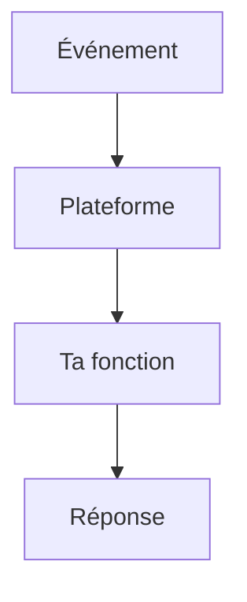

# Serverless et FaaS

> [!info] En une phrase
> Le serverless (FaaS, fonction en tant que service) consiste à écrire seulement une fonction qui réagit à un événement : la plateforme la démarre, la met à l'échelle et l'arrête pour toi. Nuclio, AWS Lambda et Cloud Functions en sont des exemples.

```dataviewjs
await dv.view("10 — Templates/Scripts/learning", { view: "concept" })
```

## 1 · Comprendre
### Définition
**Il y a bien des serveurs**, mais tu ne les gères pas : tu fournis une fonction `handler(context, event)` et une configuration.

**Déclencheurs** : une requête HTTP, un message dans une file, un minuteur, un fichier déposé.

**Mise à l'échelle** : la plateforme lance autant de copies que nécessaire, parfois zéro quand rien n'arrive.

**Démarrage à froid** : la première exécution après une pause est plus lente (il faut lancer le conteneur, charger le modèle).

**Sans état** : chaque appel doit pouvoir tourner sur une copie neuve ; ce qui doit durer va en base ou en stockage.

Nuclio, utilisé par CVAT pour l'annotation automatique, empaquette ta fonction dans une **image Docker** et la déploie.

### Pourquoi ça existe
Faire tourner un serveur complet en permanence pour un traitement appelé de temps en temps : il faut l'installer, le surveiller, le mettre à l'échelle.

### Le problème résolu
Ne déployer que la logique, payer ou consommer à l'usage, monter en charge automatiquement.

## 2 · Explorer
### Comment ça fonctionne


### Exemple concret
```python
# main.py d'une fonction Nuclio
def init_context(context):
    # exécuté une seule fois par copie : charger ce qui est lourd ici
    context.user_data.client = creer_client()

def handler(context, event):
    tache_id = event.body["tache_id"]
    png = exporter_png(SourceCvat(context.user_data.client), tache_id)
    return context.Response(body=png, content_type="image/png", status_code=200)
```
```yaml
# function.yaml (extrait)
spec:
  runtime: python:3.11
  handler: main:handler
  triggers:
    http: { kind: http, maxWorkers: 2 }
```

### Cas d'utilisation
- Fonctions d'annotation automatique de CVAT (Nuclio)
- Redimensionner une image déposée
- Tâche planifiée, webhook

> [!warning] À ne pas confondre
> Serverless n'est pas toujours moins cher ni plus simple : temps d'exécution limité, démarrage à froid, débogage local plus délicat, dépendance à la plateforme. Et une fonction n'est pas un endroit pour garder des données entre deux appels.

## 3 · Pratiquer
- Lis le function.yaml d'une fonction Nuclio de CVAT et repère le runtime, le handler et le déclencheur

## 4 · Expliquer
> [!quote] Mon résumé, avec mes mots
> _À écrire sans regarder la fiche. Si je bloque, je ne l'ai pas encore compris._

## 5 · Relier
- **Prérequis** : [[Conteneur]] · [[Image Docker]]
- **Complémentaires** : [[Architecture événementielle]] · [[Architecture hexagonale]] · [[Variable d'environnement]]

## 6 · Réviser
> [!question] Me faire interroger
> Je demande à Claude de m'interroger sur cette notion pour vérifier que je l'ai comprise.

### Validation de la maîtrise
La notion est maîtrisée quand j'ai réussi **tous les exercices** qui l'utilisent (statut `reussi` dans l'exercice).

```dataviewjs
await dv.view("10 — Templates/Scripts/learning", { view: "maitrise" })
```
