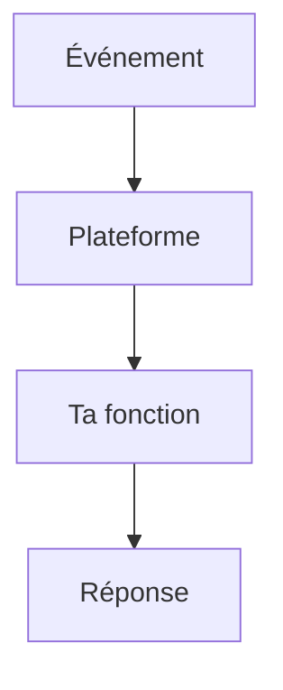
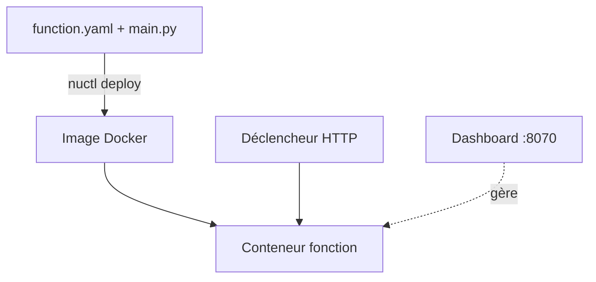

# Serverless et FaaS

> [!info] En une phrase
> Le serverless (FaaS, fonction en tant que service) consiste à écrire seulement une fonction qui réagit à un événement : la plateforme la démarre, la met à l'échelle et l'arrête pour toi. Nuclio, AWS Lambda et Cloud Functions en sont des exemples.

```dataviewjs
await dv.view("10 — Templates/Scripts/learning", { view: "concept" })
```

## 1 · Comprendre
### Définition
**Il y a bien des serveurs**, mais tu ne les gères pas : tu fournis une fonction `handler(context, event)` et une configuration.

**Déclencheurs** : une requête HTTP, un message dans une file, un minuteur, un fichier déposé.

**Mise à l'échelle** : la plateforme lance autant de copies que nécessaire, parfois zéro quand rien n'arrive.

**Démarrage à froid** : la première exécution après une pause est plus lente (il faut lancer le conteneur, charger le modèle).

**Sans état** : chaque appel doit pouvoir tourner sur une copie neuve ; ce qui doit durer va en base ou en stockage.

Nuclio, utilisé par CVAT pour l'annotation automatique, empaquette ta fonction dans une **image Docker** et la déploie.

### Pourquoi ça existe
Faire tourner un serveur complet en permanence pour un traitement appelé de temps en temps : il faut l'installer, le surveiller, le mettre à l'échelle.

### Le problème résolu
Ne déployer que la logique, payer ou consommer à l'usage, monter en charge automatiquement.

## 2 · Explorer
### Comment ça fonctionne


### Nuclio, pièce par pièce

- **Le dashboard** (port `8070`) : le chef d'orchestre. Il construit les images, lance les conteneurs, liste les fonctions. CVAT lui parle.
- **`nuctl`** : la commande pour parler au dashboard depuis le terminal (`nuctl deploy`, `nuctl get function`, `nuctl invoke`). Avec CVAT en local : `--platform local`.
- **La fonction** : un conteneur Docker à part, avec ton code et un « processeur » Nuclio qui reçoit les événements et appelle ton `handler`.
- **Le déclencheur** (*trigger*) : ce qui réveille la fonction. Pour toi, `http`, sur un port fixe (`32001`).

### `function.yaml`, ce qui compte
| Clé | Rôle |
|---|---|
| `metadata.name` | nom de la fonction (minuscules et tirets) |
| `spec.runtime` | langage et version, ex. `python:3.11` |
| `spec.handler` | `fichier:fonction`, ex. `main:handler` |
| `spec.env` | variables d'environnement (pas de mot de passe ici : `nuctl deploy --env`) |
| `spec.build.baseImage` | l'image de départ (via le Nexus au travail) |
| `spec.build.directives` | des lignes de Dockerfile en plus (`RUN pip install …`) |
| `spec.triggers` | les déclencheurs : `kind: http`, `numWorkers`, `attributes.port` |
| `spec.eventTimeout` | temps maximum pour un appel |

### `init_context`, `handler`, `context`, `event`
- `init_context(context)` : appelée **une fois** par copie (*worker*) au démarrage. Pour ce qui est lent à préparer.
- `handler(context, event)` : appelée **à chaque** événement.
- `event.method`, `event.path`, `event.headers` : la requête HTTP.
- `event.body` : un **dict** seulement si le `Content-Type` est exactement `application/json`, sinon des **octets** (`bytes`).
- `event.fields` : les paramètres de l'URL (`?job_id=3`), pas le corps.
- `context.logger.info(…)` : écrire dans les logs (`docker logs` du conteneur de la fonction).
- `context.Response(body=…, headers=…, content_type=…, status_code=…)` : la réponse, avec ses en-têtes (dont ceux de [[CORS]]).
- `context.user_data` : un endroit pour garder un objet préparé dans `init_context`.

> [!warning] Sans état, pour de vrai
> Avec `numWorkers: 2`, il y a **deux** copies de ton code, chacune avec son `init_context` et son `user_data`. Un compteur gardé dans `user_data` ne compte pas tous les appels, et un fichier écrit à un appel n'est pas garanti au suivant. D'où un **dossier temporaire par appel**.

### Deux façons d'appeler une fonction depuis CVAT
| | Par CVAT (« Models », annotation auto) | En direct (ton bouton) |
|---|---|---|
| Qui appelle | le serveur CVAT, via le dashboard Nuclio | le navigateur, sur le port de la fonction |
| Condition | `metadata.annotations.type` connu de CVAT (`detector`, `interactor`, `tracker`…) | un port fixe dans le déclencheur |
| [[CORS]] | non (serveur à serveur) | **oui** (autre origine) |
| Qui vérifie l'utilisateur | CVAT | personne, sauf si ta fonction le fait |

Ta fonction `convert-png` est du second type (`type: external`) : CVAT l'ignore dans « Models », et c'est à toi de gérer CORS.

### Exemple concret
```python
# main.py, le squelette
def init_context(context):
    context.logger.info("prête")                 # une fois par worker

def handler(context, event):
    if event.method == "OPTIONS":                 # preflight CORS (si Nuclio ne le gère pas)
        return context.Response(body="", headers=CORS, status_code=204)
    data = event.body                             # dict si Content-Type: application/json
    ...
    return context.Response(body=png, headers=CORS, content_type="image/png", status_code=200)
```
```bash
nuctl deploy --project-name cvat --path . --file function.yaml --platform local \
  --env CVAT_PASSWORD="$CVAT_PASSWORD"
nuctl get function --platform local
```

### Cas d'utilisation
- Fonctions d'annotation automatique de CVAT (Nuclio)
- Ta fonction `convert-png` appelée par un bouton
- Redimensionner une image déposée, tâche planifiée, webhook

> [!warning] À ne pas confondre
> - Serverless n'est pas toujours moins cher ni plus simple : temps d'exécution limité, démarrage à froid, débogage local plus délicat, dépendance à la plateforme.
> - En local (plateforme Docker), le conteneur de la fonction **reste allumé** : pas de mise à zéro, le « démarrage à froid » n'arrive qu'après un déploiement ou un redémarrage.
> - Le `.env` de ton script local n'existe pas dans la fonction déployée : ses variables viennent de `spec.env` et `--env` ([[Charger un fichier .env (python-dotenv)]]).

## 3 · Pratiquer
- [[Exercice - Une petite fonction Nuclio]]
- [[Exercice - Concevoir la fonction d'export CVAT]] (mise en situation)

## 4 · Expliquer
> [!quote] Mon résumé, avec mes mots
> _À écrire sans regarder la fiche. Si je bloque, je ne l'ai pas encore compris._

## 5 · Relier
- **Prérequis** : [[Conteneur]] · [[Image Docker]]
- **Complémentaires** : [[Architecture événementielle]] · [[Architecture hexagonale]] · [[Variable d'environnement]] · [[CORS]] · [[Charger un fichier .env (python-dotenv)]]

## 6 · Réviser
> [!question] Me faire interroger
> Je demande à Claude de m'interroger sur cette notion pour vérifier que je l'ai comprise.

### Validation de la maîtrise
La notion est maîtrisée quand j'ai réussi **tous les exercices** qui l'utilisent (statut `reussi` dans l'exercice).

```dataviewjs
await dv.view("10 — Templates/Scripts/learning", { view: "maitrise" })
```
