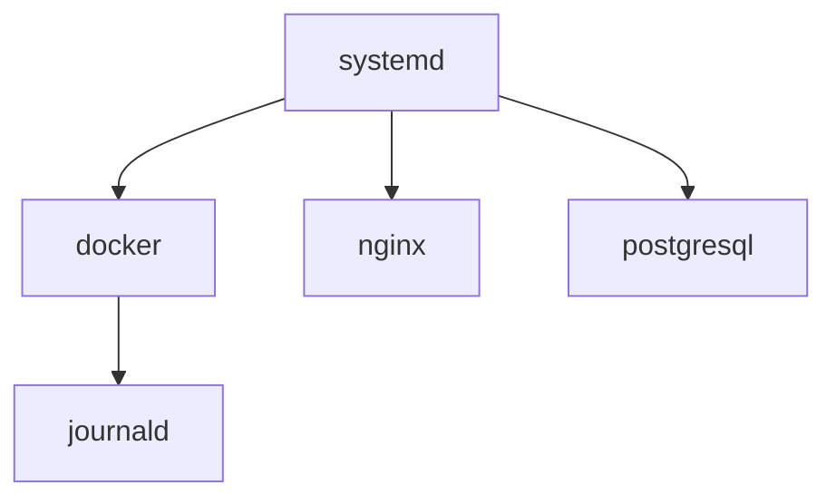

# Service (systemd)

> [!info] En une phrase
> Un programme qui tourne en permanence en arrière-plan sur un serveur (base de données, serveur web, Docker), démarré et surveillé par systemd.

```dataviewjs
await dv.view("10 — Templates/Scripts/learning", { view: "concept" })
```

## 1 · Comprendre
### Définition
**systemd** est le premier programme lancé par Linux ; il démarre et surveille les **services** (*units*). Chaque service est décrit par un fichier `.service` et piloté avec `systemctl` : démarrer, arrêter, redémarrer, activer au démarrage.

### Pourquoi ça existe
Un serveur doit relancer ses applications au démarrage et après un plantage, sans humain.

### Le problème résolu
Lancer des programmes à la main dans un terminal, qui s'arrêtent quand on se déconnecte.

## 2 · Explorer
### Comment ça fonctionne


### Exemple concret
```bash
systemctl status docker            # état, PID, dernières lignes de journal
sudo systemctl restart docker
sudo systemctl enable --now nginx  # démarrer maintenant et à chaque démarrage
systemctl list-units --type=service --state=running
```
Un service à soi : `/etc/systemd/system/zipper.service`
```ini
[Unit]
Description=Script de zip
[Service]
ExecStart=/usr/bin/python3 /opt/zipper/zipper.py /data
User=deploy
Restart=on-failure
[Install]
WantedBy=multi-user.target
```
puis `sudo systemctl daemon-reload && sudo systemctl enable --now zipper`.

### Cas d'utilisation
- Le démon Docker est un service systemd
- Faire tourner une application sans Docker sur un serveur

> [!warning] À ne pas confondre
> `start` (maintenant) et `enable` (au prochain démarrage) : il faut souvent les deux. Dans WSL, systemd doit être activé (`/etc/wsl.conf` : `[boot]` puis `systemd=true`) ; dans un **conteneur**, il n'y a pas de systemd : le conteneur lance un seul processus.

## 3 · Pratiquer

### Exercice visuel

Sur Excalidraw, **sans regarder la fiche**. Puis je compare avec la fiche, je corrige en rouge ce qui était faux, et j'explique mon dessin à voix haute ou à Claude dans le chat.

> [!example] 🛣️ Suis le trajet
> Dessine la vie d'un service : démarrage au boot, plantage, redémarrage automatique, lecture de son état avec `systemctl status`.

> [!example] 🔄 Change de contexte
> Redessine-la pour un conteneur avec `restart: unless-stopped` dans compose. Qui joue le rôle de systemd ?

### Mon schéma

> [!tip] Mon dessin Excalidraw
> _Je crée le dessin « Schéma - Service (systemd) » et je l'intègre ici avec `![[Schéma - Service (systemd).excalidraw]]`, puis je coche `schema`._

### Appliquer dans le fil rouge
- [[MesDépenses 11 - Installer l'API sur un serveur]]

## 4 · Relier
- **Prérequis** : [[Processus]] · [[Utilisateur et groupe]]
- **Complémentaires** : [[Journaux système]] · [[Démon Docker]]
- **Commandes** : [[systemctl]] · [[journalctl]]

## 5 · Réviser
> [!question] Me faire interroger
> Je demande à Claude de m'interroger sur cette notion pour vérifier que je l'ai comprise.

### Validation (compris, puis maîtrisé)
Trois cases à cocher dans les propriétés de la fiche :
- `schema` : mon dessin du concept est dans « Mon schéma » ;
- `exercice_visuel` : j'ai fait et corrigé les exercices visuels de la section 3 ;
- `fil_rouge` : je l'ai appliqué dans le fil rouge (coché tout seul quand une étape qui l'utilise est réussie).

Les trois cochées : la notion compte comme **comprise**. **Maîtrisé** : c'est moi qui le mets dans `status`, quand je le sens.

```dataviewjs
await dv.view("10 — Templates/Scripts/learning", { view: "maitrise" })
```
