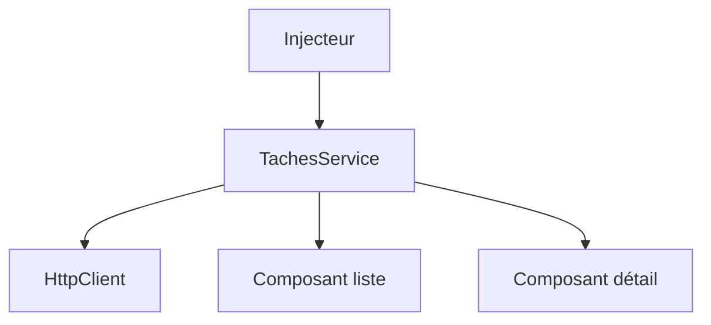

# Service et injection de dépendances

> [!info] En une phrase
> Un service Angular est une classe qui contient la logique partagée (appels d'API, état) ; l'injection de dépendances le fournit automatiquement aux composants qui le demandent.

```dataviewjs
await dv.view("10 — Templates/Scripts/learning", { view: "concept" })
```

## 1 · Comprendre
### Définition
```ts
@Injectable({ providedIn: "root" })      // une seule instance pour toute l'application
export class TachesService {
  private http = inject(HttpClient);     // le service reçoit lui-même ses dépendances
  liste() { return this.http.get<Tache[]>("/api/taches"); }
  creer(t: Partial<Tache>) { return this.http.post<Tache>("/api/taches", t); }
}

export class ListeComponent {
  private service = inject(TachesService);   // ou via le constructeur
  taches$ = this.service.liste();
}
```
**Injection de dépendances** (*DI*) : une classe ne crée pas elle-même ce dont elle a besoin, elle le **demande** ; un injecteur le lui fournit. On peut alors remplacer un service par un faux dans les tests.
Le principe dépasse Angular : NestJS, Spring (Java), ASP.NET l'utilisent aussi.

### Pourquoi ça existe
Les composants ne doivent pas contenir les appels d'API ni la logique métier, et plusieurs composants partagent les mêmes données.

### Le problème résolu
Séparer affichage et logique, partager un état, et tester facilement en injectant des faux services.

## 2 · Explorer
### Comment ça fonctionne


### Exemple concret
```ts
// app.config.ts
export const appConfig: ApplicationConfig = {
  providers: [provideRouter(routes), provideHttpClient(withInterceptors([jetonInterceptor]))],
};
// un intercepteur ajoute le jeton à chaque requête
export const jetonInterceptor: HttpInterceptorFn = (req, next) =>
  next(req.clone({ setHeaders: { Authorization: `Bearer ${inject(AuthService).jeton()}` } }));
```
```bash
ng generate service taches
```

### Cas d'utilisation
- Appels d'API
- État partagé (utilisateur connecté)
- Tests avec des services simulés

> [!warning] À ne pas confondre
> Fournir un service dans `providers` d'un composant crée une **nouvelle instance** pour ce composant : l'état n'est plus partagé. `providedIn: "root"` pour un service unique.

## 3 · Pratiquer
- Crée un service qui encapsule les appels à une API et injecte-le dans deux composants

## 4 · Expliquer
> [!quote] Mon résumé, avec mes mots
> _À écrire sans regarder la fiche. Si je bloque, je ne l'ai pas encore compris._

## 5 · Relier
- **Prérequis** : [[Composant Angular]] · [[Appeler une API avec fetch]]
- **Complémentaires** : [[Observable et RxJS]] · [[Pinia]]

## 6 · Réviser
> [!question] Me faire interroger
> Je demande à Claude de m'interroger sur cette notion pour vérifier que je l'ai comprise.

### Validation de la maîtrise
La notion est maîtrisée quand j'ai réussi **tous les exercices** qui l'utilisent (statut `reussi` dans l'exercice).

```dataviewjs
await dv.view("10 — Templates/Scripts/learning", { view: "maitrise" })
```
