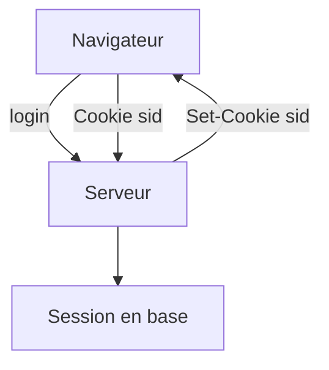

# Session et cookie

> [!info] En une phrase
> Un cookie est une petite donnée que le navigateur renvoie automatiquement au site ; une session stocke côté serveur qui est connecté, et le cookie ne contient que son identifiant.

```dataviewjs
await dv.view("10 — Templates/Scripts/learning", { view: "concept" })
```

## 1 · Comprendre
### Définition
1. Après la connexion, le serveur crée une **session** (en mémoire, en base ou dans Redis) et répond :
```
Set-Cookie: sid=8f3a…; HttpOnly; Secure; SameSite=Lax; Path=/; Max-Age=3600
```
2. Le navigateur renvoie ensuite `Cookie: sid=8f3a…` à chaque requête vers ce site.
3. Le serveur retrouve la session et donc l'utilisateur.
Attributs de sécurité :
| Attribut | Effet |
| --- | --- |
| `HttpOnly` | invisible pour JavaScript (protège contre le vol par [[XSS]]) |
| `Secure` | envoyé seulement en HTTPS |
| `SameSite=Lax/Strict` | pas envoyé par les autres sites (protège contre le [[CSRF]]) |
| `Max-Age` / `Expires` | durée de vie |

### Pourquoi ça existe
HTTP ne se souvient de rien entre deux requêtes ; il faut un moyen de rester connecté.

### Le problème résolu
Reconnaître l'utilisateur à chaque requête sans lui redemander son mot de passe, et pouvoir le déconnecter côté serveur à tout moment.

## 2 · Explorer
### Comment ça fonctionne


### Exemple concret
```js
import session from "express-session";
app.use(session({ secret: process.env.SESSION_SECRET, resave: false, saveUninitialized: false,
  cookie: { httpOnly: true, secure: true, sameSite: "lax", maxAge: 3600_000 } }));
app.post("/login", async (req, res) => {
  const u = await verifier(req.body.email, req.body.motDePasse);
  if (!u) return res.status(401).json({ erreur: "Identifiants invalides" });
  req.session.userId = u.id;
  res.sendStatus(204);
});
app.post("/logout", (req, res) => req.session.destroy(() => res.sendStatus(204)));
```
Dans les outils du navigateur : onglet *Application* (ou *Stockage*), rubrique *Cookies*.

### Cas d'utilisation
- Applications web classiques (CVAT dans le navigateur)
- Garder un panier
- Déconnecter un utilisateur à distance

> [!warning] À ne pas confondre
> **Session** (état côté serveur, révocable) et **[[JWT]]** (état dans le jeton, difficile à révoquer avant expiration). Et `localStorage` n'est pas un cookie : il n'est pas envoyé automatiquement et JavaScript peut le lire.

## 3 · Pratiquer
- Connecte-toi à un site et retrouve son cookie de session et ses attributs dans les outils du navigateur

## 4 · Expliquer
> [!quote] Mon résumé, avec mes mots
> _À écrire sans regarder la fiche. Si je bloque, je ne l'ai pas encore compris._

## 5 · Relier
- **Prérequis** : [[Authentification]] · [[En-tête HTTP]]
- **Complémentaires** : [[JWT]] · [[CSRF]]

## 6 · Réviser
> [!question] Me faire interroger
> Je demande à Claude de m'interroger sur cette notion pour vérifier que je l'ai comprise.

### Validation de la maîtrise
La notion est maîtrisée quand j'ai réussi **tous les exercices** qui l'utilisent (statut `reussi` dans l'exercice).

```dataviewjs
await dv.view("10 — Templates/Scripts/learning", { view: "maitrise" })
```
