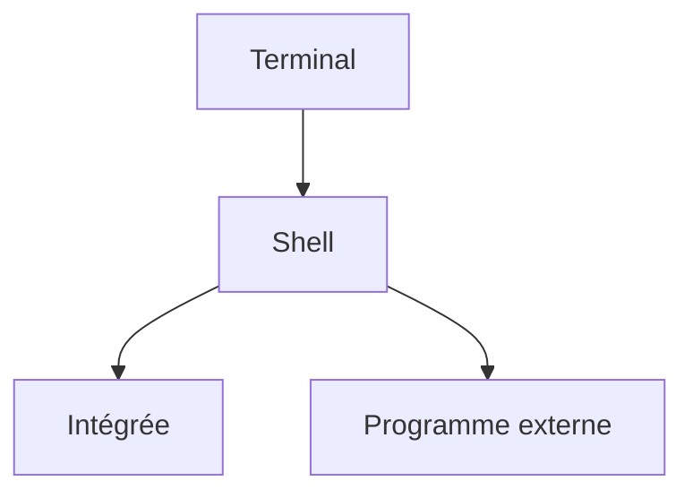

# Shell

> [!info] En une phrase
> Le programme qui lit ce que tu tapes dans le terminal, le comprend et lance les commandes. PowerShell, Bash et cmd sont trois shells différents.

```dataviewjs
await dv.view("10 — Templates/Scripts/learning", { view: "concept" })
```

## 1 · Comprendre
### Définition
Le **terminal** est la fenêtre ; le **shell** est le programme qui tourne dedans. Chaque shell a **sa propre langue** : ses commandes intégrées, sa façon d'écrire les variables, les chemins, les guillemets.

| Shell | Système | Reconnaissable à |
| --- | --- | --- |
| **PowerShell** | Windows (et ailleurs) | invite `PS C:\Users\oumar>` |
| **cmd** | Windows, ancien | invite `C:\Users\oumar>` |
| **Bash** | Linux, WSL, Git Bash, conteneurs | invite `oumar@pc:~$` |
| **Zsh** | macOS | invite `%` |

### Pourquoi ça existe
Donner un langage pour piloter le système : lancer des programmes, les enchaîner, automatiser.

### Le problème résolu
Sans shell, il faudrait un programme graphique pour chaque action.

## 2 · Explorer
### Comment ça fonctionne

- **Commande intégrée** : comprise par le shell lui-même (`cd`, `echo`).
- **Programme externe** : un fichier exécutable trouvé grâce au `PATH` (`git`, `python`, `docker`). Ceux-là marchent **dans tous les shells** ; seule la syntaxe autour change.

### Exemple concret
La même idée dans trois shells :
```powershell
$env:NOM = "Oumar"; echo $env:NOM      # PowerShell
```
```bat
set NOM=Oumar & echo %NOM%             :: cmd
```
```bash
export NOM="Oumar"; echo $NOM          # Bash
```
Windows Terminal peut ouvrir des onglets PowerShell, cmd et Ubuntu (WSL) côte à côte : la flèche ⌄ à côté de l'onglet.

### Cas d'utilisation
- Savoir **dans quel shell tu es** avant de copier une commande d'un tutoriel
- Les jobs GitLab CI et les `RUN` de Dockerfile utilisent un shell Linux (`sh` ou `bash`)

> [!warning] À ne pas confondre
> Une commande trouvée sur Internet est écrite pour **un** shell. Une commande Bash collée dans PowerShell peut échouer… ou pire, faire autre chose. Regarde l'invite avant de coller.

## 3 · Pratiquer
- Ouvre Windows Terminal et lance un onglet de chaque shell disponible ; note à quoi ressemble l'invite de chacun.
- Dans chaque shell, trouve comment afficher le dossier courant.

## 4 · Expliquer
> [!quote] Mon résumé, avec mes mots
> Le shell comprend les commandes si j'utilise son langage, et il les exécute. Une même commande peut être différente selon le shell : dans PowerShell `ls` est un alias de `Get-ChildItem`, alors que dans Bash c'est un vrai programme Linux. `git`, lui, est un programme à part que le shell trouve grâce au PATH, donc il marche pareil dans les deux.

## 5 · Relier
- **Prérequis** : [[Terminal]]
- **Les shells** : [[PowerShell]] · [[Bash]]
- **Complémentaires** : [[Variable d'environnement]] · [[Système d'exploitation et noyau]]

## 6 · Réviser
> [!question] Me faire interroger
> Je demande à Claude de m'interroger sur cette notion pour vérifier que je l'ai comprise.

### Validation de la maîtrise
La notion est maîtrisée quand j'ai réussi **tous les exercices** qui l'utilisent (statut `reussi` dans l'exercice).

```dataviewjs
await dv.view("10 — Templates/Scripts/learning", { view: "maitrise" })
```
