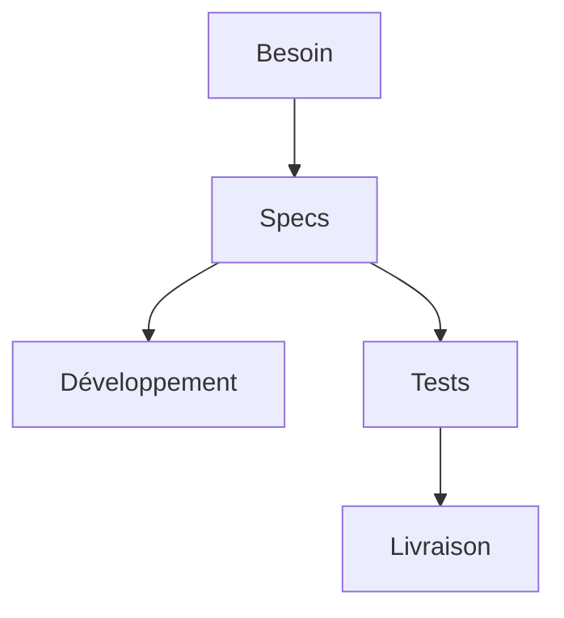

# Spécification (specs)

> [!info] En une phrase
> Une spécification (les « specs ») est un **document qui décrit précisément ce qu'on doit construire** : ce que le logiciel doit faire, dans quelles conditions, et comment on saura qu'il est réussi. C'est l'accord écrit entre ceux qui demandent et ceux qui construisent.

```dataviewjs
await dv.view("10 — Templates/Scripts/learning", { view: "concept" })
```

## 1 · Comprendre
### Définition
**Deux grandes familles** :
- **specs fonctionnelles** : le **quoi**, vu par l'utilisateur (« quand je clique sur Export PNG, je reçois une image de mes annotations ») ;
- **specs techniques** : le **comment**, vu par les développeurs (architecture, API, formats, choix de technologies). Voir [[Spécification technique]].

**Ce qu'on y trouve en général** : le contexte et l'objectif, le périmètre (ce qui est dedans et **hors** périmètre), les [[Exigences fonctionnelles et non fonctionnelles|exigences]], les cas d'usage ou [[User story|user stories]], les [[Critères d'acceptation|critères d'acceptation]], les contraintes, les questions encore ouvertes.

**Formes possibles** : un gros document ([[Cahier des charges]]), une page de wiki, une liste de user stories dans un ticket, un fichier OpenAPI pour une API. La forme compte moins que la précision.

« Lire les specs » = lire ce document avant de coder. « C'est dans les specs » = c'était convenu.

### Pourquoi ça existe
Sans écrit, chacun garde en tête sa propre version de la demande. On découvre les différences à la livraison.

### Le problème résolu
Éviter les malentendus, permettre d'estimer le travail, servir de référence pour tester et pour dire « c'est terminé ».

## 2 · Explorer
### Comment ça fonctionne


### Exemple concret
```markdown
# Specs - Export PNG des annotations
## Contexte
Les annotateurs doivent partager leurs annotations sous forme d'image.
## Objectif
Exporter en un clic une tâche CVAT en PNG avec les tracés.
## Périmètre
Dedans : une tâche à la fois, format PNG. Hors périmètre : PDF, export groupé.
## Exigences
- F1 : un bouton « Export PNG » sur la page d'une tâche
- NF1 : l'image est prête en moins de 10 s pour 50 images
## Critères d'acceptation
Étant donné une tâche annotée, quand je clique sur Export PNG, alors un PNG se télécharge.
## Questions ouvertes
- Un PNG par image ou une seule planche ?
```

### Cas d'utilisation
- Avant de coder le bouton d'export CVAT, se mettre d'accord avec son responsable
- Décrire une API avant de l'implémenter (OpenAPI)
- Répondre à un appel d'offres

> [!warning] À ne pas confondre
> Une spec n'est pas gravée dans le marbre : elle évolue, mais **chaque changement est écrit et partagé**. Et elle ne remplace pas la discussion : elle la résume.

## 3 · Pratiquer
- Écris le contexte, l'objectif et le périmètre (dedans et hors périmètre) de ton projet CVAT en 10 lignes maximum

## 4 · Expliquer
> [!quote] Mon résumé, avec mes mots
> _À écrire sans regarder la fiche. Si je bloque, je ne l'ai pas encore compris._

## 5 · Relier
- **Complémentaires** : [[Exigences fonctionnelles et non fonctionnelles]] · [[Cahier des charges]] · [[Spécification technique]] · [[User story]] · [[Critères d'acceptation]]

## 6 · Réviser
> [!question] Me faire interroger
> Je demande à Claude de m'interroger sur cette notion pour vérifier que je l'ai comprise.

### Validation de la maîtrise
La notion est maîtrisée quand j'ai réussi **tous les exercices** qui l'utilisent (statut `reussi` dans l'exercice).

```dataviewjs
await dv.view("10 — Templates/Scripts/learning", { view: "maitrise" })
```
