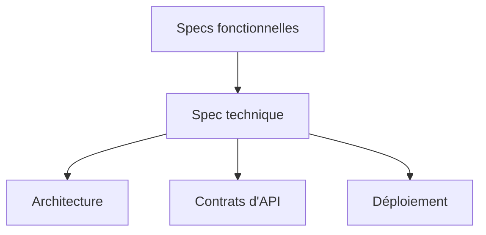

# Spécification technique

> [!info] En une phrase
> La spécification technique (ou *design doc*, document de conception) décrit **comment** l'équipe va construire la solution : les composants, leurs échanges, les formats de données, les choix techniques et leurs raisons. Elle est écrite par les développeurs, pour les développeurs.

```dataviewjs
await dv.view("10 — Templates/Scripts/learning", { view: "concept" })
```

## 1 · Comprendre
### Définition
**Elle part des specs fonctionnelles** et répond : avec quelles briques, quelles API, quelles données, quel déploiement ?

**Contenu habituel** :
- schéma d'architecture (qui parle à qui) ;
- description des composants et de leurs responsabilités ;
- contrats d'échange : routes d'API, formats JSON, exemples de requêtes et de réponses (souvent en [[OpenAPI]]) ;
- modèle de données ;
- déploiement, configuration, sécurité ;
- **alternatives envisagées** et pourquoi on ne les a pas choisies ;
- risques et points ouverts.

**Un POC sert souvent à la nourrir** : on ne sait pas encore si une approche marche, on la teste, puis on écrit la spec technique avec ce qu'on a appris.

### Pourquoi ça existe
Écrire la conception avant de coder permet de faire relire les choix par l'équipe quand ils coûtent encore peu à changer.

### Le problème résolu
Éviter de découvrir en revue de code que l'architecture ne convient pas, et garder une trace des raisons des choix.

## 2 · Explorer
### Comment ça fonctionne


### Exemple concret
```markdown
# Spec technique - Export PNG
## Architecture
Front React (bouton) -> fonction Nuclio export-png -> API CVAT
## Contrat de la fonction
POST /export-png   corps : {"tache_id": 42}
200 -> image/png     404 -> {"erreur": "tâche introuvable"}
## Composants
- SourceCvat : lit les annotations via l'API (jeton de service)
- Dessinateur : transforme les annotations en PNG (Pillow)
## Déploiement
Image construite par la CI GitLab, images de base tirées du Nexus.
## Alternatives écartées
Export côté navigateur : trop lent pour 50 images.
## Risques
Limite de temps d'exécution de Nuclio sur les grosses tâches.
```

### Cas d'utilisation
- Concevoir la fonction Nuclio d'export avant de l'écrire
- Faire valider une architecture par un développeur plus expérimenté

> [!warning] À ne pas confondre
> Une spec technique n'est pas une documentation écrite après coup : elle sert à **décider avant**. Et elle ne doit pas recopier le code ligne par ligne, seulement ce qui structure la solution.

## 3 · Pratiquer
- Dessine en 4 boîtes maximum l'architecture de ton export CVAT et écris le contrat (entrée, sortie, erreurs) de ta fonction Nuclio

## 4 · Expliquer
> [!quote] Mon résumé, avec mes mots
> _À écrire sans regarder la fiche. Si je bloque, je ne l'ai pas encore compris._

## 5 · Relier
- **Prérequis** : [[Spécification (specs)]] · [[Exigences fonctionnelles et non fonctionnelles]]
- **Complémentaires** : [[Décision d'architecture (ADR)]] · [[OpenAPI]] · [[Architecture en couches]] · [[Serverless et FaaS]]

## 6 · Réviser
> [!question] Me faire interroger
> Je demande à Claude de m'interroger sur cette notion pour vérifier que je l'ai comprise.

### Validation de la maîtrise
La notion est maîtrisée quand j'ai réussi **tous les exercices** qui l'utilisent (statut `reussi` dans l'exercice).

```dataviewjs
await dv.view("10 — Templates/Scripts/learning", { view: "maitrise" })
```
