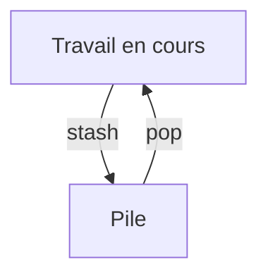

# Stash

> [!info] En une phrase
> Mettre de côté des modifications en cours, sans les committer, pour avoir une copie de travail propre, puis les ressortir plus tard.

```dataviewjs
await dv.view("10 — Templates/Scripts/learning", { view: "concept" })
```

## 1 · Comprendre
### Définition
`git stash` range tes modifications non commitées dans une pile et remet tes fichiers comme au dernier commit. `git stash pop` les réapplique.

### Pourquoi ça existe
Changer vite de branche (corriger une urgence) sans committer un travail à moitié fini.

### Le problème résolu
Des commits « wip » qui polluent l'historique, ou un `switch` refusé à cause de fichiers modifiés.

## 2 · Explorer
### Comment ça fonctionne


### Exemple concret
```bash
git stash push -m "dry-run en cours"   # mettre de côté
git switch main && git pull            # faire autre chose
git switch feat/dry-run
git stash list                         # stash@{0}: On feat/dry-run: dry-run en cours
git stash pop                          # réappliquer et retirer de la pile
git stash -u                           # inclure les fichiers non suivis
```

### Cas d'utilisation
- Une urgence sur `main` pendant un travail en cours
- Faire `git pull` alors que des fichiers sont modifiés

> [!warning] À ne pas confondre
> `stash` (temporaire, local, facile à oublier) et `commit` (durable). Un stash oublié pendant des semaines se retrouve en conflit : ne l'utilise que pour quelques heures.

## 3 · Pratiquer

### Exercice visuel

Sur Excalidraw, **sans regarder la fiche**. Puis je compare avec la fiche, je corrige en rouge ce qui était faux, et j'explique mon dessin à voix haute ou à Claude dans le chat.

> [!example] 🛣️ Suis le trajet
> Dessine ce qui arrive à ton travail en cours quand tu fais `git stash`, changes de branche pour corriger un bug, reviens et fais `git stash pop`.

> [!example] 🧠 Dessine de mémoire
> Dessine le stash comme une pile à côté de tes trois zones Git. Place ce qui entre et ce qui sort.

### Mon schéma

> [!tip] Mon dessin Excalidraw
> _Je crée le dessin « Schéma - Stash » et je l'intègre ici avec `![[Schéma - Stash.excalidraw]]`, puis je coche `schema`._

### Appliquer dans le fil rouge
- Pas encore d'étape du fil rouge pour cette notion : elle sera pratiquée dans le fil rouge de son niveau (voir [[Niveaux]]).

## 4 · Relier
- **Prérequis** : [[Index Git (staging)]] · [[Branche Git]]
- **Complémentaires** : [[Annuler dans Git]]
- **Commandes** : [[git stash]]

## 5 · Réviser
> [!question] Me faire interroger
> Je demande à Claude de m'interroger sur cette notion pour vérifier que je l'ai comprise.

### Validation de la maîtrise
Trois cases à cocher dans les propriétés de la fiche :
- `schema` : mon dessin du concept est dans « Mon schéma » ;
- `exercice_visuel` : j'ai fait et corrigé les exercices visuels de la section 3 ;
- `fil_rouge` : je l'ai appliqué dans le fil rouge (coché tout seul quand une étape qui l'utilise est réussie).

Les trois cochées : la notion compte comme **comprise**. **Maîtrisé** : c'est moi qui le mets dans `status`, quand je le sens.

```dataviewjs
await dv.view("10 — Templates/Scripts/learning", { view: "maitrise" })
```
