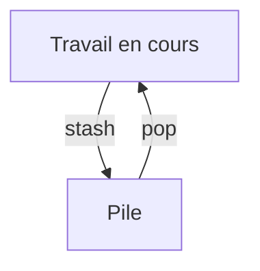

# Stash

> [!info] En une phrase
> Mettre de côté des modifications en cours, sans les committer, pour avoir une copie de travail propre, puis les ressortir plus tard.

```dataviewjs
await dv.view("10 — Templates/Scripts/learning", { view: "concept" })
```

## 1 · Comprendre
### Définition
`git stash` range tes modifications non commitées dans une pile et remet tes fichiers comme au dernier commit. `git stash pop` les réapplique.

### Pourquoi ça existe
Changer vite de branche (corriger une urgence) sans committer un travail à moitié fini.

### Le problème résolu
Des commits « wip » qui polluent l'historique, ou un `switch` refusé à cause de fichiers modifiés.

## 2 · Explorer
### Comment ça fonctionne


### Exemple concret
```bash
git stash push -m "dry-run en cours"   # mettre de côté
git switch main && git pull            # faire autre chose
git switch feat/dry-run
git stash list                         # stash@{0}: On feat/dry-run: dry-run en cours
git stash pop                          # réappliquer et retirer de la pile
git stash -u                           # inclure les fichiers non suivis
```

### Cas d'utilisation
- Une urgence sur `main` pendant un travail en cours
- Faire `git pull` alors que des fichiers sont modifiés

> [!warning] À ne pas confondre
> `stash` (temporaire, local, facile à oublier) et `commit` (durable). Un stash oublié pendant des semaines se retrouve en conflit : ne l'utilise que pour quelques heures.

## 3 · Pratiquer
- Modifie un fichier, stash, change de branche, reviens, pop ; puis essaie avec un fichier non suivi (avec et sans `-u`).

## 4 · Expliquer
> [!quote] Mon résumé, avec mes mots
> _À écrire sans regarder la fiche. Si je bloque, je ne l'ai pas encore compris._

## 5 · Relier
- **Prérequis** : [[Index Git (staging)]] · [[Branche Git]]
- **Complémentaires** : [[Annuler dans Git]]
- **Commandes** : [[git stash]]

## 6 · Réviser
> [!question] Me faire interroger
> Je demande à Claude de m'interroger sur cette notion pour vérifier que je l'ai comprise.

### Validation de la maîtrise
- [ ] Je l'explique sans notes, en 3 phrases, à quelqu'un qui ne connaît pas
- [ ] J'ai réussi un exercice qui l'utilise
- [ ] Je l'ai utilisé dans un projet
- [ ] Je sais dire quand ne pas l'utiliser (ou ce qu'il ne faut pas confondre)
