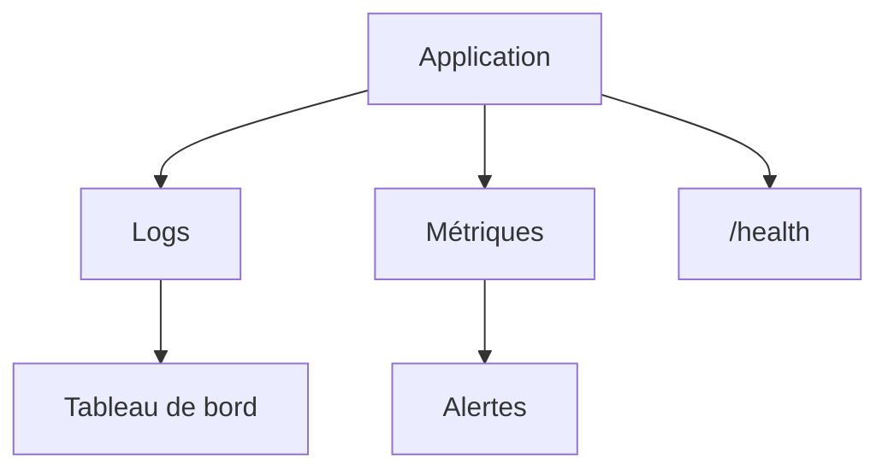

# Supervision et observabilité

> [!info] En une phrase
> La supervision surveille une application en production grâce à ses journaux, ses métriques et des contrôles de santé, et déclenche des alertes avant que les utilisateurs ne se plaignent.

```dataviewjs
await dv.view("10 — Templates/Scripts/learning", { view: "concept" })
```

## 1 · Comprendre
### Définition
Les trois piliers de l'**observabilité** :
| Pilier | Question | Exemple d'outils |
| --- | --- | --- |
| **Logs** (journaux) | que s'est-il passé ? | `docker logs`, [[Journaux système|journalctl]], Loki, ELK |
| **Métriques** | combien, à quelle vitesse ? (requêtes/s, erreurs, latence, CPU) | Prometheus, Grafana |
| **Traces** | où le temps est-il passé dans une requête qui traverse plusieurs services ? | OpenTelemetry, Jaeger |
Plus :
- **Contrôle de santé** : un endpoint `/health` (ou `HEALTHCHECK` Docker) qui dit si l'application répond.
- **Alertes** : prévenir quand le taux d'erreurs 5xx dépasse un seuil, quand le disque est plein, quand un service ne répond plus.
- **Logs structurés** (JSON, avec niveau, date, identifiant de requête) : faciles à filtrer.

### Pourquoi ça existe
En production, on ne peut pas mettre de `print` ni ouvrir un débogueur ; sans mesures, on découvre les pannes par les utilisateurs.

### Le problème résolu
Détecter, comprendre et corriger les problèmes vite, et savoir si une nouvelle version dégrade les choses.

## 2 · Explorer
### Comment ça fonctionne


### Exemple concret
```js
app.get("/health", async (req, res) => {
  try { await db.query("SELECT 1"); res.json({ statut: "ok" }); }
  catch { res.status(503).json({ statut: "base injoignable" }); }
});
console.log(JSON.stringify({ niveau: "info", msg: "export terminé", tache: 12, duree_ms: 840 }));
```
```dockerfile
HEALTHCHECK --interval=30s CMD wget -qO- http://localhost:3000/health || exit 1
```
```bash
docker compose logs -f --since 10m api
docker stats
```

### Cas d'utilisation
- Savoir si CVAT et ta fonction Nuclio tournent bien
- Comprendre une lenteur
- Être alerté d'une panne la nuit

> [!warning] À ne pas confondre
> **Logs** (des événements, en texte) et **métriques** (des nombres agrégés dans le temps) : on ne compte pas les erreurs en lisant des logs à la main. Et ne journalise jamais de mots de passe ni de jetons.

## 3 · Pratiquer
- Ajoute un `/health`, des logs JSON et un `HEALTHCHECK` à une application Docker, puis observe `docker ps` quand la base est arrêtée

## 4 · Expliquer
> [!quote] Mon résumé, avec mes mots
> _À écrire sans regarder la fiche. Si je bloque, je ne l'ai pas encore compris._

## 5 · Relier
- **Prérequis** : [[Journaliser avec logging]] · [[Docker]]
- **Complémentaires** : [[Journaux système]] · [[Code de statut HTTP]]

## 6 · Réviser
> [!question] Me faire interroger
> Je demande à Claude de m'interroger sur cette notion pour vérifier que je l'ai comprise.

### Validation de la maîtrise
La notion est maîtrisée quand j'ai réussi **tous les exercices** qui l'utilisent (statut `reussi` dans l'exercice).

```dataviewjs
await dv.view("10 — Templates/Scripts/learning", { view: "maitrise" })
```
