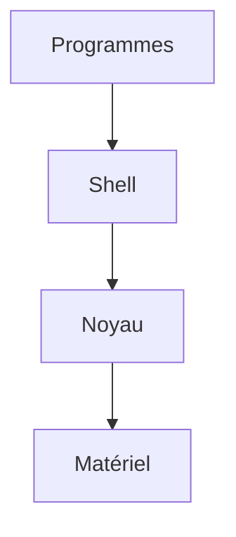

# Système d'exploitation et noyau

> [!info] En une phrase
> Le système d'exploitation fait tourner la machine ; son cœur, le noyau, est le seul à parler directement au matériel.

```dataviewjs
await dv.view("10 — Templates/Scripts/learning", { view: "concept" })
```

## 1 · Comprendre
### Définition
Le **système d'exploitation** (Windows, Linux, macOS) est le logiciel de base qui gère la machine : fichiers, mémoire, programmes, réseau. Son **noyau** (*kernel*) est la partie centrale : les programmes ne touchent jamais le matériel eux-mêmes, ils demandent au noyau.

Windows a son noyau (NT), Linux a le sien. Un programme fait pour l'un **ne tourne pas** directement sur l'autre.

### Pourquoi ça existe
Partager la machine entre des dizaines de programmes sans qu'ils se gênent, et leur offrir les mêmes services (lire un fichier, ouvrir une connexion).

### Le problème résolu
Sans lui, chaque programme devrait savoir piloter chaque disque et chaque carte réseau.

## 2 · Explorer
### Comment ça fonctionne

- Le **shell** et les commandes sont des programmes comme les autres, au-dessus du noyau.
- **Linux**, au sens strict, c'est **seulement le noyau** : le moteur. Seul, il ne sert à rien (pas de shell, pas de `ls`).
- Une **distribution** (Ubuntu, Debian, Alpine), c'est la **voiture complète** : le moteur Linux + les outils + un gestionnaire de paquets. Voir [[Distribution Linux]].
- Chaque noyau a son propre « langage » (ses **appels système**) : un programme Linux ne parle pas au noyau Windows. D'où le besoin d'un vrai noyau Linux pour les programmes Linux.

### Exemple concret
| Question | Réponse |
| --- | --- |
| Pourquoi WSL ? | les programmes Linux ont besoin d'un **noyau Linux** ; WSL 2 en ajoute un vrai dans ton PC, à côté de celui de Windows |
| Pourquoi un conteneur démarre vite ? | il ne démarre **pas de noyau** : il emprunte celui de la machine. Un appartement qui partage les fondations de l'immeuble, là où une machine virtuelle est une maison entière avec ses propres fondations ([[Docker]]) |
| Pourquoi Docker Desktop a besoin de WSL ? | l'application est un programme Windows, mais le **moteur Docker et tes conteneurs** sont des programmes Linux : ils tournent dans WSL, sur son noyau |

```bash
uname -a          # sous Linux / WSL : le noyau utilisé
cat /etc/os-release   # la distribution
```

### Cas d'utilisation
- Comprendre [[WSL]] et [[Docker]]
- Savoir pourquoi une commande Linux n'existe pas dans PowerShell

> [!warning] À ne pas confondre
> **Linux** (le noyau) et **Ubuntu** (une distribution construite autour). Et un **conteneur** (partage le noyau) avec une **machine virtuelle** (a son propre noyau).

## 3 · Pratiquer
- Dans WSL, lance `uname -a` et `cat /etc/os-release` et explique la différence entre les deux réponses.

## 4 · Expliquer
> [!quote] Mon résumé, avec mes mots
> _À écrire sans regarder la fiche. Si je bloque, je ne l'ai pas encore compris._

## 5 · Relier
- **Complémentaires** : [[Shell]] · [[Noyau (kernel)]] (le noyau expliqué en détail)
- **Utilisé par** : [[WSL]] · [[Docker]] · [[Conteneur]]

## 6 · Réviser
> [!question] Me faire interroger
> Je demande à Claude de m'interroger sur cette notion pour vérifier que je l'ai comprise.

### Validation de la maîtrise
La notion est maîtrisée quand j'ai réussi **tous les exercices** qui l'utilisent (statut `reussi` dans l'exercice).

```dataviewjs
await dv.view("10 — Templates/Scripts/learning", { view: "maitrise" })
```
