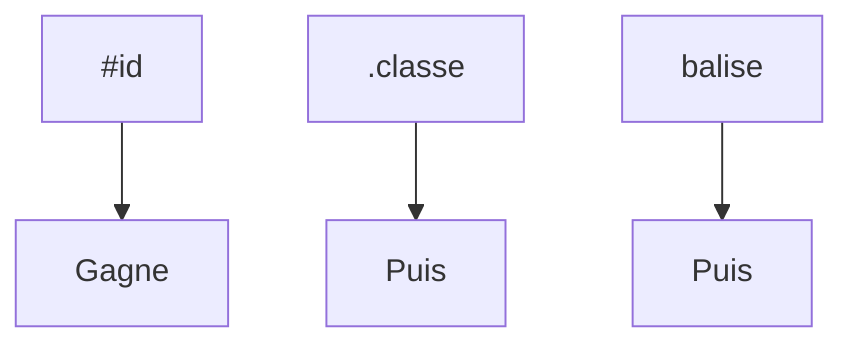

# Sélecteur CSS

> [!info] En une phrase
> La partie d'une règle CSS qui dit à quels éléments elle s'applique : par balise, classe, identifiant, position ou état.

```dataviewjs
await dv.view("10 — Templates/Scripts/learning", { view: "concept" })
```

## 1 · Comprendre
### Définition
| Sélecteur | Vise |
| --- | --- |
| `p` | toutes les balises `p` |
| `.carte` | les éléments de classe `carte` |
| `#exporter` | l'élément d'id `exporter` |
| `.carte p` | les `p` **à l'intérieur** d'une `.carte` |
| `.carte > p` | les `p` **enfants directs** |
| `a:hover` | un lien survolé (pseudo-classe) |
| `li:first-child`, `li:nth-child(2n)` | par position |
| `input[type="email"]` | par attribut |
| `.btn::before` | un pseudo-élément |

**Spécificité** : `#id` > `.classe` / `:pseudo` / `[attr]` > `balise`. À égalité, la dernière règle gagne. `!important` écrase tout (à éviter).

### Pourquoi ça existe
Appliquer un style précisément là où on le veut sans toucher au HTML.

### Le problème résolu
Mettre des attributs `style` sur chaque élément.

## 2 · Explorer
### Comment ça fonctionne


### Exemple concret
```css
.menu a { text-decoration: none; }
.menu a:hover, .menu a:focus { text-decoration: underline; }
.liste li:nth-child(odd) { background: #222; }
```
Les mêmes sélecteurs servent en JavaScript : `document.querySelectorAll(".menu a")`.

### Cas d'utilisation
- Styliser un composant sans affecter le reste
- Retrouver des éléments en JavaScript ou dans un test de bout en bout

> [!warning] À ne pas confondre
> `.a .b` (b **dans** a, avec espace) et `.a.b` (un élément qui a **les deux** classes, sans espace).

## 3 · Pratiquer
- Écris 6 sélecteurs différents sur une même page et vérifie dans F12 lesquels s'appliquent à quel élément.

## 4 · Expliquer
> [!quote] Mon résumé, avec mes mots
> _À écrire sans regarder la fiche. Si je bloque, je ne l'ai pas encore compris._

## 5 · Relier
- **Prérequis** : [[CSS]] · [[Élément et attribut HTML]]
- **Utilisé par** : [[DOM]]

## 6 · Réviser
> [!question] Me faire interroger
> Je demande à Claude de m'interroger sur cette notion pour vérifier que je l'ai comprise.

### Validation de la maîtrise
- [ ] Je l'explique sans notes, en 3 phrases, à quelqu'un qui ne connaît pas
- [ ] J'ai réussi un exercice qui l'utilise
- [ ] Je l'ai utilisé dans un projet
- [ ] Je sais dire quand ne pas l'utiliser (ou ce qu'il ne faut pas confondre)
