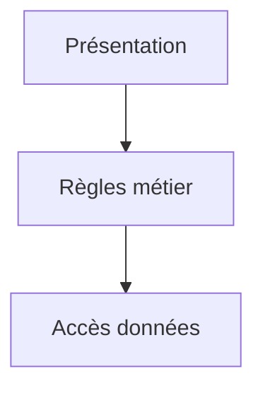

# Séparation des responsabilités

> [!info] En une phrase
> Chaque morceau de code (fonction, module, couche, service) doit avoir une seule raison d'exister et de changer : on sépare l'affichage, la logique métier et l'accès aux données.

```dataviewjs
await dv.view("10 — Templates/Scripts/learning", { view: "concept" })
```

## 1 · Comprendre
### Définition
Signes qu'une fonction fait trop : un nom avec « et » (`lireEtZipperEtEnvoyer`), plus de 40 lignes, plusieurs niveaux d'imbrication, impossible à tester sans réseau.
On découpe selon les **raisons de changer** :
- la **présentation** (HTML, ligne de commande, format JSON de l'API) ;
- les **règles métier** (quels fichiers zipper, comment nommer l'archive) ;
- l'**accès aux données et à l'extérieur** (disque, base, API CVAT).
Chaque morceau ne connaît que ce dont il a besoin.

### Pourquoi ça existe
Un code où tout est mélangé est impossible à modifier sans tout casser, et impossible à tester.

### Le problème résolu
Changer une partie (passer d'un dossier local à S3, d'une ligne de commande à une API) sans toucher au reste.

## 2 · Explorer
### Comment ça fonctionne


### Exemple concret
```python
# mélangé
def main():
    fichiers = [f for f in os.listdir(sys.argv[1]) if f.endswith(".png")]
    with zipfile.ZipFile("out.zip", "w") as z:
        for f in fichiers: z.write(os.path.join(sys.argv[1], f))
    print(f"{len(fichiers)} fichiers")

# séparé
def choisir(noms, ext):                 # métier : pur, testable
    return [n for n in noms if n.lower().endswith(ext)]
def zipper(dossier, noms, sortie):      # accès disque
    with zipfile.ZipFile(sortie, "w") as z:
        for n in noms: z.write(dossier / n, n)
def main(argv):                          # présentation
    dossier = Path(argv[1])
    noms = choisir([p.name for p in dossier.iterdir()], ".png")
    zipper(dossier, noms, Path("out.zip"))
    print(f"{len(noms)} fichiers")
```

### Cas d'utilisation
- Organiser ton script de zip
- Les couches d'une API
- Les composants et services d'un frontend

> [!warning] À ne pas confondre
> Séparer ne veut pas dire multiplier les fichiers et les abstractions : trois fonctions claires valent mieux que dix classes. On sépare quand les raisons de changer sont vraiment différentes.

## 3 · Pratiquer
- Prends un de tes scripts et découpe-le en présentation, métier et accès aux données ; écris un test pour la partie métier

## 4 · Expliquer
> [!quote] Mon résumé, avec mes mots
> _À écrire sans regarder la fiche. Si je bloque, je ne l'ai pas encore compris._

## 5 · Relier
- **Prérequis** : [[Fonction]] · [[Module et import Python]]
- **Complémentaires** : [[Architecture en couches]] · [[Principes SOLID]]
- **Utilisé par** : [[Architecture en couches]]

## 6 · Réviser
> [!question] Me faire interroger
> Je demande à Claude de m'interroger sur cette notion pour vérifier que je l'ai comprise.

### Validation de la maîtrise
La notion est maîtrisée quand j'ai réussi **tous les exercices** qui l'utilisent (statut `reussi` dans l'exercice).

```dataviewjs
await dv.view("10 — Templates/Scripts/learning", { view: "maitrise" })
```
