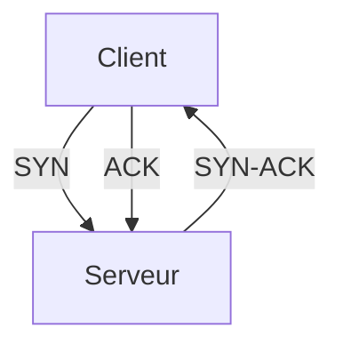

# TCP et UDP

> [!info] En une phrase
> Les deux façons de transporter des données sur le réseau : TCP garantit l'arrivée et l'ordre, UDP envoie vite sans garantie.

```dataviewjs
await dv.view("10 — Templates/Scripts/learning", { view: "concept" })
```

## 1 · Comprendre
### Définition
- **TCP** établit une **connexion** (poignée de main), numérote les données, renvoie ce qui est perdu. HTTP, HTTPS, SSH, PostgreSQL l'utilisent.
- **UDP** envoie des paquets sans connexion ni vérification. DNS, vidéo en direct, jeux l'utilisent.

Un service écoute sur un [[Port]] **et** un protocole : `443/tcp`, `53/udp`.

### Pourquoi ça existe
Certaines applications ont besoin de fiabilité, d'autres de rapidité.

### Le problème résolu
Le réseau perd et mélange des paquets : TCP rétablit un flux fiable au-dessus.

## 2 · Explorer
### Comment ça fonctionne

| Message d'erreur | Sens |
| --- | --- |
| `Connection refused` | la machine répond mais **rien n'écoute** sur ce port |
| `Connection timed out` | aucune réponse : machine éteinte, mauvaise IP ou **pare-feu** qui jette |
| `No route to host` | pas de chemin réseau |

### Exemple concret
```bash
ss -tlnp                        # ports TCP en écoute sur la machine
nc -zv gitlab.com 443           # tester une connexion TCP (paquet netcat)
```
```powershell
Test-NetConnection gitlab.com -Port 443
```

### Cas d'utilisation
- Diagnostiquer pourquoi une base ou une API ne répond pas
- Savoir quel port ouvrir dans un pare-feu

> [!warning] À ne pas confondre
> `refused` (le serveur est joignable, le service est absent) et `timeout` (quelque chose bloque ou la machine est injoignable) : ce ne sont pas les mêmes pistes.

## 3 · Pratiquer

### Exercice visuel

Sur Excalidraw, **sans regarder la fiche**. Puis je compare avec la fiche, je corrige en rouge ce qui était faux, et j'explique mon dessin à voix haute ou à Claude dans le chat.

> [!example] ⚖️ Avant / après
> Avant / après : envoyer un fichier en TCP puis en UDP. Dessine les paquets perdus et ce que fait chaque protocole.

> [!example] 🧠 Dessine de mémoire
> Dessine la poignée de main TCP en trois étapes entre ton navigateur et l'API.

### Mon schéma

> [!tip] Mon dessin Excalidraw
> _Je crée le dessin « Schéma - TCP et UDP » et je l'intègre ici avec `![[Schéma - TCP et UDP.excalidraw]]`, puis je coche `schema`._

### Appliquer dans le fil rouge
- Pas encore d'étape du fil rouge pour cette notion : elle sera pratiquée dans le fil rouge de son niveau (voir [[Niveaux]]).

## 4 · Relier
- **Prérequis** : [[Adresse IP]] · [[Port]]
- **Complémentaires** : [[Pare-feu]] · [[HTTP]]
- **Commandes** : [[ss]] · [[Test-NetConnection]]

## 5 · Réviser
> [!question] Me faire interroger
> Je demande à Claude de m'interroger sur cette notion pour vérifier que je l'ai comprise.

### Validation (compris, puis maîtrisé)
Trois cases à cocher dans les propriétés de la fiche :
- `schema` : mon dessin du concept est dans « Mon schéma » ;
- `exercice_visuel` : j'ai fait et corrigé les exercices visuels de la section 3 ;
- `fil_rouge` : je l'ai appliqué dans le fil rouge (coché tout seul quand une étape qui l'utilise est réussie).

Les trois cochées : la notion compte comme **comprise**. **Maîtrisé** : c'est moi qui le mets dans `status`, quand je le sens.

```dataviewjs
await dv.view("10 — Templates/Scripts/learning", { view: "maitrise" })
```
