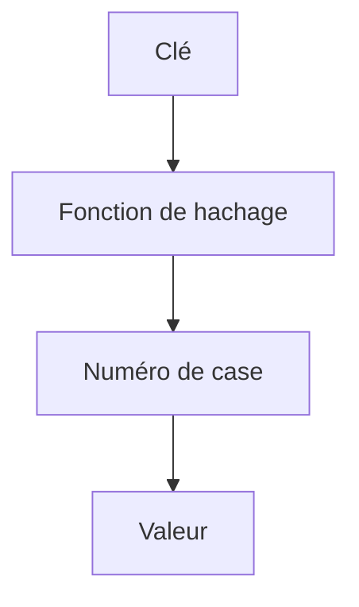

# Table de hachage

> [!info] En une phrase
> Une table de hachage associe des clés à des valeurs et retrouve une valeur à partir de sa clé en temps constant (O(1)) en moyenne ; c'est ce qu'il y a derrière dict et set en Python, Object, Map et Set en JavaScript.

```dataviewjs
await dv.view("10 — Templates/Scripts/learning", { view: "concept" })
```

## 1 · Comprendre
### Définition
Comment ça marche, en simplifiant : une **fonction de hachage** transforme la clé en un numéro de case ; la valeur est rangée dans cette case. Pour retrouver, on recalcule le numéro et on va directement à la case, sans parcourir.
- `dict` / `Map` : clé → valeur. `set` / `Set` : seulement des clés (ensemble, sans doublon).
- Recherche, ajout, suppression : **O(1)** en moyenne, contre O(n) pour chercher dans une liste.
- Les clés doivent être **non modifiables** en Python (chaîne, nombre, tuple ; pas une liste).
C'est l'outil n° 1 pour transformer un O(n²) en O(n) : « ai-je déjà vu cet élément ? », « combien de fois ? », « regrouper par… ».

### Pourquoi ça existe
Chercher dans une liste devient lent dès qu'elle est grande, et on cherche tout le temps.

### Le problème résolu
Retrouver, compter et dédoublonner instantanément, même sur des millions d'éléments.

## 2 · Explorer
### Comment ça fonctionne


### Exemple concret
```python
# compter des occurrences
from collections import Counter
labels = ["voiture", "piéton", "voiture", "vélo", "voiture"]
Counter(labels).most_common(1)          # [('voiture', 3)]

# « deux nombres dont la somme vaut cible » : O(n) au lieu de O(n²)
def deux_sommes(nombres, cible):
    vus = {}                             # valeur -> indice
    for i, n in enumerate(nombres):
        if cible - n in vus:
            return vus[cible - n], i
        vus[n] = i
    return None

# regrouper les anagrammes
groupes = {}
for mot in ["chien", "niche", "chine", "zip"]:
    groupes.setdefault("".join(sorted(mot)), []).append(mot)
# {'cehin': ['chien', 'niche', 'chine'], 'ipz': ['zip']}
```
Ne pas confondre avec le [[Hachage de mot de passe]] : même idée de fonction de hachage, mais but différent (sécurité, lent exprès).

### Cas d'utilisation
- Compter, regrouper, dédoublonner
- Cache (Redis est une grande table de hachage)
- Index par identifiant (`{t.id: t for t in taches}`)

> [!warning] À ne pas confondre
> Une table de hachage **ne garde pas d'ordre de tri** (Python garde l'ordre d'insertion, mais pas un ordre trié). Et utiliser un objet modifiable comme clé : `TypeError: unhashable type: 'list'` (utilise un tuple).

## 3 · Pratiquer

### Exercice visuel

Sur Excalidraw, **sans regarder la fiche**. Puis je compare avec la fiche, je corrige en rouge ce qui était faux, et j'explique mon dessin à voix haute ou à Claude dans le chat.

> [!example] 🧠 Dessine de mémoire
> Dessine une table de hachage : la clé « tuyau », la fonction de hachage, la case, la valeur (l'id du label).

> [!example] 🔄 Change de contexte
> Redessine-la pour un dictionnaire Python et un objet JavaScript. Pourquoi l'accès est-il aussi rapide dans les deux ?

### Mon schéma

> [!tip] Mon dessin Excalidraw
> _Je crée le dessin « Schéma - Table de hachage » et je l'intègre ici avec `![[Schéma - Table de hachage.excalidraw]]`, puis je coche `schema`._

### Appliquer dans le fil rouge
- Pas encore d'étape du fil rouge pour cette notion : elle sera pratiquée dans le fil rouge de son niveau (voir [[Niveaux]]).

## 4 · Relier
- **Prérequis** : [[Liste et dictionnaire]] · [[Complexité (notation grand O)]]
- **Complémentaires** : [[Base NoSQL]] · [[Index de base de données]]

## 5 · Réviser
> [!question] Me faire interroger
> Je demande à Claude de m'interroger sur cette notion pour vérifier que je l'ai comprise.

### Validation (compris, puis maîtrisé)
Trois cases à cocher dans les propriétés de la fiche :
- `schema` : mon dessin du concept est dans « Mon schéma » ;
- `exercice_visuel` : j'ai fait et corrigé les exercices visuels de la section 3 ;
- `fil_rouge` : je l'ai appliqué dans le fil rouge (coché tout seul quand une étape qui l'utilise est réussie).

Les trois cochées : la notion compte comme **comprise**. **Maîtrisé** : c'est moi qui le mets dans `status`, quand je le sens.

```dataviewjs
await dv.view("10 — Templates/Scripts/learning", { view: "maitrise" })
```
