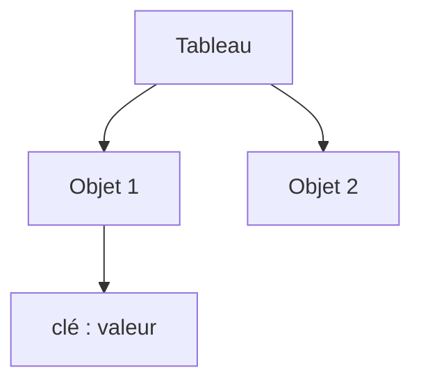

# Tableau et objet JavaScript

> [!info] En une phrase
> Le tableau range des valeurs dans l'ordre ([1, 2, 3]) ; l'objet associe des clés à des valeurs ({ nom: "a", taille: 12 }).

```dataviewjs
await dv.view("10 — Templates/Scripts/learning", { view: "concept" })
```

## 1 · Comprendre
### Définition
```js
const fichiers = ["a.txt", "b.png"];        // tableau (Array) : indices 0, 1, …
fichiers.push("c.csv");                      // ajoute à la fin
fichiers.length;                             // 3

const tache = { id: 12, nom: "Chantier", fini: false };   // objet
tache.nom;          // "Chantier"
tache["fini"];      // false
tache.labels = ["voiture"];   // ajoute une clé
```
**Déstructuration** : `const { id, nom } = tache;` et `const [premier] = fichiers;`
**Copie avec étalement** (*spread*) : `const copie = { ...tache, fini: true };` et `[...fichiers, "d.txt"]`.

### Pourquoi ça existe
Presque toutes les données manipulées sont des listes d'objets : une réponse d'API, des annotations, des tâches.

### Le problème résolu
Regrouper des informations liées sous un seul nom et les parcourir facilement.

## 2 · Explorer
### Comment ça fonctionne


### Exemple concret
```js
const annotations = [
  { label: "voiture", x: 10, y: 20 },
  { label: "piéton",  x: 50, y: 80 },
];
for (const a of annotations) {
  console.log(`${a.label} en (${a.x}, ${a.y})`);
}
const { label } = annotations[0];
```
C'est l'équivalent de la [[Liste et dictionnaire|liste et du dictionnaire]] Python, et c'est exactement la forme du [[JSON]].

### Cas d'utilisation
- Lire une réponse d'API
- L'état d'un composant React
- Les options passées à une fonction

> [!warning] À ne pas confondre
> Copier un objet avec `=` ne copie pas : `const b = a` désigne **le même** objet ; modifier `b` modifie `a`. Pour une copie, `{ ...a }` (copie superficielle) ou `structuredClone(a)`.

## 3 · Pratiquer

### Exercice visuel

Sur Excalidraw, **sans regarder la fiche**. Puis je compare avec la fiche, je corrige en rouge ce qui était faux, et j'explique mon dessin à voix haute ou à Claude dans le chat.

> [!example] 🧠 Dessine de mémoire
> Dessine une liste de dépenses : un tableau qui contient des objets. Montre l'accès `depenses[1].montant`.

> [!example] ⚖️ Avant / après
> Avant / après : un objet modifié avec `const copie = depense`, puis avec `{ ...depense }`. Dessine combien d'objets existent dans chaque cas.

### Mon schéma

> [!tip] Mon dessin Excalidraw
> _Je crée le dessin « Schéma - Tableau et objet JavaScript » et je l'intègre ici avec `![[Schéma - Tableau et objet JavaScript.excalidraw]]`, puis je coche `schema`._

### Appliquer dans le fil rouge
- Pas encore d'étape du fil rouge pour cette notion : elle sera pratiquée dans le fil rouge de son niveau (voir [[Niveaux]]).

## 4 · Relier
- **Prérequis** : [[Variables et types en JavaScript]]
- **Complémentaires** : [[JSON]] · [[Méthodes de tableau (map, filter, reduce)]]

## 5 · Réviser
> [!question] Me faire interroger
> Je demande à Claude de m'interroger sur cette notion pour vérifier que je l'ai comprise.

### Validation de la maîtrise
Trois cases à cocher dans les propriétés de la fiche :
- `schema` : mon dessin du concept est dans « Mon schéma » ;
- `exercice_visuel` : j'ai fait et corrigé les exercices visuels de la section 3 ;
- `fil_rouge` : je l'ai appliqué dans le fil rouge (coché tout seul quand une étape qui l'utilise est réussie).

Les trois cochées : la notion compte comme **comprise**. **Maîtrisé** : c'est moi qui le mets dans `status`, quand je le sens.

```dataviewjs
await dv.view("10 — Templates/Scripts/learning", { view: "maitrise" })
```
