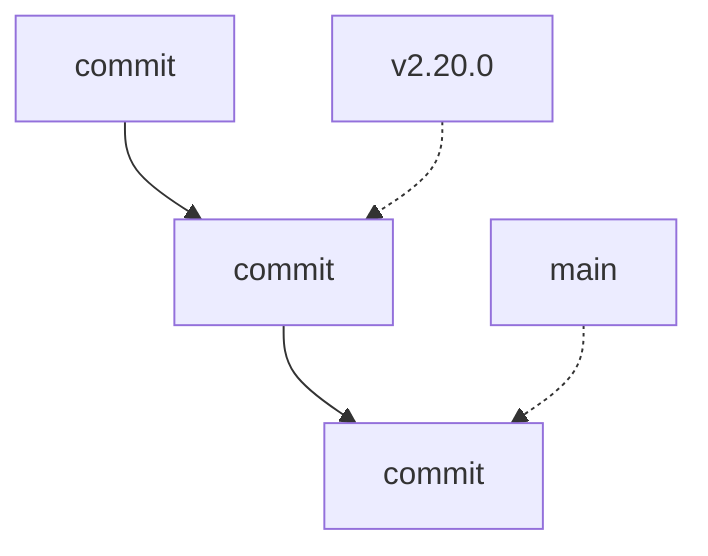

# Tag Git

> [!info] En une phrase
> Une étiquette fixe posée sur un commit précis, en général pour marquer une version (v2.20.0).

```dataviewjs
await dv.view("10 — Templates/Scripts/learning", { view: "concept" })
```

## 1 · Comprendre
### Définition
Un **tag** est un nom qui pointe **pour toujours** vers un commit. Contrairement à une branche, il ne bouge pas quand on ajoute des commits. Le tag **annoté** (`-a`) garde aussi un message, un auteur et une date : c'est celui à utiliser pour une version.

### Pourquoi ça existe
Retrouver exactement le code d'une version publiée, des mois plus tard.

### Le problème résolu
« Quel commit correspond à la version en production ? » : sans tag, il faut fouiller l'historique.

## 2 · Explorer
### Comment ça fonctionne


### Exemple concret
```bash
git tag                                  # lister
git tag -a v1.0.0 -m "Première version"  # créer sur le commit actuel
git push origin v1.0.0                   # les tags ne partent pas avec un simple git push
git switch --detach v2.20.0              # se placer sur une version
git describe --tags                      # le tag le plus proche du commit actuel
```

### Cas d'utilisation
- Partir de la **version de CVAT que tu utilises** (son tag), pas de `develop`
- Déclencher une pipeline de publication sur un tag (`$CI_COMMIT_TAG`)
- Tagger l'image Docker avec la même version

> [!warning] À ne pas confondre
> **Tag** (fixe) et **branche** (avance à chaque commit). Et le tag Git (`v2.20.0`) avec le tag d'image Docker (`:v2.20.0`) : même idée, deux systèmes différents.

## 3 · Pratiquer
- Liste les tags de CVAT et trouve celui de la version que ton équipe utilise.
- Compare deux versions : `git diff v2.19.0 v2.20.0 --stat`.

## 4 · Expliquer
> [!quote] Mon résumé, avec mes mots
> _À écrire sans regarder la fiche. Si je bloque, je ne l'ai pas encore compris._

## 5 · Relier
- **Prérequis** : [[Commit]] · [[Branche Git]]
- **Complémentaires** : [[Changelog]] · [[Convention de commit]]
- **Commandes** : [[git tag]] · [[git diff]]

## 6 · Réviser
> [!question] Me faire interroger
> Je demande à Claude de m'interroger sur cette notion pour vérifier que je l'ai comprise.

### Validation de la maîtrise
La notion est maîtrisée quand j'ai réussi **tous les exercices** qui l'utilisent (statut `reussi` dans l'exercice).

```dataviewjs
await dv.view("10 — Templates/Scripts/learning", { view: "maitrise" })
```
