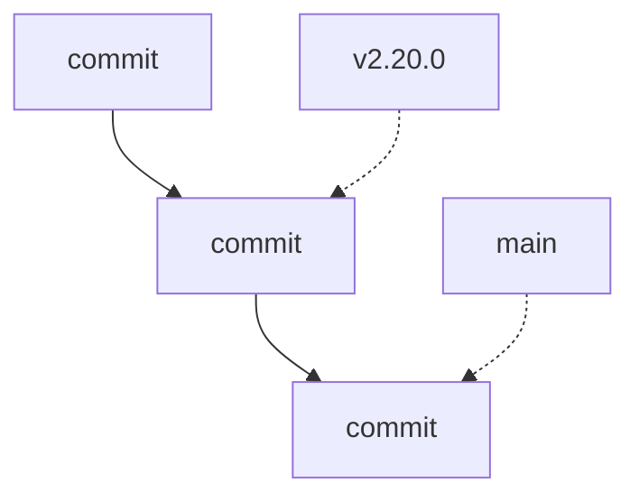

# Tag Git

> [!info] En une phrase
> Une étiquette fixe posée sur un commit précis, en général pour marquer une version (v2.20.0).

```dataviewjs
await dv.view("10 — Templates/Scripts/learning", { view: "concept" })
```

## 1 · Comprendre
### Définition
Un **tag** est un nom qui pointe **pour toujours** vers un commit. Contrairement à une branche, il ne bouge pas quand on ajoute des commits. Le tag **annoté** (`-a`) garde aussi un message, un auteur et une date : c'est celui à utiliser pour une version.

### Pourquoi ça existe
Retrouver exactement le code d'une version publiée, des mois plus tard.

### Le problème résolu
« Quel commit correspond à la version en production ? » : sans tag, il faut fouiller l'historique.

## 2 · Explorer
### Comment ça fonctionne


### Exemple concret
```bash
git tag                                  # lister
git tag -a v1.0.0 -m "Première version"  # créer sur le commit actuel
git push origin v1.0.0                   # les tags ne partent pas avec un simple git push
git switch --detach v2.20.0              # se placer sur une version
git describe --tags                      # le tag le plus proche du commit actuel
```

### Cas d'utilisation
- Partir de la **version de CVAT que tu utilises** (son tag), pas de `develop`
- Déclencher une pipeline de publication sur un tag (`$CI_COMMIT_TAG`)
- Tagger l'image Docker avec la même version

> [!warning] À ne pas confondre
> **Tag** (fixe) et **branche** (avance à chaque commit). Et le tag Git (`v2.20.0`) avec le tag d'image Docker (`:v2.20.0`) : même idée, deux systèmes différents.

## 3 · Pratiquer

### Exercice visuel

Sur Excalidraw, **sans regarder la fiche**. Puis je compare avec la fiche, je corrige en rouge ce qui était faux, et j'explique mon dessin à voix haute ou à Claude dans le chat.

> [!example] 🧠 Dessine de mémoire
> Dessine un historique de commits avec un tag `v1.0.0` et une branche `main`. Montre ce qui bouge quand on ajoute un commit.

> [!example] 🔄 Change de contexte
> Redessine-le dans la CI : un tag poussé déclenche la construction d'une image `mes-depenses-api:v1.0.0`. Relie le tag à l'image.

### Mon schéma

> [!tip] Mon dessin Excalidraw
> _Je crée le dessin « Schéma - Tag Git » et je l'intègre ici avec `![[Schéma - Tag Git.excalidraw]]`, puis je coche `schema`._

### Appliquer dans le fil rouge
- [[Fil rouge 04 - Ranger le projet dans Git]]

## 4 · Relier
- **Prérequis** : [[Commit]] · [[Branche Git]]
- **Complémentaires** : [[Changelog]] · [[Convention de commit]]
- **Commandes** : [[git tag]] · [[git diff]]

## 5 · Réviser
> [!question] Me faire interroger
> Je demande à Claude de m'interroger sur cette notion pour vérifier que je l'ai comprise.

### Validation de la maîtrise
Trois cases à cocher dans les propriétés de la fiche :
- `schema` : mon dessin du concept est dans « Mon schéma » ;
- `exercice_visuel` : j'ai fait et corrigé les exercices visuels de la section 3 ;
- `fil_rouge` : je l'ai appliqué dans le fil rouge (coché tout seul quand une étape qui l'utilise est réussie).

Les trois cochées : la notion compte comme **comprise**. **Maîtrisé** : c'est moi qui le mets dans `status`, quand je le sens.

```dataviewjs
await dv.view("10 — Templates/Scripts/learning", { view: "maitrise" })
```
