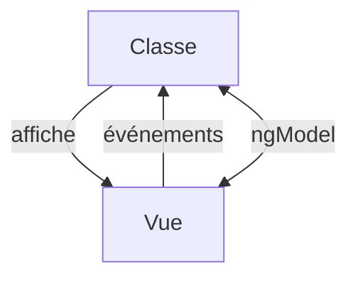

# Template et liaison de données Angular

> [!info] En une phrase
> Le template Angular relie la classe et le HTML : {{ }} affiche, [propriété] lie une valeur, (événement) écoute, [(ngModel)] lie dans les deux sens, et @if / @for contrôlent l'affichage.

```dataviewjs
await dv.view("10 — Templates/Scripts/learning", { view: "concept" })
```

## 1 · Comprendre
### Définition
| Syntaxe | Sens | Exemple |
| --- | --- | --- |
| `{{ expr }}` | interpolation (échappée) | `{{ tache.nom }}` |
| `[prop]="expr"` | liaison de propriété (classe → vue) | `[disabled]="!valide"` |
| `(evt)="code"` | liaison d'événement (vue → classe) | `(click)="sauver()"` |
| `[(ngModel)]="champ"` | double liaison (formulaires) | `<input [(ngModel)]="texte">` |
| `@if (cond) { } @else { }` | condition | |
| `@for (t of taches; track t.id) { } @empty { }` | boucle | |
| `expr \| pipe` | transformation d'affichage | `{{ date \| date:'dd/MM/yyyy' }}` |
Anciennes directives que tu verras partout : `*ngIf`, `*ngFor`.
Pour les formulaires sérieux : les **formulaires réactifs** (`FormGroup`, `FormControl`, `Validators`).

### Pourquoi ça existe
Le template doit afficher les données de la classe et lui renvoyer les actions de l'utilisateur.

### Le problème résolu
Une liaison déclarative : on ne touche jamais au DOM directement.

## 2 · Explorer
### Comment ça fonctionne


### Exemple concret
```html
<form (ngSubmit)="ajouter()">
  <input [(ngModel)]="texte" name="texte" required />
  <button [disabled]="!texte">Ajouter</button>
</form>
@for (t of taches(); track t.id) {
  <li [class.fini]="t.fini" (click)="basculer(t.id)">{{ t.nom | uppercase }}</li>
} @empty {
  <p>Aucune tâche</p>
}
```
`[(ngModel)]` demande d'importer `FormsModule` dans le composant.

### Cas d'utilisation
- Tout écran Angular
- Formulaires
- Mise en forme de dates et de nombres avec les pipes

> [!warning] À ne pas confondre
> `[valeur]="x"` (la variable x) et `valeur="x"` (le texte « x »). Et `[innerHTML]` peut être dangereux ([[XSS]]), même si Angular nettoie une partie du contenu.

## 3 · Pratiquer
- Écris un template avec chacune des syntaxes du tableau

## 4 · Expliquer
> [!quote] Mon résumé, avec mes mots
> _À écrire sans regarder la fiche. Si je bloque, je ne l'ai pas encore compris._

## 5 · Relier
- **Prérequis** : [[Composant Angular]] · [[Formulaire HTML]]
- **Complémentaires** : [[Directives Vue]]

## 6 · Réviser
> [!question] Me faire interroger
> Je demande à Claude de m'interroger sur cette notion pour vérifier que je l'ai comprise.

### Validation de la maîtrise
La notion est maîtrisée quand j'ai réussi **tous les exercices** qui l'utilisent (statut `reussi` dans l'exercice).

```dataviewjs
await dv.view("10 — Templates/Scripts/learning", { view: "maitrise" })
```
