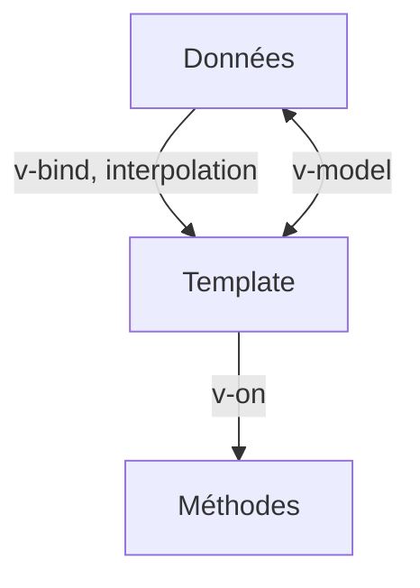

# Template et liaison de données

> [!info] En une phrase
> Le template est le HTML d'un composant, enrichi de liaisons : afficher une valeur, répéter, afficher sous condition, lier un champ, écouter un événement ; Vue et Angular ont chacun leur écriture pour les mêmes idées.

```dataviewjs
await dv.view("10 — Templates/Scripts/learning", { view: "concept" })
```

## 1 · Comprendre
### Définition
| Directive | Raccourci | Rôle |
| --- | --- | --- |
| `v-if` / `v-else-if` / `v-else` | | afficher ou non (l'élément est créé ou retiré) |
| `v-show` | | cacher en CSS (l'élément reste) |
| `v-for="t in taches" :key="t.id"` | | répéter |
| `v-bind:href="url"` | `:href` | lier un attribut à une valeur |
| `v-on:click="f"` | `@click` | écouter un événement (`@submit.prevent` fait `preventDefault`) |
| `v-model="texte"` | | liaison dans les deux sens avec un champ de formulaire |
| `v-html` | | insérer du HTML (danger [[XSS]]) |
`{{ expression }}` affiche une valeur en l'**échappant** (sans risque).

### Pourquoi ça existe
Un template doit pouvoir exprimer des conditions, des boucles et des liaisons sans devenir du JavaScript.

### Le problème résolu
Écrire des interfaces dynamiques en restant proche du HTML.

## 2 · Explorer
### Comment ça fonctionne


### Exemple concret
```vue
<template>
  <form @submit.prevent="ajouter">
    <input v-model.trim="texte" placeholder="Nouvelle tâche" />
    <button :disabled="!texte">Ajouter</button>
  </form>
  <p v-if="taches.length === 0">Aucune tâche</p>
  <ul v-else>
    <li v-for="t in taches" :key="t.id" :class="{ fini: t.fini }" @click="t.fini = !t.fini">
      {{ t.nom }}
    </li>
  </ul>
</template>
```

> [!abstract]- Comment ça s'écrit (référence à chercher, pas à apprendre par cœur)
> L'idée est la même partout ; seule l'écriture change.
>
> **Vue**
> ```html
> <p>{{ total }}</p>
> <li v-for="d in depenses" :key="d.id">{{ d.libelle }}</li>
> <p v-if="!depenses.length">Aucune dépense</p>
> <input v-model="montant">
> <button @click="ajouter">Ajouter</button>
> 
> ```
>
> **Angular**
> ```html
> <p>{{ total }}</p>
> @for (d of depenses; track d.id) { <li>{{ d.libelle }}</li> }
> @if (!depenses.length) { <p>Aucune dépense</p> }
> <input [(ngModel)]="montant">
> <button (click)="ajouter()">Ajouter</button>
> 
> ```
> Même idée, autre écriture : afficher `{{ }}`, lier une propriété `:x` / `[x]`, écouter `@click` / `(click)`, lier dans les deux sens `v-model` / `[(ngModel)]`.

### Cas d'utilisation
- Formulaires
- Listes
- Affichage conditionnel

> [!warning] À ne pas confondre
> `v-if` (retire l'élément du DOM) et `v-show` (le garde, masqué) : `v-show` pour un affichage qui bascule souvent. Et ne mets pas `v-if` et `v-for` sur le même élément : filtre avec un `computed`.

## 3 · Pratiquer

### Exercice visuel

Sur Excalidraw, **sans regarder la fiche**. Puis je compare avec la fiche, je corrige en rouge ce qui était faux, et j'explique mon dessin à voix haute ou à Claude dans le chat.

> [!example] 🧠 Dessine de mémoire
> Dessine un template Vue de la liste des dépenses et étiquette chaque directive (`v-for`, `v-if`, `v-model`, `v-on`, `v-bind`) avec ce qu'elle fait.

> [!example] 🔍 Trouve l'erreur
> Ce schéma est faux. Corrige-le en rouge et explique l'erreur.
>
> ```mermaid
> flowchart TD
>   I[input montant] --> B[v-bind]
>   B --> D[Donnée mise à jour]
> ```

### Mon schéma

> [!tip] Mon dessin Excalidraw
> _Je crée le dessin « Schéma - Template et liaison de données » et je l'intègre ici avec `![[Schéma - Template et liaison de données.excalidraw]]`, puis je coche `schema`._

### Appliquer dans le fil rouge
- [[MesDépenses 03 - Vue, afficher la liste]]
- [[MesDépenses 05 - Vue, ajouter et supprimer]]
- [[MesDépenses 11 - Angular, ajouter et supprimer]]

## 4 · Relier
- **Prérequis** : [[Composant d'interface]] · [[Formulaire HTML]]
- **Complémentaires** : [[État et réactivité]]

## 5 · Réviser
> [!question] Me faire interroger
> Je demande à Claude de m'interroger sur cette notion pour vérifier que je l'ai comprise.

### Validation (compris, puis maîtrisé)
Trois cases à cocher dans les propriétés de la fiche :
- `schema` : mon dessin du concept est dans « Mon schéma » ;
- `exercice_visuel` : j'ai fait et corrigé les exercices visuels de la section 3 ;
- `fil_rouge` : je l'ai appliqué dans le fil rouge (coché tout seul quand une étape qui l'utilise est réussie).

Les trois cochées : la notion compte comme **comprise**. **Maîtrisé** : c'est moi qui le mets dans `status`, quand je le sens.

```dataviewjs
await dv.view("10 — Templates/Scripts/learning", { view: "maitrise" })
```
