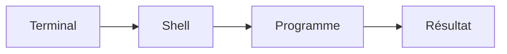

# Terminal

> [!info] En une phrase
> La fenêtre où je pilote l'ordinateur en tapant des commandes au lieu de cliquer.

## 1 · Comprendre
Le **terminal** est la fenêtre (Windows Terminal). À l'intérieur tourne un [[Shell]] (Bash dans [[WSL]]) : c'est lui qui comprend tes commandes et les lance.

Pourquoi l'utiliser : Git, Docker, Python, nuctl, la CI… presque tous les outils de dev se pilotent en commandes. Une commande se rejoue, s'enchaîne et se met dans un script.

## 2 · Explorer

Une commande se lit toujours pareil : `programme sous-commande --option argument`.
Exemple : `docker compose up -d` = programme `docker`, sous-commande `compose up`, option `-d`.

Le terminal travaille toujours **dans un dossier** (le dossier courant) : `pwd` le montre.

**Les commandes de base**

| Je veux… | Commande |
| --- | --- |
| savoir où je suis | `pwd` |
| voir le contenu | `ls -la` |
| me déplacer | `cd dossier`, `cd ..`, `cd ~` |
| créer | `mkdir dossier`, `touch fichier` |
| copier, déplacer, supprimer | `cp`, `mv`, `rm` |
| lire un fichier | `cat`, `less` |
| chercher dans un texte | `grep` |
| de l'aide | `commande --help` |

> [!warning] À ne pas confondre
> **Terminal** (la fenêtre) et **shell** (le programme qui comprend). Avant de coller une commande d'un tutoriel, regarde l'invite : `PS C:\>` = PowerShell, `oumar@pc:~$` = Bash.

## 3 · Relier
- **Ensemble** : [[Shell]] · [[WSL]] · [[Redirection et pipe]]
- **Ensuite** : [[Chemin de fichier]] · [[Processus]]
- **Cours** : [[Cours - Bash, les commandes essentielles]]

## Mes mots
> [!note] Ce que j'avais écrit avec mes mots
> Un terminal c'est juste l'interface : la fenêtre qui affiche le texte et envoie ce que je tape. Ce n'est pas lui qui comprend les commandes, c'est le shell qui tourne dedans.
