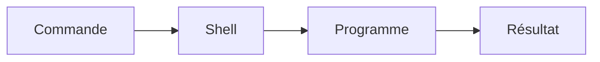

# Terminal

> [!info] En une phrase
> Une fenêtre où l'on pilote l'ordinateur en tapant des commandes texte plutôt qu'en cliquant.

```dataviewjs
await dv.view("10 — Templates/Scripts/learning", { view: "concept" })
```

## 1 · Comprendre
### Définition
Le **terminal** est l'application (Windows Terminal, iTerm…) ; il fait tourner un **shell** (PowerShell, Bash, Zsh) qui lit tes commandes, les exécute et affiche le résultat. On dit aussi « ligne de commande » ou CLI.

### Pourquoi ça existe
Beaucoup d'outils de développement n'ont pas d'interface graphique (Git, npm, Docker) ou sont plus rapides et automatisables en commandes. Une commande peut être rejouée, enchaînée, mise dans un script.

### Le problème résolu
Répéter des actions à la souris est lent et impossible à automatiser. Une commande écrite une fois peut être relancée, documentée et partagée.

## 2 · Explorer
### Comment ça fonctionne

Une commande suit presque toujours la forme : `programme sous-commande --option argument`
- `git commit -m "message"` → programme `git`, sous-commande `commit`, option `-m`, argument `"message"`.
- Le terminal travaille toujours **dans un dossier courant** : c'est le lien direct avec le [[Système de fichiers]].

### Exemple concret
```powershell
cd Documents\projets      # aller dans un dossier
mkdir api-notes          # créer un dossier
cd api-notes
node --version           # vérifier qu'un outil est installé
```

### Cas d'utilisation
- Lancer un serveur ([[Node.js]])
- Versionner du code ([[Git]])
- Installer des paquets ([[npm]])
- Gérer des conteneurs ([[Docker]])

> [!warning] À ne pas confondre
> **Terminal** (la fenêtre) et **shell** (le programme qui comprend les commandes). Sous Windows, PowerShell et Bash (WSL, Git Bash) n'ont pas exactement les mêmes commandes : `ls` existe dans les deux, mais les options diffèrent.

## 3 · Pratiquer
- [[Exercice - Naviguer dans le terminal]]

## 4 · Expliquer
> [!quote] Mon résumé, avec mes mots
> Un terminal c'est juste l'interface : la fenêtre qui affiche le texte et envoie ce que je tape. Ce n'est pas lui qui comprend les commandes, c'est le shell qui tourne dedans.

## 5 · Relier
- **Mène à** : [[Système de fichiers]] → [[Git]]
- **Utilisé par** : [[Node.js]], [[npm]], [[Docker]]
- **Commandes** : [[cd]] · [[ls]] · [[mkdir]] · [[Get-ChildItem]]
- **Approfondir** : [[Shell]] · [[PowerShell]] · [[Bash]] · [[WSL]]

## 6 · Réviser
> [!question] Me faire interroger
> Je demande à Claude de m'interroger sur cette notion pour vérifier que je l'ai comprise.

### Validation de la maîtrise
La notion est maîtrisée quand j'ai réussi **tous les exercices** qui l'utilisent (statut `reussi` dans l'exercice).

```dataviewjs
await dv.view("10 — Templates/Scripts/learning", { view: "maitrise" })
```
