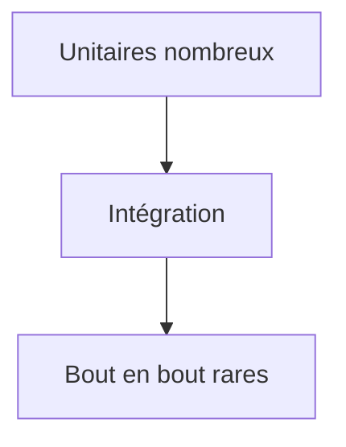

# Test automatisé

> [!info] En une phrase
> Un test automatisé est du code qui exécute ton code avec des entrées connues et vérifie le résultat ; on les lance tous en une commande, à chaque modification et dans la CI.

```dataviewjs
await dv.view("10 — Templates/Scripts/learning", { view: "concept" })
```

## 1 · Comprendre
### Définition
Un test suit presque toujours trois temps (**AAA**) :
1. **Préparer** (*Arrange*) : les données, l'état de départ.
2. **Agir** (*Act*) : appeler ce qu'on teste.
3. **Vérifier** (*Assert*) : comparer au résultat attendu.
La **pyramide des tests** :
| Niveau | Teste | Nombre | Vitesse |
| --- | --- | --- | --- |
| [[Test unitaire]] | une fonction isolée | beaucoup | millisecondes |
| [[Test d'intégration]] | plusieurs morceaux ensemble (API + base) | moins | secondes |
| [[Test de bout en bout]] | l'application entière dans un navigateur | peu | lent |
Un test qui échoue fait sortir la commande avec un [[Code de sortie|code non nul]], ce qui arrête la pipeline.

### Pourquoi ça existe
Vérifier à la main après chaque changement est lent, et on oublie toujours un cas ; une modification casse souvent quelque chose ailleurs.

### Le problème résolu
Pouvoir modifier le code sans peur : si quelque chose casse, on le sait en quelques secondes, avant la production.

## 2 · Explorer
### Comment ça fonctionne


### Exemple concret
```python
def test_nom_archive():
    # Préparer
    dossier = "export"
    # Agir
    nom = nom_archive(dossier, date(2026, 11, 6))
    # Vérifier
    assert nom == "export-2026-11-06.zip"
```
Outils : [[pytest]] (Python), [[Vitest et Jest]] (JavaScript), Playwright (navigateur).

### Cas d'utilisation
- Le job `test` de la pipeline GitLab
- Avant un refactoring
- Reproduire un bug avant de le corriger

> [!warning] À ne pas confondre
> Un test qui passe ne prouve pas que le code est juste : il prouve seulement que **ce cas** marche. Et un test qui dépend de l'ordre, de l'heure ou du réseau échoue au hasard (*flaky*) : on finit par l'ignorer.

## 3 · Pratiquer
- Pour une fonction de ton script de zip, écris la liste des cas à tester (normal, vide, limite, erreur) avant d'écrire le moindre test

## 4 · Expliquer
> [!quote] Mon résumé, avec mes mots
> _À écrire sans regarder la fiche. Si je bloque, je ne l'ai pas encore compris._

## 5 · Relier
- **Prérequis** : [[Fonction]] · [[Code de sortie]]
- **Complémentaires** : [[pytest]] · [[Vitest et Jest]]
- **Utilisé par** : [[Pipeline GitLab CI]]

## 6 · Réviser
> [!question] Me faire interroger
> Je demande à Claude de m'interroger sur cette notion pour vérifier que je l'ai comprise.

### Validation de la maîtrise
La notion est maîtrisée quand j'ai réussi **tous les exercices** qui l'utilisent (statut `reussi` dans l'exercice).

```dataviewjs
await dv.view("10 — Templates/Scripts/learning", { view: "maitrise" })
```
