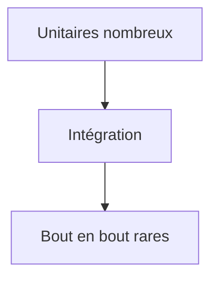

# Test automatisé

> [!info] En une phrase
> Un test automatisé est du code qui exécute ton code avec des entrées connues et vérifie le résultat ; on les lance tous en une commande, à chaque modification et dans la CI.

## 1 · Comprendre
### Définition
Un test suit presque toujours trois temps (**AAA**) :
1. **Préparer** (*Arrange*) : les données, l'état de départ.
2. **Agir** (*Act*) : appeler ce qu'on teste.
3. **Vérifier** (*Assert*) : comparer au résultat attendu.
La **pyramide des tests** :
| Niveau | Teste | Nombre | Vitesse |
| --- | --- | --- | --- |
| [[Test unitaire]] | une fonction isolée | beaucoup | millisecondes |
| [[Test d'intégration]] | plusieurs morceaux ensemble (API + base) | moins | secondes |
| [[Test de bout en bout]] | l'application entière dans un navigateur | peu | lent |
Un test qui échoue fait sortir la commande avec un [[Code de sortie|code non nul]], ce qui arrête la pipeline.

### Pourquoi ça existe
Vérifier à la main après chaque changement est lent, et on oublie toujours un cas ; une modification casse souvent quelque chose ailleurs.

### Le problème résolu
Pouvoir modifier le code sans peur : si quelque chose casse, on le sait en quelques secondes, avant la production.

## 2 · Explorer
### Comment ça fonctionne


### Exemple concret
```python
def test_nom_archive():
    # Préparer
    dossier = "export"
    # Agir
    nom = nom_archive(dossier, date(2026, 11, 6))
    # Vérifier
    assert nom == "export-2026-11-06.zip"
```
Outils : [[Test automatisé]] (Python), [[Test automatisé]] (JavaScript), Playwright (navigateur).

> [!abstract]- Comment ça s'écrit (référence à chercher, pas à apprendre par cœur)
> L'idée est la même partout ; seule l'écriture change.
>
> **Python (pytest ou unittest)**
> ```python
> def test_total():
>     assert total([{"montant": 2}, {"montant": 3}]) == 5
> # lancer : pytest   (il lance aussi les tests unittest)
> ```
>
> **JavaScript / TypeScript (Vitest ou Jest)**
> ```js
> import { test, expect } from "vitest";
> test("total", () => {
>   expect(total([{ montant: 2 }, { montant: 3 }])).toBe(5);
> });
> // lancer : npx vitest run
> ```
> Les deux outils trouvent les tests tout seuls (`test_*.py`, `*.test.js`) et rendent un code de sortie : 0 si tout passe, ce que lit la CI.
>
> **C# (.NET)**
> ```csharp
> public class CalculTests
> {
>     [Fact]
>     public void Total_additionne_les_montants()
>     {
>         var total = Calcul.Total(new() { 2m, 3m });
>         Assert.Equal(5m, total);
>     }
> }
> // lancer : dotnet test
> ```
> Avec **xUnit**, le plus courant (NUnit et MSTest se ressemblent). Les tests vivent dans un projet à part de la solution ; `[Theory]` + `[InlineData(…)]` lance le même test avec plusieurs valeurs. Voir [[dotnet test]].

### Cas d'utilisation
- Le job `test` de la pipeline GitLab
- Avant un refactoring
- Reproduire un bug avant de le corriger

> [!warning] À ne pas confondre
> Un test qui passe ne prouve pas que le code est juste : il prouve seulement que **ce cas** marche. Et un test qui dépend de l'ordre, de l'heure ou du réseau échoue au hasard (*flaky*) : on finit par l'ignorer.

## 3 · Relier
- **Prérequis** : [[Fonction]] · [[Code de sortie]]
- **Complémentaires** : [[Test automatisé]] · [[Test automatisé]]
- **Utilisé par** : [[Pipeline GitLab CI]]
