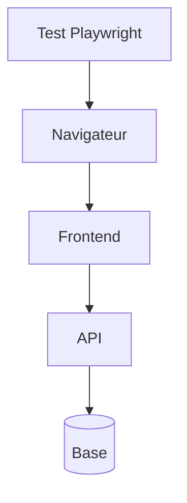

# Test de bout en bout

> [!info] En une phrase
> Un test de bout en bout (E2E) pilote un vrai navigateur sur l'application complète, comme un utilisateur : il clique, saisit et vérifie ce qui s'affiche.

```dataviewjs
await dv.view("10 — Templates/Scripts/learning", { view: "concept" })
```

## 1 · Comprendre
### Définition
Outils : **Playwright** (recommandé), Cypress, Selenium.
```ts
import { test, expect } from "@playwright/test";
test("ajouter une tâche", async ({ page }) => {
  await page.goto("http://localhost:5173/taches");
  await page.getByPlaceholder("Nouvelle tâche").fill("Lot 7");
  await page.getByRole("button", { name: "Ajouter" }).click();
  await expect(page.getByText("Lot 7")).toBeVisible();
});
```
- Cherche les éléments comme un humain (rôle, texte, label) plutôt que par classe CSS, qui change souvent.
- Lents et plus fragiles : on en garde **peu**, pour les parcours essentiels (connexion, création, export).
- `npx playwright test --ui` pour les voir s'exécuter ; une **trace** permet de rejouer un échec.

### Pourquoi ça existe
Seul un vrai navigateur sur la vraie application prouve que le parcours de l'utilisateur fonctionne entièrement.

### Le problème résolu
Vérifier les parcours critiques avant chaque mise en production, sans les refaire à la main.

## 2 · Explorer
### Comment ça fonctionne


### Exemple concret
```bash
npm init playwright@latest
npx playwright test
npx playwright test --ui
npx playwright show-report
```
Pour le bouton CVAT : un test qui ouvre une tâche, clique sur « Exporter en PNG » et vérifie qu'un fichier est téléchargé (`page.waitForEvent("download")`).

### Cas d'utilisation
- Parcours de connexion
- Parcours critique (commande, export)
- Vérifier un déploiement en préproduction

> [!warning] À ne pas confondre
> Tout tester en bout en bout : la suite devient lente et fragile. Et les `waitForTimeout(3000)` : Playwright attend tout seul que l'élément apparaisse, utilise ses assertions `expect(...).toBeVisible()`.

## 3 · Pratiquer
- Écris un test Playwright du parcours principal de ton application React de tâches

## 4 · Expliquer
> [!quote] Mon résumé, avec mes mots
> _À écrire sans regarder la fiche. Si je bloque, je ne l'ai pas encore compris._

## 5 · Relier
- **Prérequis** : [[Test d'intégration]] · [[DOM]]
- **Complémentaires** : [[Accessibilité web]]

## 6 · Réviser
> [!question] Me faire interroger
> Je demande à Claude de m'interroger sur cette notion pour vérifier que je l'ai comprise.

### Validation de la maîtrise
La notion est maîtrisée quand j'ai réussi **tous les exercices** qui l'utilisent (statut `reussi` dans l'exercice).

```dataviewjs
await dv.view("10 — Templates/Scripts/learning", { view: "maitrise" })
```
