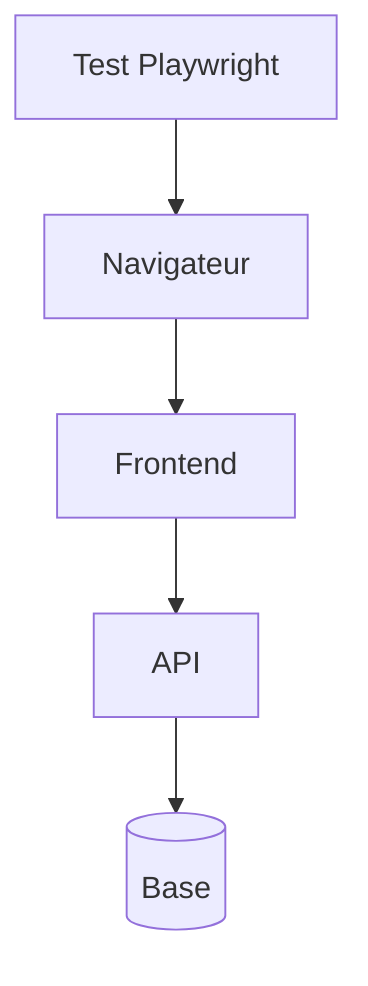

# Test de bout en bout

> [!info] En une phrase
> Un test de bout en bout (E2E) pilote un vrai navigateur sur l'application complète, comme un utilisateur : il clique, saisit et vérifie ce qui s'affiche.

```dataviewjs
await dv.view("10 — Templates/Scripts/learning", { view: "concept" })
```

## 1 · Comprendre
### Définition
Outils : **Playwright** (recommandé), Cypress, Selenium.
```ts
import { test, expect } from "@playwright/test";
test("ajouter une tâche", async ({ page }) => {
  await page.goto("http://localhost:5173/taches");
  await page.getByPlaceholder("Nouvelle tâche").fill("Lot 7");
  await page.getByRole("button", { name: "Ajouter" }).click();
  await expect(page.getByText("Lot 7")).toBeVisible();
});
```
- Cherche les éléments comme un humain (rôle, texte, label) plutôt que par classe CSS, qui change souvent.
- Lents et plus fragiles : on en garde **peu**, pour les parcours essentiels (connexion, création, export).
- `npx playwright test --ui` pour les voir s'exécuter ; une **trace** permet de rejouer un échec.

### Pourquoi ça existe
Seul un vrai navigateur sur la vraie application prouve que le parcours de l'utilisateur fonctionne entièrement.

### Le problème résolu
Vérifier les parcours critiques avant chaque mise en production, sans les refaire à la main.

## 2 · Explorer
### Comment ça fonctionne


### Exemple concret
```bash
npm init playwright@latest
npx playwright test
npx playwright test --ui
npx playwright show-report
```
Pour un bouton d'export : un test qui ouvre une page, clique sur « Exporter en PDF » et vérifie qu'un fichier est téléchargé (`page.waitForEvent("download")`).

### Cas d'utilisation
- Parcours de connexion
- Parcours critique (commande, export)
- Vérifier un déploiement en préproduction

> [!warning] À ne pas confondre
> Tout tester en bout en bout : la suite devient lente et fragile. Et les `waitForTimeout(3000)` : Playwright attend tout seul que l'élément apparaisse, utilise ses assertions `expect(...).toBeVisible()`.

## 3 · Pratiquer

### Exercice visuel

Sur Excalidraw, **sans regarder la fiche**. Puis je compare avec la fiche, je corrige en rouge ce qui était faux, et j'explique mon dessin à voix haute ou à Claude dans le chat.

> [!example] 🛣️ Suis le trajet
> Dessine un test Playwright qui ajoute une dépense : le navigateur, le front Vue, l'API, la base, la vérification à l'écran.

> [!example] 🔄 Change de contexte
> Redessine-le pour des tests écrits en langage naturel (Gherkin) : le scénario, les étapes, le navigateur, le rapport de résultats.

### Mon schéma

> [!tip] Mon dessin Excalidraw
> _Je crée le dessin « Schéma - Test de bout en bout » et je l'intègre ici avec `![[Schéma - Test de bout en bout.excalidraw]]`, puis je coche `schema`._

### Appliquer dans le fil rouge
- Pas encore d'étape du fil rouge pour cette notion : elle sera pratiquée dans le fil rouge de son niveau (voir [[Niveaux]]).

## 4 · Relier
- **Prérequis** : [[Test d'intégration]] · [[DOM]]
- **Complémentaires** : [[Accessibilité web]]

## 5 · Réviser
> [!question] Me faire interroger
> Je demande à Claude de m'interroger sur cette notion pour vérifier que je l'ai comprise.

### Validation (compris, puis maîtrisé)
Trois cases à cocher dans les propriétés de la fiche :
- `schema` : mon dessin du concept est dans « Mon schéma » ;
- `exercice_visuel` : j'ai fait et corrigé les exercices visuels de la section 3 ;
- `fil_rouge` : je l'ai appliqué dans le fil rouge (coché tout seul quand une étape qui l'utilise est réussie).

Les trois cochées : la notion compte comme **comprise**. **Maîtrisé** : c'est moi qui le mets dans `status`, quand je le sens.

```dataviewjs
await dv.view("10 — Templates/Scripts/learning", { view: "maitrise" })
```
