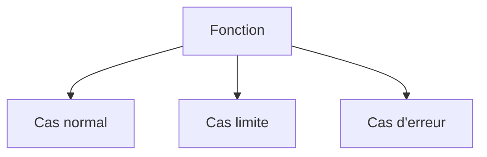

# Test unitaire

> [!info] En une phrase
> Un test unitaire vérifie une petite unité de code (une fonction, une classe) isolée du reste : pas de réseau, pas de base, pas de disque réel.

```dataviewjs
await dv.view("10 — Templates/Scripts/learning", { view: "concept" })
```

## 1 · Comprendre
### Définition
Caractéristiques d'un bon test unitaire (**FIRST**) : rapide (*Fast*), indépendant des autres (*Isolated*), reproductible (*Repeatable*), qui dit seul s'il passe (*Self-validating*), écrit en même temps que le code (*Timely*).
Ce qu'on teste pour une fonction :
- le **cas normal** ;
- les **cas limites** : liste vide, zéro, chaîne vide, très grande valeur ;
- les **erreurs** : l'exception attendue est bien levée.
Le code facile à tester est du code dont les fonctions reçoivent leurs entrées en paramètres et renvoient un résultat, sans effet caché (fonctions **pures**).

### Pourquoi ça existe
Trouver un bug précisément : quand un test unitaire échoue, on sait quelle fonction et quel cas.

### Le problème résolu
Valider chaque brique séparément, très vite, des centaines de fois par jour.

## 2 · Explorer
### Comment ça fonctionne


### Exemple concret
```js
// taille.js
export function formaterTaille(o) {
  if (o < 0) throw new RangeError("taille négative");
  if (o < 1024) return `${o} o`;
  return `${(o / 1024).toFixed(1)} Ko`;
}
// taille.test.js
import { describe, it, expect } from "vitest";
import { formaterTaille } from "./taille.js";
describe("formaterTaille", () => {
  it("affiche les octets sous 1 Ko", () => expect(formaterTaille(512)).toBe("512 o"));
  it("passe en Ko à 1024", () => expect(formaterTaille(1024)).toBe("1.0 Ko"));
  it("refuse une taille négative", () => expect(() => formaterTaille(-1)).toThrow(RangeError));
});
```

### Cas d'utilisation
- Fonctions de calcul et de formatage
- Règles métier
- Validation des données

> [!warning] À ne pas confondre
> Tester l'**implémentation** (« la fonction appelle X puis Y ») au lieu du **comportement** (« pour cette entrée, ce résultat ») : le test casse à chaque refactoring alors que rien n'est faux.

## 3 · Pratiquer

### Exercice visuel

Sur Excalidraw, **sans regarder la fiche**. Puis je compare avec la fiche, je corrige en rouge ce qui était faux, et j'explique mon dessin avec mes mots (section 4).

> [!example] 🧠 Dessine de mémoire
> Dessine une fonction qui calcule les totaux par catégorie, isolée dans une bulle : ce qui entre, ce qui sort, ce qui est volontairement absent (réseau, base).

> [!example] 🔍 Trouve l'erreur
> Ce schéma est faux. Corrige-le en rouge et explique l'erreur.
>
> ```mermaid
> flowchart TD
>   T[Test unitaire] --> A[API réelle]
>   A --> B[Base réelle]
> ```

### Mon schéma

> [!tip] Mon dessin Excalidraw
> _Je crée le dessin « Schéma - Test unitaire » et je l'intègre ici avec `![[Schéma - Test unitaire.excalidraw]]`._

### Appliquer dans le fil rouge
- Pas encore d'étape du fil rouge pour cette notion : je l'applique dans mon travail (CVAT, Nuclio) ou je demande une étape à Claude.

## 4 · Expliquer
> [!quote] Mon résumé, avec mes mots
> _J'explique mon schéma avec mes mots, sans regarder la fiche. Si je bloque, je ne l'ai pas encore compris._

## 5 · Relier
- **Prérequis** : [[Test automatisé]]
- **Complémentaires** : [[Doublure de test (mock)]]

## 6 · Réviser
> [!question] Me faire interroger
> Je demande à Claude de m'interroger sur cette notion pour vérifier que je l'ai comprise.

### Validation de la maîtrise
La notion est maîtrisée quand je sais :
1. **l'expliquer** de façon fluide, à partir de mon schéma (section 4) ;
2. **l'adapter** à un autre contexte (consigne « Change de contexte », ou Claude m'interroge sur un autre cas) ;
3. **l'appliquer** pour de vrai dans le fil rouge (section 3).

Réussir un exercice ne suffit pas. C'est moi qui passe le statut en `maitrise`.

```dataviewjs
await dv.view("10 — Templates/Scripts/learning", { view: "maitrise" })
```
