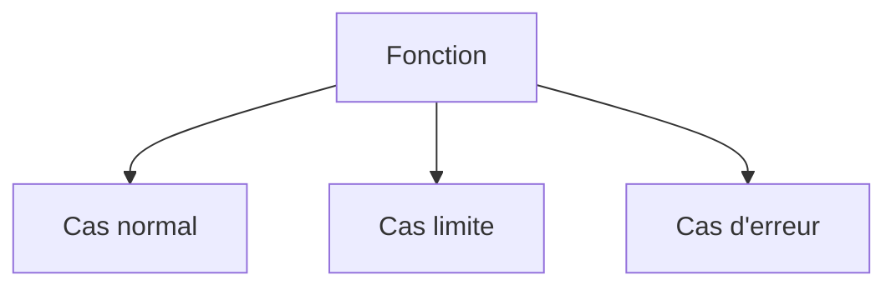

# Test unitaire

> [!info] En une phrase
> Un test unitaire vérifie une petite unité de code (une fonction, une classe) isolée du reste : pas de réseau, pas de base, pas de disque réel.

```dataviewjs
await dv.view("10 — Templates/Scripts/learning", { view: "concept" })
```

## 1 · Comprendre
### Définition
Caractéristiques d'un bon test unitaire (**FIRST**) : rapide (*Fast*), indépendant des autres (*Isolated*), reproductible (*Repeatable*), qui dit seul s'il passe (*Self-validating*), écrit en même temps que le code (*Timely*).
Ce qu'on teste pour une fonction :
- le **cas normal** ;
- les **cas limites** : liste vide, zéro, chaîne vide, très grande valeur ;
- les **erreurs** : l'exception attendue est bien levée.
Le code facile à tester est du code dont les fonctions reçoivent leurs entrées en paramètres et renvoient un résultat, sans effet caché (fonctions **pures**).

### Pourquoi ça existe
Trouver un bug précisément : quand un test unitaire échoue, on sait quelle fonction et quel cas.

### Le problème résolu
Valider chaque brique séparément, très vite, des centaines de fois par jour.

## 2 · Explorer
### Comment ça fonctionne


### Exemple concret
```js
// taille.js
export function formaterTaille(o) {
  if (o < 0) throw new RangeError("taille négative");
  if (o < 1024) return `${o} o`;
  return `${(o / 1024).toFixed(1)} Ko`;
}
// taille.test.js
import { describe, it, expect } from "vitest";
import { formaterTaille } from "./taille.js";
describe("formaterTaille", () => {
  it("affiche les octets sous 1 Ko", () => expect(formaterTaille(512)).toBe("512 o"));
  it("passe en Ko à 1024", () => expect(formaterTaille(1024)).toBe("1.0 Ko"));
  it("refuse une taille négative", () => expect(() => formaterTaille(-1)).toThrow(RangeError));
});
```

### Cas d'utilisation
- Fonctions de calcul et de formatage
- Règles métier
- Validation des données

> [!warning] À ne pas confondre
> Tester l'**implémentation** (« la fonction appelle X puis Y ») au lieu du **comportement** (« pour cette entrée, ce résultat ») : le test casse à chaque refactoring alors que rien n'est faux.

## 3 · Pratiquer
- Écris cinq tests unitaires pour une fonction qui choisit les fichiers à zipper selon leur extension

## 4 · Expliquer
> [!quote] Mon résumé, avec mes mots
> _À écrire sans regarder la fiche. Si je bloque, je ne l'ai pas encore compris._

## 5 · Relier
- **Prérequis** : [[Test automatisé]]
- **Complémentaires** : [[Doublure de test (mock)]]

## 6 · Réviser
> [!question] Me faire interroger
> Je demande à Claude de m'interroger sur cette notion pour vérifier que je l'ai comprise.

### Validation de la maîtrise
La notion est maîtrisée quand j'ai réussi **tous les exercices** qui l'utilisent (statut `reussi` dans l'exercice).

```dataviewjs
await dv.view("10 — Templates/Scripts/learning", { view: "maitrise" })
```
