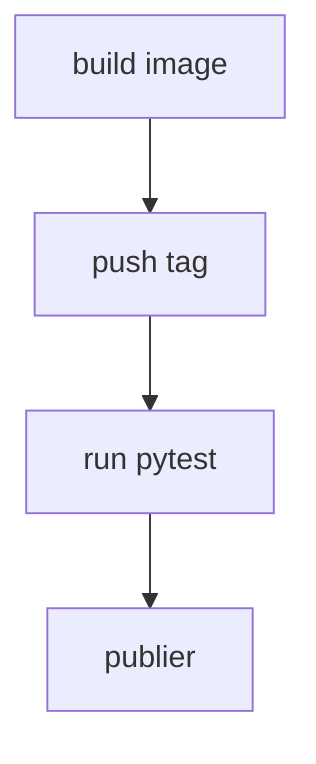

# Tester l'image, pas le dépôt

> [!info] En une phrase
> Dans une CI qui construit des images, les tests tournent dans l'image construite : ils vérifient ce qui sera livré, pas les fichiers du dépôt.

```dataviewjs
await dv.view("10 — Templates/Scripts/learning", { view: "concept" })
```

## 1 · Comprendre
### Définition
Une pipeline sérieuse construit l'image **puis** lance les tests **dans cette image** (`docker run mon-image pytest`). Le test vérifie donc le contenu réel de l'image : le code copié par le Dockerfile, les paquets installés, la configuration.

### Pourquoi ça existe
Ce qui part en production, c'est l'image. Tester le dépôt à côté prouverait seulement que le code marche **sur le runner**, pas dans l'image.

### Le problème résolu
« Les tests passent mais l'image est cassée » : un fichier oublié par `COPY`, un paquet absent de `requirements.txt`, une variable non définie dans l'image.

## 2 · Explorer
### Comment ça fonctionne


### Exemple concret
```yaml
test:
  stage: test
  needs: [build]
  image: docker:24
  services: [docker:24-dind]
  script:
    - docker pull "$CI_REGISTRY_IMAGE:$CI_COMMIT_SHORT_SHA"
    - docker run --rm "$CI_REGISTRY_IMAGE:$CI_COMMIT_SHORT_SHA" pytest -v tests/
```
Conséquences :
- Corriger un test ou du code dans le dépôt **ne suffit pas** : il faut **reconstruire l'image** pour que le test voie la correction.
- Si le test échoue sur un fichier « qui existe pourtant », vérifie qu'il est bien **dans l'image** (`.dockerignore`, `COPY`).

### Cas d'utilisation
- Les jobs de tests de CVAT, lancés dans les images construites
- Ta propre image de script : `docker run mon-zipper` avec un dossier de test monté

> [!warning] À ne pas confondre
> Le dossier du dépôt sur le runner (`$CI_PROJECT_DIR`) et le système de fichiers **de l'image**. Et un test qu'on « débloque » en le désactivant ne prouve plus rien : lis d'abord ce qu'il vérifie.

## 3 · Pratiquer
- Dans la CI de CVAT, trouve un job de test et note **quelle image** il utilise.
- Avec ton image de script, supprime volontairement un fichier de la ligne `COPY`, et observe un test échouer alors que le fichier est dans le dépôt.

## 4 · Expliquer
> [!quote] Mon résumé, avec mes mots
> _À écrire sans regarder la fiche. Si je bloque, je ne l'ai pas encore compris._

## 5 · Relier
- **Prérequis** : [[Image Docker]] · [[pytest]] · [[Pipeline GitLab CI]]
- **Complémentaires** : [[Construire une image dans la CI]]
- **Utilisé par** : [[Fiche - Réflexes pour déboguer une pipeline]]

## 6 · Réviser
> [!question] Me faire interroger
> Je demande à Claude de m'interroger sur cette notion pour vérifier que je l'ai comprise.

### Validation de la maîtrise
- [ ] Je l'explique sans notes, en 3 phrases, à quelqu'un qui ne connaît pas
- [ ] J'ai réussi un exercice qui l'utilise
- [ ] Je l'ai utilisé dans un projet
- [ ] Je sais dire quand ne pas l'utiliser (ou ce qu'il ne faut pas confondre)
