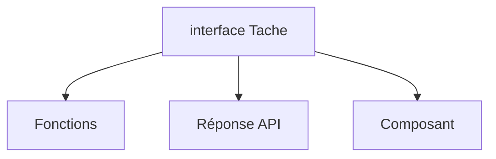

# Type et interface TypeScript

> [!info] En une phrase
> On décrit la forme d'un objet avec une interface ou un alias type, puis TypeScript vérifie que chaque objet la respecte.

```dataviewjs
await dv.view("10 — Templates/Scripts/learning", { view: "concept" })
```

## 1 · Comprendre
### Définition
```ts
interface Tache {
  id: number;
  nom: string;
  fini: boolean;
  labels?: string[];          // optionnelle
  readonly creeLe: string;    // non modifiable
}
type Id = number | string;    // alias de type

const t: Tache = { id: 1, nom: "Chantier", fini: false, creeLe: "2026-11-06" };
function terminer(t: Tache): Tache { return { ...t, fini: true }; }
```
Types de base : `string`, `number`, `boolean`, `null`, `undefined`, tableaux `string[]`, objets, `any` (désactive la vérification), `unknown` (inconnu, à vérifier avant usage), `void` (ne renvoie rien).

### Pourquoi ça existe
Les données d'une application ont une forme précise ; il faut la nommer une fois et la réutiliser partout.

### Le problème résolu
Une propriété mal orthographiée ou manquante devient une erreur immédiate au lieu d'un `undefined` silencieux.

## 2 · Explorer
### Comment ça fonctionne


### Exemple concret
```ts
interface Annotation { label: string; x: number; y: number; }
interface ReponseExport { tache: number; annotations: Annotation[]; }

async function charger(id: number): Promise<ReponseExport> {
  const rep = await fetch(`/api/taches/${id}/annotations`);
  return rep.json();
}
const r = await charger(12);
r.annotations[0].lable;   // ❌ Property 'lable' does not exist. Did you mean 'label'?
```

### Cas d'utilisation
- Décrire les réponses d'API
- Les props d'un composant React ou Angular
- Les paramètres de configuration

> [!warning] À ne pas confondre
> `interface` et `type` se ressemblent : `interface` pour la forme d'un objet (extensible avec `extends`), `type` pour tout le reste (unions, alias). Et `any` n'est pas une solution : il éteint TypeScript ; préfère `unknown`.

## 3 · Pratiquer

### Exercice visuel

Sur Excalidraw, **sans regarder la fiche**. Puis je compare avec la fiche, je corrige en rouge ce qui était faux, et j'explique mon dessin avec mes mots (section 4).

> [!example] 🧠 Dessine de mémoire
> Dessine l'interface `Depense` (id, libelle, montant, categorie) comme un moule, et deux objets : un qui rentre, un qui ne rentre pas.

> [!example] 🔄 Change de contexte
> Le même modèle existe côté API en Python (schéma Pydantic). Dessine les deux moules côte à côte et ce qui les relie.

### Mon schéma

> [!tip] Mon dessin Excalidraw
> _Je crée le dessin « Schéma - Type et interface TypeScript » et je l'intègre ici avec `![[Schéma - Type et interface TypeScript.excalidraw]]`._

### Appliquer dans le fil rouge
- Pas encore d'étape du fil rouge pour cette notion : je l'applique dans mon travail (CVAT, Nuclio) ou je demande une étape à Claude.

## 4 · Expliquer
> [!quote] Mon résumé, avec mes mots
> _J'explique mon schéma avec mes mots, sans regarder la fiche. Si je bloque, je ne l'ai pas encore compris._

## 5 · Relier
- **Prérequis** : [[TypeScript]] · [[Tableau et objet JavaScript]]
- **Complémentaires** : [[Union et type littéral]]
- **Utilisé par** : [[Générique TypeScript]]

## 6 · Réviser
> [!question] Me faire interroger
> Je demande à Claude de m'interroger sur cette notion pour vérifier que je l'ai comprise.

### Validation de la maîtrise
La notion est maîtrisée quand je sais :
1. **l'expliquer** de façon fluide, à partir de mon schéma (section 4) ;
2. **l'adapter** à un autre contexte (consigne « Change de contexte », ou Claude m'interroge sur un autre cas) ;
3. **l'appliquer** pour de vrai dans le fil rouge (section 3).

Réussir un exercice ne suffit pas. C'est moi qui passe le statut en `maitrise`.

```dataviewjs
await dv.view("10 — Templates/Scripts/learning", { view: "maitrise" })
```
