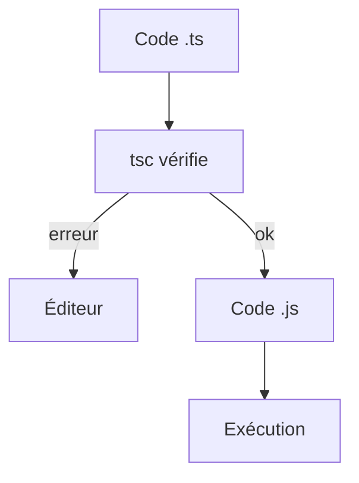

# TypeScript

> [!info] En une phrase
> TypeScript est du JavaScript avec des types : le compilateur vérifie le code avant l'exécution, puis le transforme en JavaScript normal.

```dataviewjs
await dv.view("10 — Templates/Scripts/learning", { view: "concept" })
```

## 1 · Comprendre
### Définition
On ajoute des **annotations de type** au JavaScript :
```ts
function aire(largeur: number, hauteur: number): number {
  return largeur * hauteur;
}
aire(3, "4");   // ❌ erreur AVANT d'exécuter : "4" n'est pas un number
```
Le navigateur et Node ne comprennent pas TypeScript : le compilateur `tsc` (ou un outil comme Vite) **retire les types** et produit du `.js`. Les types n'existent donc **qu'au moment du développement**.
Beaucoup de types sont **inférés** : `const n = 3` est déjà un `number`, inutile de l'écrire.

### Pourquoi ça existe
En JavaScript, les erreurs de type (propriété mal écrite, mauvais argument) n'apparaissent qu'à l'exécution, parfois en production.

### Le problème résolu
Détecter ces erreurs dans l'éditeur, avoir l'autocomplétion, et pouvoir modifier un gros projet sans peur. Angular est écrit en TypeScript ; la plupart des projets React aussi.

## 2 · Explorer
### Comment ça fonctionne


### Exemple concret
```ts
const taches: string[] = ["a", "b"];
let compteur = 0;            // inféré : number
compteur = "trois";          // ❌ Type 'string' is not assignable to type 'number'

function saluer(nom?: string) {   // ? = paramètre optionnel
  return `Bonjour ${nom ?? "toi"}`;
}
```
Pour essayer sans rien installer : le *TypeScript Playground* sur typescriptlang.org.

### Cas d'utilisation
- Angular (obligatoire)
- React et Vue (très courant)
- Backend Node avec Express ou NestJS

> [!warning] À ne pas confondre
> TypeScript ne vérifie **rien à l'exécution** : une réponse d'API annoncée `Tache` peut contenir n'importe quoi. Pour vérifier les données venant de l'extérieur, il faut une [[Validation des données]].

## 3 · Pratiquer

### Exercice visuel

Sur Excalidraw, **sans regarder la fiche**. Puis je compare avec la fiche, je corrige en rouge ce qui était faux, et j'explique mon dessin à voix haute ou à Claude dans le chat.

> [!example] ⚖️ Avant / après
> Avant / après : un fichier JavaScript et le même en TypeScript. Dessine ce que le compilateur vérifie en plus et ce qui arrive finalement au navigateur.

> [!example] 🧠 Dessine de mémoire
> Dessine les deux moments d'un programme TypeScript : la compilation et l'exécution. Place les types : existent-ils encore à l'exécution ?

### Mon schéma

> [!tip] Mon dessin Excalidraw
> _Je crée le dessin « Schéma - TypeScript » et je l'intègre ici avec `![[Schéma - TypeScript.excalidraw]]`, puis je coche `schema`._

### Appliquer dans le fil rouge
- Pas encore d'étape du fil rouge pour cette notion : elle sera pratiquée dans le fil rouge de son niveau (voir [[Niveaux]]).

## 4 · Relier
- **Prérequis** : [[JavaScript]] · [[Variables et types]]
- **Complémentaires** : [[Type et interface TypeScript]] · [[Compilation TypeScript (tsc et tsconfig)]]
- **Utilisé par** : [[Angular]] · [[React]]

## 5 · Réviser
> [!question] Me faire interroger
> Je demande à Claude de m'interroger sur cette notion pour vérifier que je l'ai comprise.

### Validation (compris, puis maîtrisé)
Trois cases à cocher dans les propriétés de la fiche :
- `schema` : mon dessin du concept est dans « Mon schéma » ;
- `exercice_visuel` : j'ai fait et corrigé les exercices visuels de la section 3 ;
- `fil_rouge` : je l'ai appliqué dans le fil rouge (coché tout seul quand une étape qui l'utilise est réussie).

Les trois cochées : la notion compte comme **comprise**. **Maîtrisé** : c'est moi qui le mets dans `status`, quand je le sens.

```dataviewjs
await dv.view("10 — Templates/Scripts/learning", { view: "maitrise" })
```
