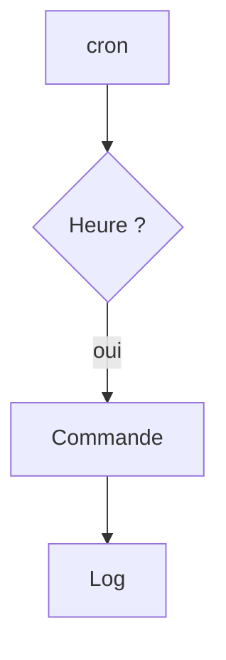

# Tâche planifiée (cron)

> [!info] En une phrase
> cron lance automatiquement une commande à heures fixes (chaque nuit, chaque lundi, toutes les 5 minutes).

```dataviewjs
await dv.view("10 — Templates/Scripts/learning", { view: "concept" })
```

## 1 · Comprendre
### Définition
Chaque utilisateur a une **crontab** : une ligne par tâche, avec 5 champs de date puis la commande.
```text
┌ minute (0-59)
│ ┌ heure (0-23)
│ │ ┌ jour du mois (1-31)
│ │ │ ┌ mois (1-12)
│ │ │ │ ┌ jour de la semaine (0-7, 0 et 7 = dimanche)
│ │ │ │ │
0 2 * * *  /opt/zipper/run.sh >> /var/log/zipper.log 2>&1
```

### Pourquoi ça existe
Automatiser les tâches répétitives : sauvegardes, nettoyages, rapports.

### Le problème résolu
Oublier de lancer à la main la sauvegarde du soir.

## 2 · Explorer
### Comment ça fonctionne

| Expression | Sens |
| --- | --- |
| `*/5 * * * *` | toutes les 5 minutes |
| `0 2 * * *` | chaque jour à 2 h |
| `0 9 * * 1` | chaque lundi à 9 h |
| `0 0 1 * *` | le 1er du mois à minuit |

### Exemple concret
```bash
crontab -e      # modifier ses tâches
crontab -l      # les lister
```
Vérifie une expression sur crontab.guru.

### Cas d'utilisation
- Lancer ton script de zip chaque nuit
- Nettoyer les vieux fichiers d'export
- En CI, l'équivalent est une **pipeline planifiée** (*Build > Pipeline schedules*)

> [!warning] À ne pas confondre
> cron lance la commande avec un environnement **minimal** (peu de variables, `PATH` court, dossier `~`) : utilise des **chemins absolus** et redirige la sortie vers un fichier, sinon les erreurs disparaissent.

## 3 · Pratiquer
- Planifie une tâche toutes les minutes qui écrit la date dans un fichier, vérifie, puis supprime-la.

## 4 · Expliquer
> [!quote] Mon résumé, avec mes mots
> _À écrire sans regarder la fiche. Si je bloque, je ne l'ai pas encore compris._

## 5 · Relier
- **Prérequis** : [[Script shell]] · [[Redirection et pipe]]
- **Complémentaires** : [[Service (systemd)]]
- **Commandes** : [[crontab]]

## 6 · Réviser
> [!question] Me faire interroger
> Je demande à Claude de m'interroger sur cette notion pour vérifier que je l'ai comprise.

### Validation de la maîtrise
- [ ] Je l'explique sans notes, en 3 phrases, à quelqu'un qui ne connaît pas
- [ ] J'ai réussi un exercice qui l'utilise
- [ ] Je l'ai utilisé dans un projet
- [ ] Je sais dire quand ne pas l'utiliser (ou ce qu'il ne faut pas confondre)
