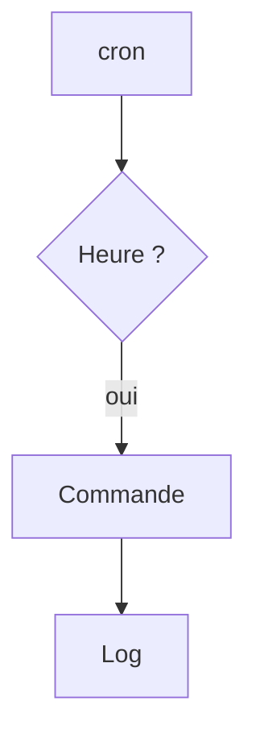

# Tâche planifiée (cron)

> [!info] En une phrase
> cron lance automatiquement une commande à heures fixes (chaque nuit, chaque lundi, toutes les 5 minutes).

```dataviewjs
await dv.view("10 — Templates/Scripts/learning", { view: "concept" })
```

## 1 · Comprendre
### Définition
Chaque utilisateur a une **crontab** : une ligne par tâche, avec 5 champs de date puis la commande.
```text
┌ minute (0-59)
│ ┌ heure (0-23)
│ │ ┌ jour du mois (1-31)
│ │ │ ┌ mois (1-12)
│ │ │ │ ┌ jour de la semaine (0-7, 0 et 7 = dimanche)
│ │ │ │ │
0 2 * * *  /opt/zipper/run.sh >> /var/log/zipper.log 2>&1
```

### Pourquoi ça existe
Automatiser les tâches répétitives : sauvegardes, nettoyages, rapports.

### Le problème résolu
Oublier de lancer à la main la sauvegarde du soir.

## 2 · Explorer
### Comment ça fonctionne

| Expression | Sens |
| --- | --- |
| `*/5 * * * *` | toutes les 5 minutes |
| `0 2 * * *` | chaque jour à 2 h |
| `0 9 * * 1` | chaque lundi à 9 h |
| `0 0 1 * *` | le 1er du mois à minuit |

### Exemple concret
```bash
crontab -e      # modifier ses tâches
crontab -l      # les lister
```
Vérifie une expression sur crontab.guru.

### Cas d'utilisation
- Lancer ton script de zip chaque nuit
- Nettoyer les vieux fichiers d'export
- En CI, l'équivalent est une **pipeline planifiée** (*Build > Pipeline schedules*)

> [!warning] À ne pas confondre
> cron lance la commande avec un environnement **minimal** (peu de variables, `PATH` court, dossier `~`) : utilise des **chemins absolus** et redirige la sortie vers un fichier, sinon les erreurs disparaissent.

## 3 · Pratiquer

### Exercice visuel

Sur Excalidraw, **sans regarder la fiche**. Puis je compare avec la fiche, je corrige en rouge ce qui était faux, et j'explique mon dessin avec mes mots (section 4).

> [!example] 🧠 Dessine de mémoire
> Dessine une ligne crontab en cinq cases (minute, heure, jour, mois, jour de la semaine) et une commande. Écris « chaque nuit à 2 h ».

> [!example] 🔄 Change de contexte
> Redessine la même tâche comme une pipeline planifiée dans GitLab. Qu'est-ce qui remplace la crontab ?

### Mon schéma

> [!tip] Mon dessin Excalidraw
> _Je crée le dessin « Schéma - Tâche planifiée (cron) » et je l'intègre ici avec `![[Schéma - Tâche planifiée (cron).excalidraw]]`._

### Appliquer dans le fil rouge
- Pas encore d'étape du fil rouge pour cette notion : je l'applique dans mon travail (CVAT, Nuclio) ou je demande une étape à Claude.

## 4 · Expliquer
> [!quote] Mon résumé, avec mes mots
> _J'explique mon schéma avec mes mots, sans regarder la fiche. Si je bloque, je ne l'ai pas encore compris._

## 5 · Relier
- **Prérequis** : [[Script shell]] · [[Redirection et pipe]]
- **Complémentaires** : [[Service (systemd)]]
- **Commandes** : [[crontab]]

## 6 · Réviser
> [!question] Me faire interroger
> Je demande à Claude de m'interroger sur cette notion pour vérifier que je l'ai comprise.

### Validation de la maîtrise
La notion est maîtrisée quand je sais :
1. **l'expliquer** de façon fluide, à partir de mon schéma (section 4) ;
2. **l'adapter** à un autre contexte (consigne « Change de contexte », ou Claude m'interroge sur un autre cas) ;
3. **l'appliquer** pour de vrai dans le fil rouge (section 3).

Réussir un exercice ne suffit pas. C'est moi qui passe le statut en `maitrise`.

```dataviewjs
await dv.view("10 — Templates/Scripts/learning", { view: "maitrise" })
```
