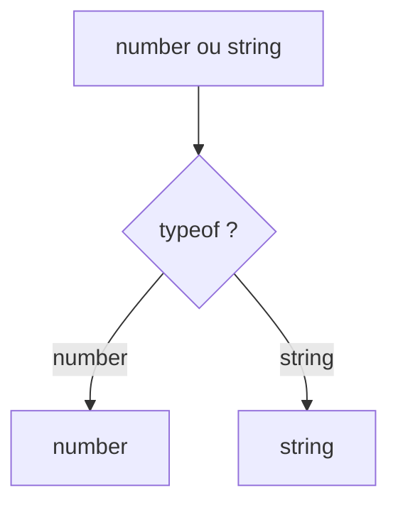

# Union et type littéral

> [!info] En une phrase
> Une union dit qu'une valeur peut être d'un type OU d'un autre (string | number) ; un type littéral limite à des valeurs précises ("ok" | "erreur"), et TypeScript affine le type après un test.

```dataviewjs
await dv.view("10 — Templates/Scripts/learning", { view: "concept" })
```

## 1 · Comprendre
### Définition
```ts
type Statut = "a-faire" | "en-cours" | "fini";   // seulement ces trois chaînes
let s: Statut = "fini";
s = "termine";   // ❌

function afficher(id: number | string) {
  if (typeof id === "number") {
    return id.toFixed(0);      // ici id est number
  }
  return id.toUpperCase();     // ici id est string
}
```
Cet affinage s'appelle le **rétrécissement** (*narrowing*) : `typeof`, `===`, `in`, `Array.isArray`, ou le test de `null`.
**Union discriminée** : chaque cas a un champ commun qui le distingue.
```ts
type Resultat =
  | { ok: true; donnees: string[] }
  | { ok: false; erreur: string };
```

### Pourquoi ça existe
Une valeur réelle a souvent plusieurs formes possibles (chargement, succès, erreur ; nombre ou texte).

### Le problème résolu
Obliger le code à traiter chaque cas, et empêcher les fautes de frappe sur des valeurs fixes.

## 2 · Explorer
### Comment ça fonctionne


### Exemple concret
```ts
function message(r: Resultat): string {
  if (r.ok) return `${r.donnees.length} éléments`;   // r.donnees existe ici
  return `Erreur : ${r.erreur}`;                       // r.erreur existe ici
}
const nom: string | null = document.querySelector("input")?.value ?? null;
if (nom !== null) console.log(nom.length);
```

### Cas d'utilisation
- Statuts et états d'une interface (chargement, ok, erreur)
- Valeurs possiblement nulles
- Paramètres qui acceptent plusieurs formes

> [!warning] À ne pas confondre
> Le `?.` (chaînage optionnel) et le `??` (valeur par défaut si null/undefined) ne sont pas `||` : `0 || 5` donne 5, `0 ?? 5` donne 0.

## 3 · Pratiquer
- Modélise l'état d'un chargement (`chargement`, `ok` avec données, `erreur` avec message) et écris la fonction qui l'affiche

## 4 · Expliquer
> [!quote] Mon résumé, avec mes mots
> _À écrire sans regarder la fiche. Si je bloque, je ne l'ai pas encore compris._

## 5 · Relier
- **Prérequis** : [[Type et interface TypeScript]]
- **Complémentaires** : [[Condition (if)]]

## 6 · Réviser
> [!question] Me faire interroger
> Je demande à Claude de m'interroger sur cette notion pour vérifier que je l'ai comprise.

### Validation de la maîtrise
La notion est maîtrisée quand j'ai réussi **tous les exercices** qui l'utilisent (statut `reussi` dans l'exercice).

```dataviewjs
await dv.view("10 — Templates/Scripts/learning", { view: "maitrise" })
```
